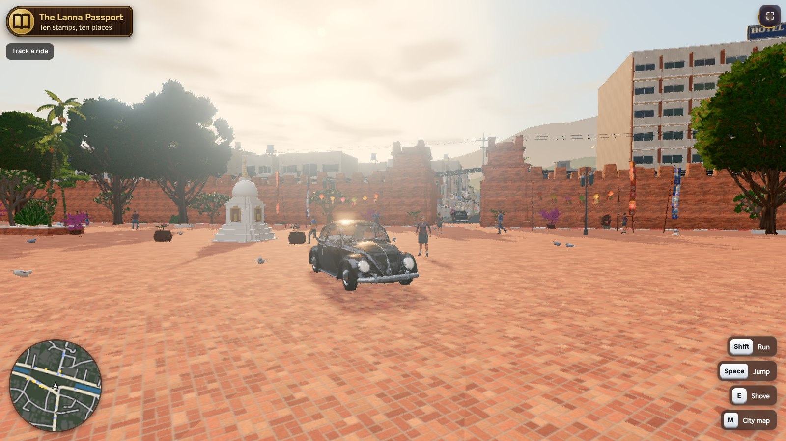
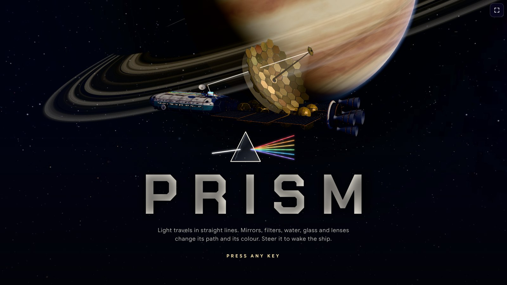

<p align="center">
<a href="README.md">English</a> · <a href="README.fr.md">Français</a> · <a href="README.es.md">Español</a> · <b>Deutsch</b> · <a href="README.it.md">Italiano</a> · <a href="README.pt.md">Português</a> · <a href="README.pl.md">Polski</a> · <a href="README.ja.md">日本語</a> · <a href="README.ko.md">한국어</a> · <a href="README.zh.md">中文</a> · <a href="README.th.md">ไทย</a> · <a href="README.ar.md">العربية</a>
</p>

<div align="center">

# Agent-Skills für E-Learning

**Spielend lernen, bauend verdienen.**

Aus Hausaufgaben werden Spiele. Aus Unterricht werden Kurse. Aus Ihrem Wissen wird eine Community.

Skills, die Claude, ChatGPT, Gemini, Cursor oder jedem anderen KI-Agenten beibringen, im MEXTY-Ökosystem zu bauen:
Lernspiele auf **EdVerse**, Creator-Communitys auf **Mextribe**, Kurse und Lernpfade auf **MEXTY**.

[KI verbinden](https://mexty.ai/connect) · [Auf EdVerse spielen](https://future.mexty.ai/edverse) · [Preise](https://mexty.ai/pricing)

<p>
<a href="#für-organisationen-erstellen-zuweisen-auswerten"></a>
&nbsp;&nbsp;&nbsp;<b>×</b>&nbsp;&nbsp;&nbsp;
<a href="https://future.mexty.ai/edverse"></a>
&nbsp;&nbsp;&nbsp;<b>×</b>&nbsp;&nbsp;&nbsp;
<a href="https://future.mexty.ai/mextribe"></a>
</p>

## MEXTY LMS × EdVerse × Mextribe

<table>
<tr>
<td width="33%" align="center"><a href="#für-organisationen-erstellen-zuweisen-auswerten"></a><br><b>MEXTY LMS</b><br><sub>Kurse, Lernpfade und Fortschrittsverfolgung für Schulen und Unternehmen</sub></td>
<td width="33%" align="center"><a href="https://future.mexty.ai/edverse"></a><br><b>EdVerse</b><br><sub>Lernspiele für 4- bis 18-Jährige. Spielen, bauen, verkaufen</sub></td>
<td width="33%" align="center"><a href="https://future.mexty.ai/mextribe"></a><br><b>Mextribe</b><br><sub>Von Creatorn lernen. Die eigene Community unterrichten</sub></td>
</tr>
</table>

<sub>Ein Konto für alle drei.</sub>

</div>

---

## Ein Ökosystem, drei Zugänge

| | Für Familien | Für Creator | Für Organisationen |
|---|---|---|---|
| **Wer** | Eltern, Kinder, Schülerinnen und Schüler, Studierende | Lehrkräfte, Spieleentwickler, alle mit einem KI-Abo | Schulen, Hochschulen, Bildungsanbieter, kleine und mittlere Unternehmen |
| **Was Sie tun** | Lernspiele spielen, Hausaufgaben in ein Spiel verwandeln, den Fortschritt Ihres Kindes verfolgen | Spiele und Kurse bauen, allein oder gemeinsam, sie verkaufen und eine eigene Lern-Community führen | Schulungen im Team erstellen, sie Ihren Leuten zuweisen und sehen, wer was abgeschlossen hat |
| **Wo** | [EdVerse](https://future.mexty.ai/edverse) | EdVerse Studio und Mextribe | Der MEXTY-Workspace: Authoring und LMS |
| **Kosten zum Einstieg** | Kostenlos | Kostenlos | Tarif Authoring, Authoring + LMS oder Enterprise |
| **Mehr dazu** | [Eltern](audiences/parents.md) | [Spieleentwickler](audiences/game-developers.md) | [Unternehmen](audiences/companies.md) · [Hochschulen und Schulen](audiences/universities-and-schools.md) |

## Was die einzelnen Skills tun

| Skill | Was er tut |
|---|---|
| [`mexty-start`](skills/mexty-start/SKILL.md) | Findet heraus, wer Sie sind und was Sie brauchen, wählt zuerst den kostenlosen Weg und übergibt an den passenden Skill |
| [`homework-to-game`](skills/homework-to-game/SKILL.md) | Liest ein Arbeitsblatt, eine Lektion oder eine Lernliste und baut ein Spiel, bei dem das Spielen das Üben ist |
| [`track-kid-progress`](skills/track-kid-progress/SKILL.md) | Für Eltern: was ein Kind in einer Woche oder einem Monat auf EdVerse gelernt hat, als kurzer Bericht mit Vorschlägen für den nächsten Schritt |
| [`pick-games-for-my-kid`](skills/pick-games-for-my-kid/SKILL.md) | Wählt Spiele nach Alter, Fach und Sprache aus und richtet eine entspannte Routine sowie die Bildschirmzeit ein |
| [`learning-game-design`](skills/learning-game-design/SKILL.md) | Entwirft das Spiel, bevor Code entsteht: die Fähigkeit, die Spielschleife, die Level, alles auf einer Seite |
| [`edverse-game-qa`](skills/edverse-game-qa/SKILL.md) | Prüft ein Spiel vor der Store-Prüfung anhand der 11 EdVerse Game Requirements und behebt, was eine Prüfung beanstandet hat |
| [`edverse-publish-and-earn`](skills/edverse-publish-and-earn/SKILL.md) | Store-Eintrag, Preis, Einreichung und der laufende Betrieb eines Spiels mit Vorschlagsbox und Statistiken |
| [`edverse-game-performance`](skills/edverse-game-performance/SKILL.md) | Bringt ein 3D-Browserspiel auf einem Schultablet zum Laufen: Budgets, Profiling, WebGL und WebGPU |
| [`multiplayer-and-saves`](skills/multiplayer-and-saves/SKILL.md) | Gespeicherter Fortschritt, Bestenlisten, Erfolge und Echtzeit-Spiel, kindersicher umgesetzt |
| [`free-creative-toolkit`](skills/free-creative-toolkit/SKILL.md) | Blender ohne Oberfläche für 3D, Whisper für Untertitel, Opuscar-Filmstile für Videos, Stock-Medien – bevor kostenpflichtig generiert wird |
| [`curriculum-to-learning-path`](skills/curriculum-to-learning-path/SKILL.md) | Macht aus einem Lehrplan oder einer Liste von Lernzielen einen Lernpfad, ein Kurs pro Lernziel |
| [`ai-literacy-curriculum`](skills/ai-literacy-curriculum/SKILL.md) | KI-Kompetenz für Schülerinnen, Schüler und Studierende nach Alter, ausgerichtet am Rahmenwerk der Einrichtung |
| [`assessment-design`](skills/assessment-design/SKILL.md) | Eine faire Prüfung: was sie bescheinigt, ein Prüfungsplan, Fragen, Punkte und eine Bestehensgrenze |
| [`mexty-courses-for-teams`](skills/mexty-courses-for-teams/SKILL.md) | Kurse, Aktivitäten, Prüfungen und Lernpfade für Schulen und Unternehmen, mit Lizenzen und Analysen |
| [`onboarding-path`](skills/onboarding-path/SKILL.md) | Ein Onboarding-Pfad für eine Rolle, von Tag 1 bis Tag 90, aus den Unterlagen, die das Unternehmen bereits hat |
| [`compliance-course`](skills/compliance-course/SKILL.md) | Ein Compliance-Kurs mit Abschlusstest, geschrieben auf Grundlage der eigenen Richtlinie der Organisation |
| [`keep-training-current`](skills/keep-training-current/SKILL.md) | Schulungen, die an ihre Quelle gebunden sind: Entwürfe bei Änderungen, Review, Rezertifizierung, geplante Agenten und eine Verkaufsseite aus einem Kurs |
| [`ai-literacy-at-work`](skills/ai-literacy-at-work/SKILL.md) | KI-Kompetenz für Mitarbeitende nach Rolle, abgestimmt auf die genutzten Tools und die KI-Richtlinie der Organisation |
| [`sales-enablement`](skills/sales-enablement/SKILL.md) | Produktwissen, Pitch-Training und Einwandbehandlung auf Basis des Produktdatenblatts |
| [`analytics-dashboards`](skills/analytics-dashboards/SKILL.md) | Baut ein individuelles Dashboard, das eine Frage zum Lernen mit Live-Daten beantwortet |
| [`build-together`](skills/build-together/SKILL.md) | Gemeinsames Schreiben, Entwürfe, Reviews, Kommentare, Versionen und Merges, im Workspace und in EdVerse |
| [`mextribe-community`](skills/mextribe-community/SKILL.md) | Beiträge, bezahlte Abos, Kommentare, Updates und Auswertungen: eine Lern-Community, die eine einzelne Person führt |
| [`instagram-showcase`](skills/instagram-showcase/SKILL.md) | Reels, Storys, Karussells und Bildunterschriften aus dem, was Sie gemacht haben |

## Spielend lernen, bauend verdienen

**Spielend lernen.** Ein Kind, das ein gutes Lernspiel spielt, übt eine Fähigkeit, ohne dazu aufgefordert zu werden – und ein Erwachsener kann sehen, was es geübt hat.

**Bauend verdienen.** Wer das Spiel baut, gewinnt doppelt. Zuerst an Verständnis: Eine Lektion lässt sich nur in ein Spiel verwandeln, wenn man sie gut genug kennt, um sie dem Spiel zu erklären. Dann an Geld: Ein Spiel im Store kann verkauft oder nach den Minuten vergütet werden, die Kinder damit spielen.

Diese Skills machen beides auch für Menschen möglich, die noch nie ein Spiel entwickelt haben: Sie beschreiben die Hausaufgabe, und Ihre KI baut das Spiel mit Ihnen, prüft es anhand der Store-Anforderungen und hilft Ihnen bei der Veröffentlichung.

## Auf EdVerse entstanden

<div align="center">

<a href="https://future.mexty.ai/edverse/play/6aec3b57c9fbf8c716737432"></a>

<sub><b><a href="https://future.mexty.ai/edverse/play/6aec3b57c9fbf8c716737432">Prism</a></b>: Wecken Sie ein schlafendes Raumschiff, Lichtstrahl für Lichtstrahl. Spiegel, Farbfilter, Lichtbrechung, Prismen und Linsen, alles mit echter Optik: Sie finden die Regel heraus, und die Tür öffnet sich. Naturwissenschaften, 10–18 Jahre, kostenlos. Auf EdVerse entstanden, von josephmaupas2.</sub>

</div>

Jedes Spiel hier ist live im Store und kostenlos spielbar. Ein Klick genügt, um es zu spielen.

<table>
<tr>
<td width="33%"><a href="https://future.mexty.ai/edverse/play/6ad4f323d2da4f44ae744019"></a><br><b><a href="https://future.mexty.ai/edverse/play/6ad4f323d2da4f44ae744019">Fraction Coaster</a></b><br><sub>Achterbahn fahren und den richtigen Bruch treffen. Mathe, ab 7 Jahren.</sub></td>
<td width="33%"><a href="https://future.mexty.ai/edverse/play/6ad8655c3b54b5603c79c1e4"></a><br><b><a href="https://future.mexty.ai/edverse/play/6ad8655c3b54b5603c79c1e4">Math Kitchen Rush</a></b><br><sub>Eine Koop-Küche, in der Zahlen die Zutaten sind. Mathe, ab 7 Jahren.</sub></td>
<td width="33%"><a href="https://future.mexty.ai/edverse/play/6ad5d61286bc6e0a1c20a99d"></a><br><b><a href="https://future.mexty.ai/edverse/play/6ad5d61286bc6e0a1c20a99d">Turbo Gates</a></b><br><sub>Durch das Tor mit der richtigen Antwort steuern und die Rundenzeit drücken. Mathe, 10–15 Jahre.</sub></td>
</tr>
<tr>
<td><a href="https://future.mexty.ai/edverse/play/6ad711bd87e1e3de99f9e2c8"></a><br><b><a href="https://future.mexty.ai/edverse/play/6ad711bd87e1e3de99f9e2c8">MathBot Siege</a></b><br><sub>Auf den Bildschirm mit der richtigen Antwort schießen und den Roboter abschalten. Mathe, 7–12 Jahre.</sub></td>
<td><a href="https://future.mexty.ai/edverse/play/6ae1d1c8b82eb1abf68a3fa6"></a><br><b><a href="https://future.mexty.ai/edverse/play/6ae1d1c8b82eb1abf68a3fa6">The Cartographers of the Fog</a></b><br><sub>Eine Seeschlacht im Nebel, um Gitterkoordinaten und Himmelsrichtungen zu üben. Mathe, 7–12 Jahre. Von josephmaupas2.</sub></td>
<td><a href="https://future.mexty.ai/edverse/play/6ad9bb439c6bc47946fdc049"></a><br><b><a href="https://future.mexty.ai/edverse/play/6ad9bb439c6bc47946fdc049">Body Heroes</a></b><br><sub>3D-Anatomie und Operationen zum Selbermachen, von Schulbiologie bis Medizin-Vorstudium. Körper &amp; Gesundheit, 13–18 Jahre. Von nixht1.</sub></td>
</tr>
<tr>
<td><a href="https://future.mexty.ai/edverse/play/6aca37b57d7d7ac76d4cb78d"></a><br><b><a href="https://future.mexty.ai/edverse/play/6aca37b57d7d7ac76d4cb78d">Math Kingdom</a></b><br><sub>Kopfrechnen treibt Ihre Armee in einem Echtzeit-Turnier an. Mathe, 7–15 Jahre.</sub></td>
<td><a href="https://future.mexty.ai/edverse/play/6ae00ca2d76841160f7bb1ee"></a><br><b><a href="https://future.mexty.ai/edverse/play/6ae00ca2d76841160f7bb1ee">Tick-Tock Town</a></b><br><sub>Die Zeiger der Stadtuhr drehen und die Uhrzeit ablesen. Mathe, 7–9 Jahre. Von josephmaupas2.</sub></td>
<td><a href="https://future.mexty.ai/edverse/play/6ae0544fb82eb1abf68a0b0b"></a><br><b><a href="https://future.mexty.ai/edverse/play/6ae0544fb82eb1abf68a0b0b">Robot Matrix</a></b><br><sub>Roboter mit Vektoren und Matrizen bewegen, um eine Raumstation zu erleuchten. Mathe und Programmieren, 16–18 Jahre.</sub></td>
</tr>
</table>

<details>
<summary>Mehr aus Prism</summary>
<br>
<table><tr>
<td></td>
<td></td>
<td></td>
</tr></table>
</details>

## Für Eltern: ein sicherer Ort und ein Weg, den Fortschritt zu verfolgen

**Sicher nach den Regeln des Stores.** Jedes Spiel wird vor der Aufnahme anhand derselben Anforderungen getestet, zuerst von der Person, die es gebaut hat, dann von einem MEXTY-Prüfer. Ein Spiel auf EdVerse hat:

- keine Werbung, keinen Chat, keine Links aus dem Spiel heraus, keine Kaufschaltflächen und keine Anmeldeschranke;
- keine Abfrage von Name, E-Mail-Adresse, Foto oder Standort eines Kindes und keine Tracker;
- nichts Gewalttätiges, Beängstigendes oder Verhöhnendes und nichts, das ein Kind unter Druck setzt, weiterzuspielen oder zu bezahlen;
- einen freundlichen Umgang mit falschen Antworten und Ton, der sich stummschalten lässt;
- eine „Melden“-Schaltfläche, die mit einem Tipp erreichbar ist und vom MEXTY-Team beantwortet wird.

**Verfolgen, was Ihr Kind lernt.** In EdVerse fügt ein Erwachsener jedes Kind als Lernenden hinzu und erhält dafür ein Dashboard:

| Sie sehen | Was es Ihnen sagt | |
|---|---|---|
| Spielzeit, gespielte Spiele, aktive Tage | Wie viel und wie regelmäßig | Kostenlos |
| Wann gespielt wird | Morgens, nach der Schule oder abends | Kostenlos |
| Beherrschte Fähigkeiten | Was durchgehend richtig beantwortet wird | Lernenden-Lizenz |
| Übungsbedarf | Fähigkeiten, die in weniger als 60% der Fälle richtig beantwortet werden | Lernenden-Lizenz |
| Fächer und Fortschritt in jedem Spiel | Wohin die Zeit fließt | Lernenden-Lizenz |

Eine Lernenden-Lizenz gibt es ab €5 pro Monat und Kind; sie schaltet außerdem alle Spiele mit dem Label ★ Included („inklusive“) frei.

<table>
<tr>
<td width="64%"><br><sub><b>Ihr Dashboard.</b> Spielzeit, gespielte Spiele, beherrschte Fähigkeiten und aktive Tage für jeden Lernenden, über 7 oder 30 Tage.</sub></td>
<td width="36%"><br><sub><b>Ihre Einstellungen.</b> Altersbereich, ein Tageslimit, Ruhezeiten und welche Spiele sichtbar sind. In Ihrem Konto gespeichert und auf jedem Gerät wirksam.</sub></td>
</tr>
</table>

<sub>Dargestellt mit einem Demo-Lernenden.</sub>

**Sie behalten die Kontrolle.** Legen Sie ein tägliches Zeitlimit und spielfreie Stunden fest; beides gilt auf jedem Gerät. Ein Kind sieht nie einen Bezahlbildschirm: Es sieht den Preis und fragt zuerst Sie. KI-Assistenten können weder die Profile noch den Fortschritt von Kindern einsehen.

**Lassen Sie sich den Bericht von Ihrer KI geben.** „Was hat Mia diesen Monat gelernt, und was sollten wir üben?“ Mit [`track-kid-progress`](skills/track-kid-progress/SKILL.md) liest Ihre KI den Lernbericht der Kinder mit Lernenden-Lizenz und fasst ihn in einfachen Worten zusammen, mit einem Spiel als nächstem Vorschlag – auf Wunsch jede Woche oder jeden Monat.

**Und wenn die Hausaufgabe das Problem ist:** Geben Sie Ihrer KI das Arbeitsblatt und erhalten Sie ein Spiel, das Ihr Kind noch heute Abend spielen kann, mit [`homework-to-game`](skills/homework-to-game/SKILL.md).

## Für Creator: bauen, einstellen, zuhören, verdienen

Eine Person mit einem KI-Abo kann den gesamten Kreislauf allein stemmen. Das Bauen ist kostenlos: Die MCP-Tools verbrauchen keine MEXTY-Credits.

1. **Bauen** Sie ein Spiel aus einer Lektion, die Sie gut kennen ([`homework-to-game`](skills/homework-to-game/SKILL.md)).
2. **Bestehen Sie die Prüfung** anhand der 11 EdVerse Game Requirements ([`edverse-game-qa`](skills/edverse-game-qa/SKILL.md)).
3. **Stellen Sie es ein**: kostenlos, zum Festpreis, „Zahl, was du willst“ oder ★ Included für Familien und Schulen mit Lernenden-Lizenz ([`edverse-publish-and-earn`](skills/edverse-publish-and-earn/SKILL.md)).
4. **Hören Sie zu**: Spielerinnen und Spieler schicken Ideen an die Vorschlagsbox des Spiels. Was Sie annehmen, wird zur öffentlichen Roadmap.
5. **Sammeln Sie Ihre Community**: Posten Sie das Spiel auf Mextribe und ergänzen Sie ein bezahltes Abo, sobald Follower mehr wollen ([`mextribe-community`](skills/mextribe-community/SKILL.md)).
6. **Zeigen Sie es**: ein Reel, eine Story und ein Karussell zu jeder Veröffentlichung ([`instagram-showcase`](skills/instagram-showcase/SKILL.md)).

Sie behalten 80% jedes Spieleverkaufs nach Abzug der Kartengebühr und 80% der Mextribe-Mitgliedschaften nach Abzug der Kartengebühren.

### Der EdVerse-Editor

Jedes Spiel öffnet sich in einem Live-3D-Editor im Browser. Sie, Ihre Mitwirkenden und Ihre KI-Assistenten bauen gleichzeitig in derselben Welt: Beschreiben Sie, was Sie möchten, und sehen Sie zu, wie es entsteht – oder verschieben Sie die Dinge selbst. Die obere Leiste wechselt zwischen Ansehen, Spielen und Bearbeiten, zeigt die Vorschau für Smartphone, Tablet und Desktop, öffnet den Verlauf und ruft den Assistenten auf.


<sub><b>Floodline.</b> Ein Parkour-Spiel aus der Ich-Perspektive über die Dächer einer Stadt, die überflutet wird: Lineare Funktionen und Änderungsraten verraten, wie viel Zeit bleibt. Mathe, 13–15 Jahre.</sub>

<table>
<tr>
<td width="50%"><br><sub><b>Songthaew Rush.</b> Chiang Mai, nachgebaut aus OpenStreetMap: ein schwarzer Käfer vor dem Tha-Phae-Tor, mit Ultra-Grafik.</sub></td>
<td width="50%"><br><sub><b>Prism.</b> Die Eröffnungsszene: ein schlafendes Raumschiff und Licht als einziges Werkzeug.</sub></td>
</tr>
</table>

<sub>Floodline ist im Editor zu sehen; Songthaew Rush und Prism im laufenden Spiel.</sub>

## Mextribe: von Creatorn lernen, die eigene Community unterrichten

Mextribe ist die soziale Seite des Ökosystems. Creator posten, was sie machen: Kurse, Lernpfade, interaktive Aktivitäten, Videos und EdVerse-Spiele. Lernende folgen ihnen kostenlos und abonnieren den Rest. Die Nutzung ist kostenlos, für Creator wie für Lernende.

<a href="https://future.mexty.ai/mextribe/explore"></a>

<sub><b>Entdecken.</b> Für dich, Trends, neue Creator, Kostenloses und Spiele. Stöbern geht auch ohne Konto.</sub>

<table>
<tr>
<td width="50%"><a href="https://future.mexty.ai/mextribe/@fabien.sabati"></a><br><sub><b>Die Seite eines Creators.</b> Beiträge, Follower und Mitglieder; Serien; ein Raster, das der Creator selbst anordnet und anpinnt; Tabs für Kurse, Lernpfade, Videos, Aktivitäten und Spiele.</sub></td>
<td width="50%"><br><sub><b>Ein Beitrag.</b> Die Aktivität läuft direkt dort. Likes, Kommentare, Teilen und Speichern; Fortschritt und Zertifikate landen im MEXTY-Konto der Lernenden.</sub></td>
</tr>
</table>

| Für Lernende | Für Creator |
|---|---|
| Creatorn kostenlos folgen | Alles posten, was Sie auf MEXTY oder EdVerse gebaut haben, dazu Videos und Fotos |
| Kurse, Aktivitäten und Spiele direkt im Beitrag spielen | Kostenlose Beiträge, Beiträge nur für Mitglieder oder ein Einzelpreis für einen Beitrag |
| Das Abo eines Creators abschließen und die gesamte Bibliothek nutzen | Bezahlte Abos nach dem Patreon-Prinzip: Sie behalten 80% nach Kartengebühren, Auszahlung monatlich |
| Kommentieren und Fragen stellen | Kommentare beantworten, die guten anpinnen, den Rest zurückhalten oder ausblenden |
| Jeder Beitrag nennt das Alter, für das er gedacht ist | Ein Update oder eine Umfrage an Follower oder Mitglieder senden |
| | Auswertungen: Follower, Mitglieder, Einnahmen und wo Lernende abspringen |

**Von Grund auf sicher.** Es gibt keine privaten Nachrichten. Jeder Beitrag gibt seine Zielgruppe nach Alter an; der erste Beitrag eines Creators für unter 18-Jährige wird von MEXTY geprüft, bevor er online geht; Kommentare, die dazu auffordern, sich woanders zu unterhalten, oder nach persönlichen Daten fragen, werden zurückgehalten. Lernende unter 18 erscheinen Creatorn nur mit Vornamen und einem Initial.

**Steuern Sie es über Ihre KI.** „Poste meinen Chemiekurs für 13- bis 17-Jährige, Lektion 1 kostenlos, der Rest für Mitglieder.“ „Zeig mir die Kommentare, die auf eine Antwort warten, und entwirf freundliche Antworten.“ „Welcher Beitrag hat diesen Monat die meisten Mitglieder gebracht?“ Jeder Beitrag beginnt als Entwurf, und nichts wird ohne Ihr Ja veröffentlicht, bepreist oder versendet. Siehe [`mextribe-community`](skills/mextribe-community/SKILL.md) sowie [`instagram-showcase`](skills/instagram-showcase/SKILL.md) für das Share-Kit: Link, QR-Code, Story-Karte und Bildunterschriften.

## Für Organisationen: erstellen, zuweisen, auswerten

MEXTY ist ein Autorentool und ein LMS, einzeln oder zusammen erhältlich. Mit dem MEXTY MCP baut Ihr eigener KI-Assistent direkt in Ihrem Workspace: Kurse, interaktive Aktivitäten, Prüfungen und ganze Lernpfade, auf Basis Ihrer Dokumente und Richtlinien.

<table>
<tr>
<td width="50%"><br><sub><b>Erstellen.</b> Ein Lernpfad ist ein Raster aus nummerierten Feldern, die sich der Reihe nach freischalten. Ein Feld kann mehrere Elemente enthalten, von denen alle oder ein beliebiges erforderlich sind. Bearbeiten Sie ihn selbst oder lassen Sie Ihre KI die gesamte Struktur aufbauen.</sub></td>
<td width="50%"><br><sub><b>Auswerten.</b> Lernende, Abschlussquote, Punktzahl und Zeit für jeden Kurs und eine Fortschrittszeile für jeden Lernenden.</sub></td>
</tr>
</table>

| Sie sind | Sie erhalten |
|---|---|
| Eine **Schule oder Hochschule** | Lehrpläne als Lernpfade, Prüfungen mit Zertifikaten, Rollen für Lernende, Fortschritt pro Person |
| Ein **Bildungsanbieter** | Kurse, die sich als HTML und SCORM für das LMS exportieren lassen, das Ihre Kunden bereits nutzen |
| Ein **Unternehmen** | Onboarding, Compliance- und Produktschulungen aus Ihren eigenen Dokumenten; Lizenzen und Rollen für Ihre Teams; wer was abgeschlossen hat |

- **Rollen und Lizenzen**: Laden Sie Creator und Lernende ein; Rollen legen fest, was jede Person tun darf.
- **Ihre eigenen Dashboards**: Bauen Sie über die Standardanalysen hinaus ein Dashboard, das Ihre Frage mit Live-Daten beantwortet: Onboarding-Abschlüsse pro Woche, Zertifikate, die bald ablaufen, die Fragen, die eine Klasse falsch beantwortet. Teilen Sie es mit einer Rolle, einem Team oder einer einzelnen Person ([`analytics-dashboards`](skills/analytics-dashboards/SKILL.md)).
- **Über die eigenen Mauern hinaus**: Posten Sie einen Kurs auf Mextribe oder stellen Sie eine Aktivität, die als Spiel funktioniert, auf EdVerse ein.

Das MEXTY MCP ist in **Authoring**, **Authoring + LMS** und **Enterprise** enthalten. Um Inhalte Lernenden zuzuweisen und deren Fortschritt zu verfolgen, wird das LMS benötigt. Beginnen Sie mit [`mexty-courses-for-teams`](skills/mexty-courses-for-teams/SKILL.md); die Preise finden Sie auf der [Preisseite](https://mexty.ai/pricing).

## Compliance und Schulungen, die sich selbst aktuell halten

Compliance-Schulungen scheitern leise: Die Richtlinie ändert sich, der Kurs nicht. Hier hat ein Kurs eine Quelle, eine Version und eine verantwortliche Person, und ein KI-Agent kann die Quelle für Sie im Blick behalten.

| Wann | Was passiert |
|---|---|
| Eine Richtlinie, ein Gesetz oder ein Produktdatenblatt ändert sich | Der Agent liest die neue Version, findet die Kurse, die sie zitieren, und entwirft die Änderungen – mehr nicht |
| Bevor Lernende etwas sehen | Die für den Kurs verantwortliche Person prüft den Entwurf, sieht, wer eingeschrieben und zertifiziert ist, und veröffentlicht ihn oder plant ihn für den Tag, an dem die Richtlinie in Kraft tritt |
| Nach einer wesentlichen Änderung | Sie sehen, wer ein Zertifikat für die alte Version besitzt, und weisen nur das neu zu, was sich geändert hat |
| Jede Woche, nach Zeitplan | Ein Bericht: was sich geändert hat, welche Entwürfe warten, wessen Zertifikat bald abläuft |
| Ein neuer Kurs wird veröffentlicht | Der Agent kann eine Landingpage und ein Angebot entwerfen, um ihn außerhalb der Organisation zu verkaufen |

Geeignet für Datenschutz, IT-Sicherheit, Arbeits- und Gesundheitsschutz, Verhaltenskodizes, KI-Kompetenz und Produktschulungen. Nichts wird ohne das Ja eines Menschen veröffentlicht, zertifiziert oder zum Verkauf angeboten. Siehe [`keep-training-current`](skills/keep-training-current/SKILL.md).

## Gemeinsam gebaut

Weder ein Kurs noch ein Spiel ist die Arbeit einer einzelnen Person, deshalb sind beide Produkte für gemeinsames Arbeiten gemacht. Lernende und Spielende sehen immer nur, was veröffentlicht oder gemergt wurde.

| | Im MEXTY-Workspace | In EdVerse |
|---|---|---|
| **Seite an Seite arbeiten** | Mitautorinnen und Mitautoren an einem Kurs, einer Aktivität, einer Prüfung oder einem Lernpfad | Mehrere Personen und ihre KI-Assistenten im selben Live-3D-Editor und im selben Code. Änderungen werden zusammengeführt; nichts ist gesperrt |
| **Gefahrlos ausprobieren** | Entwürfe: Änderungen, die gerade ausprobiert werden, neben der Live-Version | Entwürfe der Welt und des Codes eines Spiels. Wer über den Freigabelink dazukommt, arbeitet in einem Entwurf |
| **Review** | Reviewer benennen, den Inhalt kommentieren, die Änderungen und die davon Betroffenen sehen, freigeben oder zurückgeben | Sehen, was sich geändert hat, Objekt für Objekt und Datei für Datei; die Eigentümerin, der Eigentümer oder ein Maintainer mergt |
| **Veröffentlichen** | Jetzt veröffentlichen oder einplanen | In das Spiel mergen; der Store zeigt die neue Version nach ihrer Prüfung |
| **Zurückgehen** | Versionsverlauf: vergleichen und jede Version als Entwurf wiederherstellen | Ein Entwurf kann geschlossen werden; Konflikte werden im direkten Vergleich aufgelöst |
| **Nennung** | Mitautorinnen und Mitautoren werden genannt | Wer gemergte Arbeit beigetragen hat, wird genannt und an den Einnahmen des Spiels aus dem Lernenden-Pool beteiligt |

Eine Klasse kann auf diese Weise gemeinsam ein Spiel bauen: Es gehört der Lehrkraft, jede Gruppe arbeitet in ihrem eigenen Entwurf, und die Klasse prüft jeden Entwurf, bevor er gemergt wird. Siehe [`build-together`](skills/build-together/SKILL.md).

## Was kostenlos ist und wofür ein Tarif nötig ist

| | EdVerse | Mextribe | MEXTY |
|---|---|---|---|
| **Was es ist** | Store und Studio für Lernspiele, 4–18 Jahre | Soziales Netzwerk fürs Lernen, mit bezahlten Creator-Abos | KI-Authoring und LMS für Organisationen |
| **Nutzung mit Ihrer KI** | **Kostenlos** | **Kostenlos** | Tarif **Authoring**, **Authoring + LMS** oder **Enterprise** |
| **Wie Sie verdienen** | Ein Spiel zum Festpreis oder nach dem Prinzip „Zahl, was du willst“ verkaufen, aus dem Lernenden-Pool nach gespielten Minuten vergütet werden (★ Included) oder Spiele verbessern, die für Zusammenarbeit offen sind, und an deren Pool-Einnahmen beteiligt werden, sobald Ihr Entwurf gemergt ist | Bezahlte Mitgliedschaften und Einzelverkäufe | — |
| **Was Sie behalten** | 80% jedes Verkaufs nach Abzug der Kartengebühr | 80% nach Kartengebühren | — |

Die MCP-Tools verbrauchen keine MEXTY-Credits: Das Denken übernimmt Ihr eigenes KI-Abo. Nur die Mediengenerierung (Bilder, Stimmen, 3D-Modelle, Transkription) verbraucht Credits, und [`free-creative-toolkit`](skills/free-creative-toolkit/SKILL.md) zeigt für jeden dieser Fälle den kostenlosen Weg.

## Von anderen Autoren enthalten

Spieleentwicklung ist ein Handwerk für sich, deshalb enthält das Repository auch Skills von anderen, unverändert und unter ihren eigenen Lizenzen. Quellen und Lizenzen stehen in [`THIRD_PARTY.md`](THIRD_PARTY.md).

| Ordner | Was darin steckt | Von |
|---|---|---|
| [`third-party/gamedev`](third-party/gamedev) | 18 Skills: Game Feel, Leveldesign, Spiel-UI, Audio, Kameras, Eingabe, Spielstände, Performance, Asset-Pipeline, schnelles Prototyping, three.js-Setup, glTF und Beleuchtung sowie Playbooks für Rätsel-, Jump-’n’-Run-, Shooter-, Karten- und Rollenspiele | [awesome-gamedev-agent-skills](https://github.com/gamedev-skills/awesome-gamedev-agent-skills), Apache 2.0 |
| [`third-party/webgpu-threejs-tsl`](third-party/webgpu-threejs-tsl) | WebGPU-Renderer von three.js und TSL: Node-Materialien, Compute-Shader, Post-Processing, Geräteverlust | [webgpu-claude-skill](https://github.com/dgreenheck/webgpu-claude-skill), MIT |

Ergänzend empfohlen, jeweils aus der eigenen Quelle installiert: [bang-motion](https://github.com/bangtutorial/bang-motion) für Motion Graphics, [canvas-design](https://github.com/anthropics/skills/tree/main/skills/canvas-design) für Poster und Karussells sowie die Filmstile von [Lemo-Opuscar](https://github.com/lemomo-ai/lemo-opuscar).

## Von der Hausaufgabe zum Spiel im Store

```
 Hausaufgabe ──► homework-to-game ──► edverse-game-qa ────► edverse-publish-and-earn ──► instagram-showcase
 (ein Blatt,     Mechanik wählen,     die 11 Store-         Preis, Einreichung,          Reel, Story,
  eine Lektion)  aus einer Vorlage    Anforderungen;        Vorschlagsbox,               Karussell
                 bauen                Sie spielen den Test  Wochenrhythmus
```

Jedes Spiel wird zweimal anhand derselben Anforderungen getestet: von Ihnen, indem Sie es im Studio spielen, und von einem MEXTY-Prüfer. Eine KI kann diesen Test nicht für Sie ablegen. Sie kann aber dafür sorgen, dass Sie ihn bestehen.

## Installation

**1. Verbinden Sie die MCP-Server** unter [mexty.ai/connect](https://mexty.ai/connect) (Claude, ChatGPT, Cursor, VS Code, Gemini CLI, Codex und andere). In Claude Code:

```bash
claude mcp add --transport http edverse  https://mcp.mexty.ai/mcp/edverse
claude mcp add --transport http mextribe https://mcp.mexty.ai/mcp/mextribe
claude mcp add --transport http mexty    https://mcp.mexty.ai/mcp/mexty
```

**2. Fügen Sie die Skills hinzu.**

Claude Code, als Plugin:

```
/plugin marketplace add mext-ai/elearning-agent-skills
/plugin install elearning-agent-skills@mexty
```

Oder kopieren Sie die Ordner, die Sie möchten:

```bash
git clone https://github.com/mext-ai/elearning-agent-skills
cp -r elearning-agent-skills/skills/* ~/.claude/skills/
cp -r elearning-agent-skills/third-party/gamedev/* ~/.claude/skills/          # optional
cp -r elearning-agent-skills/third-party/webgpu-threejs-tsl ~/.claude/skills/ # optional
```

Claude.ai: Packen Sie einen Skill-Ordner als ZIP und laden Sie ihn unter Settings → Capabilities → Skills hoch. Andere Agenten: Jeder Skill ist eine einzelne Markdown-Datei; verweisen Sie Ihren Agenten auf die `SKILL.md`, die Sie brauchen.

**3. Sagen Sie, was Sie möchten.**

> Hier ist das Arbeitsblatt meiner Tochter zum Bruchrechnen. Mach daraus ein Spiel, das sie auf dem Tablet spielen kann.

> Was hat mein Sohn diesen Monat auf EdVerse gelernt, und was sollten wir üben?

> Ist mein Spiel bereit für die EdVerse-Prüfung?

> Lies die Vorschläge zu meinen veröffentlichten Spielen und sag mir, was ich diese Woche bauen soll.

> Finde jeden Montag ein kollaboratives Spiel, das ein Level zum Bruchrechnen braucht, baue es in einem Entwurf und bitte die Eigentümerin oder den Eigentümer um ein Review.

> Mach aus unserer Datenschutzrichtlinie einen 10-minütigen Onboarding-Kurs mit Quiz und weise ihn den neuen Mitarbeitenden zu.

---

<div align="center">
<sub>Von <a href="https://mexty.ai">MEXTY</a>. Die Grafiken der Spiele gehören den jeweiligen Creatorn. Skills von Drittanbietern gehören ihren Autoren; siehe <a href="THIRD_PARTY.md">THIRD_PARTY.md</a>.</sub>
</div>
