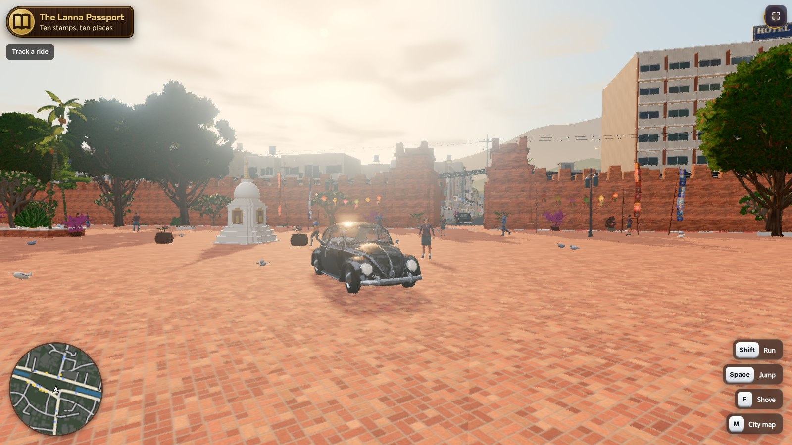
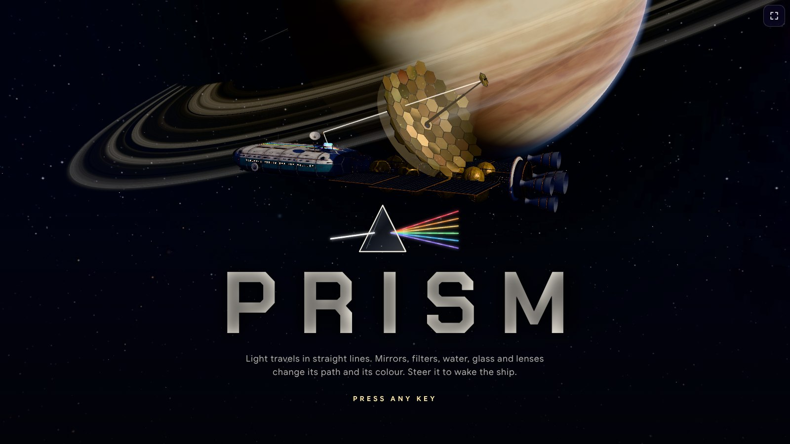

<p align="center">
<a href="README.md">English</a> · <a href="README.fr.md">Français</a> · <b>Español</b> · <a href="README.de.md">Deutsch</a> · <a href="README.it.md">Italiano</a> · <a href="README.pt.md">Português</a> · <a href="README.pl.md">Polski</a> · <a href="README.ja.md">日本語</a> · <a href="README.ko.md">한국어</a> · <a href="README.zh.md">中文</a> · <a href="README.th.md">ไทย</a> · <a href="README.ar.md">العربية</a>
</p>

<div align="center">

# Skills de agente para e-learning

**Jugar para aprender, crear para ganar.**

Convierte los deberes en juegos. Convierte las lecciones en cursos. Convierte lo que sabes en una comunidad.

Skills que enseñan a Claude, ChatGPT, Gemini, Cursor o cualquier agente de IA a crear en el ecosistema MEXTY:
juegos educativos en **EdVerse**, comunidades de creadores en **Mextribe**, cursos e itinerarios de aprendizaje en **MEXTY**.

[Conecta tu IA](https://mexty.ai/connect) · [Juega en EdVerse](https://future.mexty.ai/edverse) · [Precios](https://mexty.ai/pricing)

<p>
<a href="#para-organizaciones-crear-asignar-seguir"></a>
&nbsp;&nbsp;&nbsp;<b>×</b>&nbsp;&nbsp;&nbsp;
<a href="https://future.mexty.ai/edverse"></a>
&nbsp;&nbsp;&nbsp;<b>×</b>&nbsp;&nbsp;&nbsp;
<a href="https://future.mexty.ai/mextribe"></a>
</p>

## MEXTY LMS × EdVerse × Mextribe

<table>
<tr>
<td width="33%" align="center"><a href="#para-organizaciones-crear-asignar-seguir"></a><br><b>MEXTY LMS</b><br><sub>Cursos, itinerarios de aprendizaje y seguimiento para centros educativos y empresas</sub></td>
<td width="33%" align="center"><a href="https://future.mexty.ai/edverse"></a><br><b>EdVerse</b><br><sub>Juegos educativos de 4 a 18 años. Juégalos, créalos, véndelos</sub></td>
<td width="33%" align="center"><a href="https://future.mexty.ai/mextribe"></a><br><b>Mextribe</b><br><sub>Aprende de los creadores. Enseña a tu tribu</sub></td>
</tr>
</table>

<sub>Una sola cuenta para los tres.</sub>

</div>

---

## Un ecosistema, tres puertas de entrada

| | Para familias | Para creadores | Para organizaciones |
|---|---|---|---|
| **Quién** | Padres, niños, estudiantes | Docentes, creadores de juegos, cualquiera con una suscripción a una IA | Colegios, universidades, proveedores de formación, pequeñas y medianas empresas |
| **Qué haces** | Jugar a juegos educativos, convertir los deberes en un juego, seguir el progreso de tu hijo | Crear juegos y cursos, solo o con otros, venderlos, dirigir tu propia comunidad de aprendizaje | Crear formación en equipo, asignarla a tu gente, ver quién ha completado qué |
| **Dónde** | [EdVerse](https://future.mexty.ai/edverse) | EdVerse Studio y Mextribe | El espacio de trabajo de MEXTY: Authoring y LMS |
| **Coste para empezar** | Gratis | Gratis | Plan Authoring, Authoring + LMS o Enterprise |
| **Más información** | [Padres](audiences/parents.md) | [Desarrolladores de juegos](audiences/game-developers.md) | [Empresas](audiences/companies.md) · [Universidades y colegios](audiences/universities-and-schools.md) |

## Qué hace cada skill

| Skill | Qué hace |
|---|---|
| [`mexty-start`](skills/mexty-start/SKILL.md) | Averigua quién eres y qué necesitas, elige primero la vía gratuita y te deja en manos de la skill adecuada |
| [`homework-to-game`](skills/homework-to-game/SKILL.md) | Lee una ficha, una lección o una lista de repaso y crea un juego en el que jugar es practicar |
| [`track-kid-progress`](skills/track-kid-progress/SKILL.md) | Para padres: lo que un niño ha aprendido en EdVerse en una semana o un mes, en un informe breve con ideas para el siguiente paso |
| [`pick-games-for-my-kid`](skills/pick-games-for-my-kid/SKILL.md) | Elige juegos por edad, materia e idioma, y organiza una rutina tranquila y los ajustes de tiempo de pantalla |
| [`learning-game-design`](skills/learning-game-design/SKILL.md) | Diseña el juego antes de escribir una sola línea de código: la habilidad, el bucle de juego, los niveles, todo en una página |
| [`edverse-game-qa`](skills/edverse-game-qa/SKILL.md) | Comprueba un juego frente a los 11 requisitos de los juegos de EdVerse antes de la revisión de la tienda y corrige lo que una revisión haya devuelto |
| [`edverse-publish-and-earn`](skills/edverse-publish-and-earn/SKILL.md) | Ficha en la tienda, precio, envío y gestión del juego con el buzón de sugerencias y las estadísticas |
| [`edverse-game-performance`](skills/edverse-game-performance/SKILL.md) | Hace que un juego 3D de navegador funcione en una tableta escolar: presupuestos, perfilado, WebGL y WebGPU |
| [`multiplayer-and-saves`](skills/multiplayer-and-saves/SKILL.md) | Progreso guardado, clasificaciones, logros y juego en tiempo real, hechos de forma segura para los niños |
| [`free-creative-toolkit`](skills/free-creative-toolkit/SKILL.md) | Blender sin interfaz para el 3D, Whisper para los subtítulos, los estilos de película de Opuscar para el vídeo, bancos de medios, antes de cualquier generación de pago |
| [`curriculum-to-learning-path`](skills/curriculum-to-learning-path/SKILL.md) | Convierte un temario o un conjunto de resultados de aprendizaje en un itinerario de aprendizaje, con un curso por resultado |
| [`ai-literacy-curriculum`](skills/ai-literacy-curriculum/SKILL.md) | Alfabetización en IA para alumnos y estudiantes según la edad, ajustada al marco que sigue el centro |
| [`assessment-design`](skills/assessment-design/SKILL.md) | Una evaluación justa: qué certifica, una tabla de especificaciones, preguntas, puntos y una nota de corte |
| [`mexty-courses-for-teams`](skills/mexty-courses-for-teams/SKILL.md) | Cursos, actividades, evaluaciones e itinerarios de aprendizaje para centros educativos y empresas, con plazas y analíticas |
| [`onboarding-path`](skills/onboarding-path/SKILL.md) | Un itinerario de incorporación para un puesto, del día 1 al día 90, a partir de los documentos que tiene la empresa |
| [`compliance-course`](skills/compliance-course/SKILL.md) | Un curso de cumplimiento normativo y su prueba, redactados a partir de la política de la propia organización |
| [`keep-training-current`](skills/keep-training-current/SKILL.md) | Formación ligada a su fuente: borradores ante cada cambio, revisión, recertificación, agentes programados y una página de ventas a partir de un curso |
| [`ai-literacy-at-work`](skills/ai-literacy-at-work/SKILL.md) | Alfabetización en IA para el personal según su puesto, adaptada a las herramientas que usa y a la política de IA de la organización |
| [`sales-enablement`](skills/sales-enablement/SKILL.md) | Conocimiento del producto, práctica del discurso de ventas y gestión de objeciones a partir de la ficha de producto |
| [`analytics-dashboards`](skills/analytics-dashboards/SKILL.md) | Crea un panel a medida que responde a una pregunta sobre el aprendizaje con datos en vivo |
| [`build-together`](skills/build-together/SKILL.md) | Coautoría, borradores, revisiones, comentarios, versiones y fusiones, en el espacio de trabajo y en EdVerse |
| [`mextribe-community`](skills/mextribe-community/SKILL.md) | Publicaciones, planes de pago, comentarios, novedades y estadísticas: una comunidad de aprendizaje llevada por una sola persona |
| [`instagram-showcase`](skills/instagram-showcase/SKILL.md) | Reels, Stories, carruseles y textos a partir de lo que has creado |

## Jugar para aprender, crear para ganar

**Jugar para aprender.** Un niño que juega a un buen juego educativo practica una habilidad sin que nadie se lo pida, y un adulto puede ver qué ha practicado.

**Crear para ganar.** Quien crea el juego gana dos veces. Primero, en comprensión: no puedes convertir una lección en un juego sin dominarla lo bastante como para explicársela a uno. Después, en dinero: un juego en la tienda se puede vender, o cobrar por los minutos que los niños juegan con él.

Estas skills hacen posibles ambas cosas para alguien que nunca ha hecho un juego: describe los deberes y tu IA construye el juego contigo, lo comprueba frente a los requisitos de la tienda y te ayuda a publicarlo.

## Hecho en EdVerse

<div align="center">

<a href="https://future.mexty.ai/edverse/play/6aec3b57c9fbf8c716737432"></a>

<sub><b><a href="https://future.mexty.ai/edverse/play/6aec3b57c9fbf8c716737432">Prism</a></b>: despierta una nave dormida, rayo a rayo. Espejos, filtros de color, refracción, prismas y lentes, todo con óptica real: descubres la regla y la puerta se abre. Ciencias, de 10 a 18 años, gratis. Hecho en EdVerse por josephmaupas2.</sub>

</div>

Todos los juegos que ves aquí están publicados en la tienda y son gratuitos. Haz clic en uno para jugar.

<table>
<tr>
<td width="33%"><a href="https://future.mexty.ai/edverse/play/6ad4f323d2da4f44ae744019"></a><br><b><a href="https://future.mexty.ai/edverse/play/6ad4f323d2da4f44ae744019">Fraction Coaster</a></b><br><sub>Súbete a una montaña rusa y salpica la fracción correcta. Matemáticas, a partir de 7 años.</sub></td>
<td width="33%"><a href="https://future.mexty.ai/edverse/play/6ad8655c3b54b5603c79c1e4"></a><br><b><a href="https://future.mexty.ai/edverse/play/6ad8655c3b54b5603c79c1e4">Math Kitchen Rush</a></b><br><sub>Una cocina cooperativa donde los números son los ingredientes. Matemáticas, a partir de 7 años.</sub></td>
<td width="33%"><a href="https://future.mexty.ai/edverse/play/6ad5d61286bc6e0a1c20a99d"></a><br><b><a href="https://future.mexty.ai/edverse/play/6ad5d61286bc6e0a1c20a99d">Turbo Gates</a></b><br><sub>Cruza la puerta de la respuesta correcta para rebajar tu tiempo por vuelta. Matemáticas, de 10 a 15 años.</sub></td>
</tr>
<tr>
<td><a href="https://future.mexty.ai/edverse/play/6ad711bd87e1e3de99f9e2c8"></a><br><b><a href="https://future.mexty.ai/edverse/play/6ad711bd87e1e3de99f9e2c8">MathBot Siege</a></b><br><sub>Dispara a la pantalla que muestra la respuesta correcta para apagar el robot. Matemáticas, de 7 a 12 años.</sub></td>
<td><a href="https://future.mexty.ai/edverse/play/6ae1d1c8b82eb1abf68a3fa6"></a><br><b><a href="https://future.mexty.ai/edverse/play/6ae1d1c8b82eb1abf68a3fa6">The Cartographers of the Fog</a></b><br><sub>Una batalla naval en la niebla para practicar las coordenadas en cuadrícula y los puntos cardinales. Matemáticas, de 7 a 12 años. Por josephmaupas2.</sub></td>
<td><a href="https://future.mexty.ai/edverse/play/6ad9bb439c6bc47946fdc049"></a><br><b><a href="https://future.mexty.ai/edverse/play/6ad9bb439c6bc47946fdc049">Body Heroes</a></b><br><sub>Anatomía en 3D y cirugía práctica, desde la biología del colegio hasta la preparación para Medicina. Cuerpo &amp; salud, de 13 a 18 años. Por nixht1.</sub></td>
</tr>
<tr>
<td><a href="https://future.mexty.ai/edverse/play/6aca37b57d7d7ac76d4cb78d"></a><br><b><a href="https://future.mexty.ai/edverse/play/6aca37b57d7d7ac76d4cb78d">Math Kingdom</a></b><br><sub>El cálculo mental da fuerza a tu ejército en un torneo en tiempo real. Matemáticas, de 7 a 15 años.</sub></td>
<td><a href="https://future.mexty.ai/edverse/play/6ae00ca2d76841160f7bb1ee"></a><br><b><a href="https://future.mexty.ai/edverse/play/6ae00ca2d76841160f7bb1ee">Tick-Tock Town</a></b><br><sub>Mueve las agujas del reloj del pueblo para decir la hora. Matemáticas, de 7 a 9 años. Por josephmaupas2.</sub></td>
<td><a href="https://future.mexty.ai/edverse/play/6ae0544fb82eb1abf68a0b0b"></a><br><b><a href="https://future.mexty.ai/edverse/play/6ae0544fb82eb1abf68a0b0b">Robot Matrix</a></b><br><sub>Mueve robots con vectores y matrices para iluminar una estación espacial. Matemáticas y programación, de 16 a 18 años.</sub></td>
</tr>
</table>

<details>
<summary>Más de Prism</summary>
<br>
<table><tr>
<td></td>
<td></td>
<td></td>
</tr></table>
</details>

## Para padres: un lugar seguro y una forma de seguir el progreso

**Seguro por las normas de la tienda.** Cada juego se prueba frente a los mismos requisitos antes de publicarse, primero por su autor y después por un revisor de MEXTY. Un juego en EdVerse:

- no tiene anuncios, ni chat, ni enlaces que saquen del juego, ni botones de compra, ni registro obligatorio;
- no pide el nombre, el correo, la foto ni la ubicación del niño, y no lleva rastreadores;
- no contiene nada violento, que dé miedo o que se burle, ni nada que presione al niño para seguir jugando o para pagar;
- trata con amabilidad las respuestas incorrectas y permite silenciar el sonido;
- incluye un botón Denunciar a un solo toque, que atiende el equipo de MEXTY.

**Sigue lo que aprenden.** En EdVerse, un adulto añade a cada niño como alumno y obtiene un panel para cada uno:

| Lo que ves | Lo que te dice | |
|---|---|---|
| Tiempo de juego, juegos jugados, días activos | Cuánto y con qué regularidad | Gratis |
| Cuándo juegan | Por la mañana, después del colegio o por la tarde-noche | Gratis |
| Habilidades dominadas | Lo que responden bien de forma constante | Plaza de alumno |
| Necesita práctica | Habilidades que aciertan menos del 60% de las veces | Plaza de alumno |
| Materias y progreso en cada juego | A qué dedican el tiempo | Plaza de alumno |

Una plaza de alumno cuesta desde €5 al mes por niño y además desbloquea todos los juegos ★ Included (incluidos).

<table>
<tr>
<td width="64%"><br><sub><b>Tu panel.</b> Tiempo de juego, juegos jugados, habilidades dominadas y días activos de cada alumno, en 7 o 30 días.</sub></td>
<td width="36%"><br><sub><b>Tus ajustes.</b> Franja de edad, un límite diario, horas de descanso y qué juegos pueden ver. Se guardan en tu cuenta y se aplican en todos los dispositivos.</sub></td>
</tr>
</table>

<sub>Se muestra con un alumno de demostración.</sub>

**Tú decides.** Fija un límite de tiempo diario y unas horas sin juegos; ambos se aplican en todos los dispositivos. Un niño nunca ve una pantalla de pago: ve el precio y te pregunta primero. Los asistentes de IA no pueden ver los perfiles ni el progreso de los niños.

**Pídele el informe a tu IA.** «¿Qué ha aprendido Mia este mes y qué deberíamos practicar?» Con [`track-kid-progress`](skills/track-kid-progress/SKILL.md), tu IA lee el informe de aprendizaje de los niños que tienen una plaza de alumno y te lo cuenta con palabras sencillas, con un juego para probar a continuación, cada semana o cada mes si quieres.

**Y cuando el problema son los deberes:** dale la ficha a tu IA y consigue un juego al que tu hijo pueda jugar esta misma noche, con [`homework-to-game`](skills/homework-to-game/SKILL.md).

## Para creadores: crea, publica, escucha, gana

Una sola persona con una sola suscripción a una IA puede llevar todo el ciclo. Crear es gratis: las herramientas MCP no gastan créditos de MEXTY.

1. **Crea** un juego a partir de una lección que domines ([`homework-to-game`](skills/homework-to-game/SKILL.md)).
2. **Supera la revisión** frente a los 11 requisitos de los juegos de EdVerse ([`edverse-game-qa`](skills/edverse-game-qa/SKILL.md)).
3. **Publícalo**: gratis, a precio fijo, paga lo que quieras o ★ Included para las familias y los centros con una plaza de alumno ([`edverse-publish-and-earn`](skills/edverse-publish-and-earn/SKILL.md)).
4. **Escucha**: los jugadores envían ideas al buzón de sugerencias del juego. Las que aceptas se convierten en su hoja de ruta pública.
5. **Reúne**: publícalo en Mextribe y añade un plan de pago cuando tus seguidores pidan más ([`mextribe-community`](skills/mextribe-community/SKILL.md)).
6. **Muestra**: un Reel, una Story y un carrusel cada vez que lanzas algo ([`instagram-showcase`](skills/instagram-showcase/SKILL.md)).

Te quedas con el 80% de cada venta de un juego después de la comisión de la tarjeta, y con el 80% de las suscripciones de Mextribe después de las comisiones de tarjeta.

### El editor de EdVerse

Cada juego se abre en un editor 3D en vivo en el navegador. Tú, tus colaboradores y tus asistentes de IA construís en el mismo mundo al mismo tiempo: describe lo que quieres y mira cómo aparece, o mueve las cosas tú mismo. La barra superior alterna entre ver, jugar y editar, muestra la vista previa en móvil, tableta y ordenador, abre el historial y llama al Asistente.


<sub><b>Floodline.</b> Un juego de parkour en primera persona por las azoteas de una ciudad que se inunda, donde las funciones lineales y las tasas de variación te dicen cuánto tiempo te queda. Matemáticas, de 13 a 15 años.</sub>

<table>
<tr>
<td width="50%"><br><sub><b>Songthaew Rush.</b> Chiang Mai reconstruida a partir de OpenStreetMap: un Escarabajo negro frente a la puerta Tha Phae, con gráficos Ultra.</sub></td>
<td width="50%"><br><sub><b>Prism.</b> La escena inicial: una nave dormida y la luz como única herramienta.</sub></td>
</tr>
</table>

<sub>Floodline se muestra en el editor; Songthaew Rush y Prism, durante la partida.</sub>

## Mextribe: aprende de los creadores, enseña a tu tribu

Mextribe es el lado social del ecosistema. Los creadores publican lo que hacen: cursos, itinerarios de aprendizaje, actividades interactivas, vídeos y juegos de EdVerse. Los alumnos los siguen gratis y se suscriben para acceder al resto. Usarlo es gratis, tanto para creadores como para alumnos.

<a href="https://future.mexty.ai/mextribe/explore"></a>

<sub><b>Explorar.</b> Para ti, tendencias, nuevos creadores, gratis y juegos. Cualquiera puede explorar sin cuenta.</sub>

<table>
<tr>
<td width="50%"><a href="https://future.mexty.ai/mextribe/@fabien.sabati"></a><br><sub><b>La página de un creador.</b> Publicaciones, seguidores y miembros; series; una cuadrícula que el creador ordena y en la que fija lo que quiere; pestañas de cursos, itinerarios, vídeos, actividades y juegos.</sub></td>
<td width="50%"><br><sub><b>Una publicación.</b> La actividad se juega ahí mismo. Me gusta, comentarios, compartir y guardar; el progreso y los certificados van a la cuenta de MEXTY del alumno.</sub></td>
</tr>
</table>

| Para alumnos | Para creadores |
|---|---|
| Sigue a creadores gratis | Publica cualquier cosa que hayas creado en MEXTY o EdVerse, además de vídeos y fotos |
| Haz cursos y actividades y juega a los juegos sin salir de la publicación | Publicaciones gratuitas, solo para miembros o con un precio único por publicación |
| Suscríbete al plan de un creador para acceder a toda su biblioteca | Planes de pago al estilo Patreon: te quedas con el 80% después de las comisiones de tarjeta, con pago mensual |
| Comenta y haz preguntas | Responde a los comentarios, fija los mejores, retén u oculta el resto |
| Cada publicación indica a qué edades va dirigida | Envía una novedad o una encuesta a tus seguidores o a tus miembros |
| | Estadísticas: seguidores, miembros, ingresos y dónde abandonan los alumnos |

**Seguro por diseño.** No hay mensajes privados. Cada publicación declara su público por edad; la primera publicación de un creador dirigida a menores de 18 años la revisa MEXTY antes de que se publique; los comentarios que piden hablar en otro sitio o que solicitan datos personales quedan retenidos. Los alumnos menores de 18 años aparecen ante los creadores solo con un nombre de pila y una inicial.

**Gestiónalo desde tu IA.** «Publica mi curso de química para edades de 13 a 17 años, con la lección 1 gratis y el resto para miembros.» «Enséñame los comentarios que esperan respuesta y redacta respuestas amables.» «¿Qué publicación ha traído más miembros este mes?» Toda publicación empieza como borrador, y nada se publica, se pone a la venta ni se envía sin tu sí. Consulta [`mextribe-community`](skills/mextribe-community/SKILL.md), e [`instagram-showcase`](skills/instagram-showcase/SKILL.md) para el kit para compartir: enlace, código QR, tarjeta para Story y textos.

## Para organizaciones: crear, asignar, seguir

MEXTY es una herramienta de autor y un LMS, que se contratan por separado o juntos. Con el MCP de MEXTY, tu propio asistente de IA crea dentro de tu espacio de trabajo: cursos, actividades interactivas, evaluaciones e itinerarios de aprendizaje completos, a partir de tus documentos y políticas.

<table>
<tr>
<td width="50%"><br><sub><b>Crear.</b> Un itinerario de aprendizaje es una cuadrícula de casillas numeradas que se desbloquean en orden. Una casilla puede contener varios elementos, y exigirse todos o solo uno cualquiera. Edítalo tú mismo o deja que tu IA construya toda la estructura.</sub></td>
<td width="50%"><br><sub><b>Seguir.</b> Alumnos, finalización, puntuación y tiempo de cada curso, y una línea de progreso para cada alumno.</sub></td>
</tr>
</table>

| Eres | Obtienes |
|---|---|
| Un **colegio o una universidad** | Planes de estudio como itinerarios de aprendizaje, evaluaciones con certificados, roles de alumno y progreso por estudiante |
| Un **proveedor de formación** | Cursos que se exportan a HTML y SCORM para el LMS que tus clientes ya tienen |
| Una **empresa** | Formación de incorporación, de cumplimiento normativo y de producto creada a partir de tus propios documentos; plazas y roles para tus equipos; quién ha completado qué |

- **Roles y plazas**: invita a creadores y alumnos; los roles deciden qué puede hacer cada persona.
- **Tus propios paneles**: más allá de las analíticas estándar, crea un panel que responda a tu pregunta con datos en vivo: incorporaciones completadas por semana, certificados a punto de caducar, las preguntas en las que falla una clase. Compártelo con un rol, un equipo o una sola persona ([`analytics-dashboards`](skills/analytics-dashboards/SKILL.md)).
- **Llega más allá de tus paredes**: publica un curso en Mextribe o publica en EdVerse una actividad que funcione como juego.

El MCP de MEXTY viene con **Authoring**, **Authoring + LMS** y **Enterprise**. Para asignar contenidos a los alumnos y hacer su seguimiento hace falta el LMS. Empieza con [`mexty-courses-for-teams`](skills/mexty-courses-for-teams/SKILL.md); los precios están en la [página de precios](https://mexty.ai/pricing).

## Cumplimiento normativo y formación que se mantiene al día sola

La formación en cumplimiento normativo falla en silencio: la política cambia y el curso no. Aquí un curso tiene una fuente, una versión y un responsable, y un agente de IA puede vigilar la fuente por ti.

| Cuándo | Qué ocurre |
|---|---|
| Cambia una política, una ley o una ficha de producto | El agente lee la nueva versión, encuentra los cursos que la citan y prepara los cambios en borrador, nada más |
| Antes de que los alumnos vean nada | El responsable del curso revisa el borrador, ve quién está inscrito y certificado, y lo publica o lo programa para el día en que la política entra en vigor |
| Después de un cambio sustancial | Ves quién tiene un certificado de la versión anterior y reasignas solo lo que ha cambiado |
| Cada semana, de forma programada | Un informe: qué ha cambiado, qué borradores están pendientes, a quién le caduca pronto el certificado |
| Se publica un curso nuevo | El agente puede preparar una página de destino y una oferta para venderlo fuera de la organización |

Sirve para protección de datos, seguridad, prevención de riesgos laborales, códigos de conducta, alfabetización en IA y formación de producto. Nada se publica, se certifica ni se pone a la venta sin el sí de una persona. Consulta [`keep-training-current`](skills/keep-training-current/SKILL.md).

## Creado en equipo

Ni un curso ni un juego son trabajo de una sola persona, así que ambos productos están pensados para el trabajo compartido. Los alumnos y los jugadores solo ven lo que se ha publicado o fusionado.

| | En el espacio de trabajo de MEXTY | En EdVerse |
|---|---|---|
| **Trabajar codo con codo** | Coautores en un curso, una actividad, una evaluación o un itinerario de aprendizaje | Varias personas y sus asistentes de IA en el mismo editor 3D en vivo y en el mismo código. Los cambios se fusionan; nada queda bloqueado |
| **Probar sin riesgo** | Borradores: cambios que se están probando, junto a la versión publicada | Borradores del mundo y del código de un juego. Quien entra por el enlace para compartir trabaja en uno |
| **Revisar** | Designa revisores, comenta el contenido, ve los cambios y a quién afectan, aprueba o devuelve | Ve qué ha cambiado, objeto por objeto y archivo por archivo; el propietario o un mantenedor fusiona |
| **Publicar** | Publica ahora o prográmalo | Fusiona en el juego; la tienda ofrece la nueva versión tras su revisión |
| **Volver atrás** | Historial de versiones: compara y restaura cualquier versión como borrador | Un borrador se puede cerrar; los conflictos se resuelven comparando las dos versiones lado a lado |
| **Autoría** | Se nombra a los coautores | Los autores del trabajo fusionado figuran en los créditos y participan en lo que el juego gana del fondo de alumnos |

Una clase puede crear un juego de esta forma: el docente es el propietario, cada grupo trabaja en su propio borrador y la clase revisa cada uno antes de fusionarlo. Consulta [`build-together`](skills/build-together/SKILL.md).

## Qué es gratis y qué requiere un plan

| | EdVerse | Mextribe | MEXTY |
|---|---|---|---|
| **Qué es** | Tienda y estudio de juegos educativos, de 4 a 18 años | Red social para aprender, con planes de pago de creadores | Creación de contenidos con IA y LMS para organizaciones |
| **Usarlo con tu IA** | **Gratis** | **Gratis** | Plan **Authoring**, **Authoring + LMS** o **Enterprise** |
| **Cómo ganas** | Vende un juego a precio fijo o con paga lo que quieras, cobra del fondo de alumnos según los minutos jugados (★ Included), o mejora juegos abiertos a la colaboración y participa en sus ingresos del fondo una vez fusionado tu borrador | Planes de suscripción de pago y ventas individuales | — |
| **Con qué te quedas** | El 80% de cada venta después de la comisión de la tarjeta | El 80% después de las comisiones de tarjeta | — |

Las herramientas MCP no gastan créditos de MEXTY: quien piensa es tu propia suscripción a una IA. Solo la generación de medios (imágenes, voces, modelos 3D, transcripción) gasta créditos, y [`free-creative-toolkit`](skills/free-creative-toolkit/SKILL.md) te enseña la forma gratuita de hacer cada cosa.

## Incluido de otros autores

Hacer juegos es un oficio en sí mismo, así que el repositorio también incluye skills escritas por otros, sin cambios y bajo sus propias licencias. Las fuentes y las licencias están en [`THIRD_PARTY.md`](THIRD_PARTY.md).

| Carpeta | Qué contiene | De |
|---|---|---|
| [`third-party/gamedev`](third-party/gamedev) | 18 skills: sensaciones de juego, diseño de niveles, interfaz de juego, audio, cámaras, controles, guardado, rendimiento, pipeline de recursos, prototipado rápido, configuración de three.js, glTF e iluminación, y guías para juegos de puzles, plataformas, disparos, cartas y rol | [awesome-gamedev-agent-skills](https://github.com/gamedev-skills/awesome-gamedev-agent-skills), Apache 2.0 |
| [`third-party/webgpu-threejs-tsl`](third-party/webgpu-threejs-tsl) | Renderizador WebGPU de three.js y TSL: materiales de nodos, compute shaders, posprocesado, pérdida del dispositivo gráfico | [webgpu-claude-skill](https://github.com/dgreenheck/webgpu-claude-skill), MIT |

Recomendados como complemento, instalados desde sus propias fuentes: [bang-motion](https://github.com/bangtutorial/bang-motion) para motion graphics, [canvas-design](https://github.com/anthropics/skills/tree/main/skills/canvas-design) para carteles y carruseles, y los estilos de película de [Lemo-Opuscar](https://github.com/lemomo-ai/lemo-opuscar).

## De los deberes a un juego en la tienda

```
 deberes  ──► homework-to-game ──► edverse-game-qa ──► edverse-publish-and-earn ──► instagram-showcase
 (una ficha,   elegir una mecánica, los 11 requisitos   precio, envío,               Reel, Story,
  una lección) crear desde una      de la tienda;       buzón de sugerencias,        carrusel
               plantilla            tú haces la prueba  ciclo semanal
```

Cada juego se prueba dos veces frente a los mismos requisitos: por ti, jugándolo en el Studio, y por un revisor de MEXTY. Una IA no puede pasar esa prueba por ti. Lo que sí puede es asegurarse de que la superes.

## Instalación

**1. Conecta los servidores MCP** en [mexty.ai/connect](https://mexty.ai/connect) (Claude, ChatGPT, Cursor, VS Code, Gemini CLI, Codex y otros). En Claude Code:

```bash
claude mcp add --transport http edverse  https://mcp.mexty.ai/mcp/edverse
claude mcp add --transport http mextribe https://mcp.mexty.ai/mcp/mextribe
claude mcp add --transport http mexty    https://mcp.mexty.ai/mcp/mexty
```

**2. Añade las skills.**

Claude Code, como plugin:

```
/plugin marketplace add mext-ai/elearning-agent-skills
/plugin install elearning-agent-skills@mexty
```

O copia las carpetas que quieras:

```bash
git clone https://github.com/mext-ai/elearning-agent-skills
cp -r elearning-agent-skills/skills/* ~/.claude/skills/
cp -r elearning-agent-skills/third-party/gamedev/* ~/.claude/skills/          # optional
cp -r elearning-agent-skills/third-party/webgpu-threejs-tsl ~/.claude/skills/ # optional
```

Claude.ai: comprime en zip la carpeta de una skill y súbela en Settings → Capabilities → Skills. Otros agentes: cada skill es un único archivo Markdown; indícale a tu agente el `SKILL.md` que necesites.

**3. Di lo que quieres.**

> Esta es la ficha de fracciones de mi hija. Conviértela en un juego al que pueda jugar en la tableta.

> ¿Qué ha aprendido mi hijo en EdVerse este mes y qué deberíamos practicar?

> ¿Está mi juego listo para la revisión de EdVerse?

> Lee las sugerencias de mis juegos publicados y dime qué crear esta semana.

> Cada lunes, busca un juego colaborativo al que le falte un nivel de fracciones, créalo en un borrador y pídele una revisión al propietario.

> Convierte nuestra política de privacidad de datos en un curso de incorporación de 10 minutos con un cuestionario y asígnalo a las nuevas incorporaciones.

---

<div align="center">
<sub>Por <a href="https://mexty.ai">MEXTY</a>. El arte de cada juego pertenece a su creador. Las skills de terceros pertenecen a sus autores; consulta <a href="THIRD_PARTY.md">THIRD_PARTY.md</a>.</sub>
</div>
