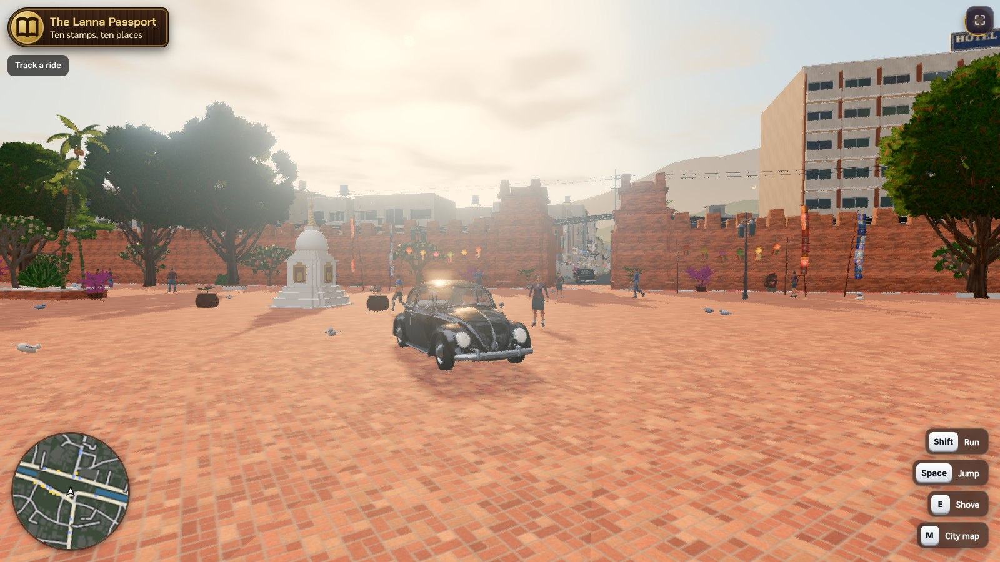
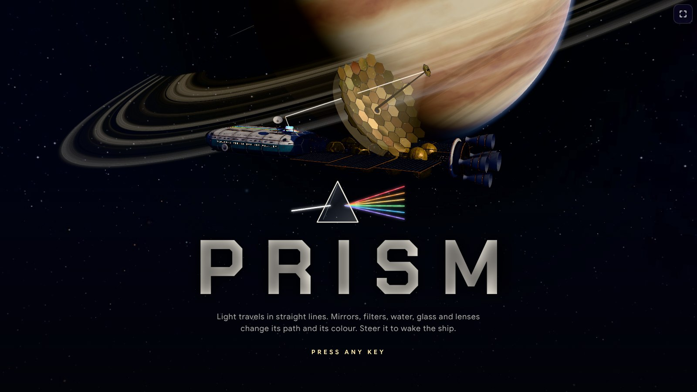

<p align="center">
<a href="README.md">English</a> · <a href="README.fr.md">Français</a> · <a href="README.es.md">Español</a> · <a href="README.de.md">Deutsch</a> · <b>Italiano</b> · <a href="README.pt.md">Português</a> · <a href="README.pl.md">Polski</a> · <a href="README.ja.md">日本語</a> · <a href="README.ko.md">한국어</a> · <a href="README.zh.md">中文</a> · <a href="README.th.md">ไทย</a> · <a href="README.ar.md">العربية</a>
</p>

<div align="center">

# Skill per agenti dedicate all'e-learning

**Giocare per imparare, creare per guadagnare.**

Trasforma i compiti in giochi. Trasforma le lezioni in corsi. Trasforma ciò che sai in una community.

Skill che insegnano a Claude, ChatGPT, Gemini, Cursor o a qualsiasi agente IA a creare nell'ecosistema MEXTY:
giochi didattici su **EdVerse**, community di creator su **Mextribe**, corsi e percorsi di apprendimento su **MEXTY**.

[Collega la tua IA](https://mexty.ai/connect) · [Gioca su EdVerse](https://future.mexty.ai/edverse) · [Prezzi](https://mexty.ai/pricing)

<p>
<a href="#per-le-organizzazioni-creare-assegnare-monitorare"></a>
&nbsp;&nbsp;&nbsp;<b>×</b>&nbsp;&nbsp;&nbsp;
<a href="https://future.mexty.ai/edverse"></a>
&nbsp;&nbsp;&nbsp;<b>×</b>&nbsp;&nbsp;&nbsp;
<a href="https://future.mexty.ai/mextribe"></a>
</p>

## MEXTY LMS × EdVerse × Mextribe

<table>
<tr>
<td width="33%" align="center"><a href="#per-le-organizzazioni-creare-assegnare-monitorare"></a><br><b>MEXTY LMS</b><br><sub>Corsi, percorsi di apprendimento e monitoraggio per scuole e aziende</sub></td>
<td width="33%" align="center"><a href="https://future.mexty.ai/edverse"></a><br><b>EdVerse</b><br><sub>Giochi didattici dai 4 ai 18 anni. Giocali, creali, vendili</sub></td>
<td width="33%" align="center"><a href="https://future.mexty.ai/mextribe"></a><br><b>Mextribe</b><br><sub>Impara dai creator. Insegna alla tua tribù</sub></td>
</tr>
</table>

<sub>Un solo account per tutti e tre.</sub>

</div>

---

## Un ecosistema, tre porte d'ingresso

| | Per le famiglie | Per i creator | Per le organizzazioni |
|---|---|---|---|
| **Chi** | Genitori, bambini, studenti | Insegnanti, creatori di giochi, chiunque abbia un abbonamento a un'IA | Scuole, università, enti di formazione, piccole e medie imprese |
| **Cosa fai** | Giochi con i giochi didattici, trasformi i compiti in un gioco, segui i progressi di tuo figlio | Crei giochi e corsi, da solo o con altri, li vendi, gestisci la tua community di apprendimento | Crei la formazione in team, la assegni alle tue persone, vedi chi ha completato cosa |
| **Dove** | [EdVerse](https://future.mexty.ai/edverse) | EdVerse Studio e Mextribe | Lo spazio di lavoro MEXTY: Authoring e LMS |
| **Costo per iniziare** | Gratis | Gratis | Piano Authoring, Authoring + LMS o Enterprise |
| **Per saperne di più** | [Genitori](audiences/parents.md) | [Sviluppatori di giochi](audiences/game-developers.md) | [Aziende](audiences/companies.md) · [Università e scuole](audiences/universities-and-schools.md) |

## Cosa fa ogni skill

| Skill | Cosa fa |
|---|---|
| [`mexty-start`](skills/mexty-start/SKILL.md) | Capisce chi sei e di cosa hai bisogno, sceglie prima la strada gratuita e ti affida alla skill giusta |
| [`homework-to-game`](skills/homework-to-game/SKILL.md) | Legge una scheda, una lezione o un elenco di ripasso e crea un gioco in cui giocare significa esercitarsi |
| [`track-kid-progress`](skills/track-kid-progress/SKILL.md) | Per i genitori: cosa ha imparato un bambino su EdVerse in una settimana o in un mese, in un breve resoconto con i prossimi passi da provare |
| [`pick-games-for-my-kid`](skills/pick-games-for-my-kid/SKILL.md) | Sceglie i giochi per età, materia e lingua, e imposta una routine serena e i limiti di tempo davanti allo schermo |
| [`learning-game-design`](skills/learning-game-design/SKILL.md) | Progetta il gioco prima di scrivere una riga di codice: la competenza, il ciclo di gioco, i livelli, tutto in una pagina |
| [`edverse-game-qa`](skills/edverse-game-qa/SKILL.md) | Verifica un gioco rispetto agli 11 requisiti dei giochi EdVerse prima della revisione dello store, e corregge ciò che una revisione ha rimandato indietro |
| [`edverse-publish-and-earn`](skills/edverse-publish-and-earn/SKILL.md) | Scheda nello store, prezzo, invio e gestione del gioco con la cassetta dei suggerimenti e le statistiche |
| [`edverse-game-performance`](skills/edverse-game-performance/SKILL.md) | Fa girare un gioco 3D per browser su un tablet scolastico: budget, profilazione, WebGL e WebGPU |
| [`multiplayer-and-saves`](skills/multiplayer-and-saves/SKILL.md) | Salvataggio dei progressi, classifiche, obiettivi e gioco in tempo reale, realizzati in modo sicuro per i bambini |
| [`free-creative-toolkit`](skills/free-creative-toolkit/SKILL.md) | Blender senza interfaccia per il 3D, Whisper per i sottotitoli, gli stili cinematografici Opuscar per i video, archivi di contenuti multimediali, prima di qualsiasi generazione a pagamento |
| [`curriculum-to-learning-path`](skills/curriculum-to-learning-path/SKILL.md) | Trasforma un programma o un insieme di risultati di apprendimento in un percorso di apprendimento, con un corso per ogni risultato |
| [`ai-literacy-curriculum`](skills/ai-literacy-curriculum/SKILL.md) | Alfabetizzazione all'IA per alunni e studenti in base all'età, costruita sul quadro di riferimento seguito dall'istituto |
| [`assessment-design`](skills/assessment-design/SKILL.md) | Una valutazione equa: cosa certifica, uno schema della prova, le domande, i punteggi e una soglia di superamento |
| [`mexty-courses-for-teams`](skills/mexty-courses-for-teams/SKILL.md) | Corsi, attività, valutazioni e percorsi di apprendimento per scuole e aziende, con posti e statistiche |
| [`onboarding-path`](skills/onboarding-path/SKILL.md) | Un percorso di onboarding per un ruolo, dal giorno 1 al giorno 90, a partire dai documenti che l'azienda possiede |
| [`compliance-course`](skills/compliance-course/SKILL.md) | Un corso di compliance con la relativa verifica, scritto a partire dalla policy dell'organizzazione stessa |
| [`keep-training-current`](skills/keep-training-current/SKILL.md) | Formazione legata alla propria fonte: bozze a ogni modifica, revisione, ricertificazione, agenti pianificati e una pagina di vendita ricavata da un corso |
| [`ai-literacy-at-work`](skills/ai-literacy-at-work/SKILL.md) | Alfabetizzazione all'IA per il personale in base al ruolo, adattata agli strumenti che usa e alla policy sull'IA dell'organizzazione |
| [`sales-enablement`](skills/sales-enablement/SKILL.md) | Conoscenza del prodotto, allenamento alla presentazione commerciale e gestione delle obiezioni a partire dalla scheda prodotto |
| [`analytics-dashboards`](skills/analytics-dashboards/SKILL.md) | Crea una dashboard su misura che risponde a una domanda sull'apprendimento con dati in tempo reale |
| [`build-together`](skills/build-together/SKILL.md) | Co-authoring, bozze, revisioni, commenti, versioni e unioni, nello spazio di lavoro e in EdVerse |
| [`mextribe-community`](skills/mextribe-community/SKILL.md) | Post, piani a pagamento, commenti, aggiornamenti e statistiche: una community di apprendimento gestita da una sola persona |
| [`instagram-showcase`](skills/instagram-showcase/SKILL.md) | Reel, Storie, caroselli e didascalie a partire da ciò che hai creato |

## Giocare per imparare, creare per guadagnare

**Giocare per imparare.** Un bambino che gioca con un buon gioco didattico esercita una competenza senza che nessuno glielo chieda, e un adulto può vedere su cosa si è esercitato.

**Creare per guadagnare.** Chi crea il gioco guadagna due volte. Prima in comprensione: non puoi trasformare una lezione in un gioco senza conoscerla abbastanza bene da spiegarla a un gioco. Poi in denaro: un gioco nello store può essere venduto, oppure retribuito in base ai minuti in cui i bambini ci giocano.

Queste skill rendono possibili entrambe le cose anche per chi non ha mai creato un gioco: descrivi i compiti e la tua IA costruisce il gioco insieme a te, lo verifica rispetto ai requisiti dello store e ti aiuta a pubblicarlo.

## Creati su EdVerse

<div align="center">

<a href="https://future.mexty.ai/edverse/play/6aec3b57c9fbf8c716737432"></a>

<sub><b><a href="https://future.mexty.ai/edverse/play/6aec3b57c9fbf8c716737432">Prism</a></b>: risveglia un'astronave addormentata, un raggio alla volta. Specchi, filtri colorati, rifrazione, prismi e lenti, tutto basato su ottica reale: scopri la regola e la porta si apre. Scienze, 10–18 anni, gratis. Creato su EdVerse da josephmaupas2.</sub>

</div>

Tutti i giochi che vedi qui sono online nello store e gratuiti. Clicca su uno per giocarci.

<table>
<tr>
<td width="33%"><a href="https://future.mexty.ai/edverse/play/6ad4f323d2da4f44ae744019"></a><br><b><a href="https://future.mexty.ai/edverse/play/6ad4f323d2da4f44ae744019">Fraction Coaster</a></b><br><sub>Sali sulle montagne russe e colpisci la frazione giusta. Matematica, dai 7 anni.</sub></td>
<td width="33%"><a href="https://future.mexty.ai/edverse/play/6ad8655c3b54b5603c79c1e4"></a><br><b><a href="https://future.mexty.ai/edverse/play/6ad8655c3b54b5603c79c1e4">Math Kitchen Rush</a></b><br><sub>Una cucina cooperativa dove i numeri sono gli ingredienti. Matematica, dai 7 anni.</sub></td>
<td width="33%"><a href="https://future.mexty.ai/edverse/play/6ad5d61286bc6e0a1c20a99d"></a><br><b><a href="https://future.mexty.ai/edverse/play/6ad5d61286bc6e0a1c20a99d">Turbo Gates</a></b><br><sub>Passa attraverso il varco con la risposta giusta per abbassare il tuo tempo sul giro. Matematica, 10–15 anni.</sub></td>
</tr>
<tr>
<td><a href="https://future.mexty.ai/edverse/play/6ad711bd87e1e3de99f9e2c8"></a><br><b><a href="https://future.mexty.ai/edverse/play/6ad711bd87e1e3de99f9e2c8">MathBot Siege</a></b><br><sub>Spara allo schermo che mostra la risposta giusta per spegnere il robot. Matematica, 7–12 anni.</sub></td>
<td><a href="https://future.mexty.ai/edverse/play/6ae1d1c8b82eb1abf68a3fa6"></a><br><b><a href="https://future.mexty.ai/edverse/play/6ae1d1c8b82eb1abf68a3fa6">The Cartographers of the Fog</a></b><br><sub>Una battaglia navale nella nebbia per esercitarsi con le coordinate sulla griglia e i punti cardinali. Matematica, 7–12 anni. Di josephmaupas2.</sub></td>
<td><a href="https://future.mexty.ai/edverse/play/6ad9bb439c6bc47946fdc049"></a><br><b><a href="https://future.mexty.ai/edverse/play/6ad9bb439c6bc47946fdc049">Body Heroes</a></b><br><sub>Anatomia in 3D e chirurgia da provare in prima persona, dalla biologia scolastica alla preparazione a Medicina. Corpo &amp; salute, 13–18 anni. Di nixht1.</sub></td>
</tr>
<tr>
<td><a href="https://future.mexty.ai/edverse/play/6aca37b57d7d7ac76d4cb78d"></a><br><b><a href="https://future.mexty.ai/edverse/play/6aca37b57d7d7ac76d4cb78d">Math Kingdom</a></b><br><sub>Il calcolo mentale dà forza al tuo esercito in un torneo in tempo reale. Matematica, 7–15 anni.</sub></td>
<td><a href="https://future.mexty.ai/edverse/play/6ae00ca2d76841160f7bb1ee"></a><br><b><a href="https://future.mexty.ai/edverse/play/6ae00ca2d76841160f7bb1ee">Tick-Tock Town</a></b><br><sub>Gira le lancette dell'orologio della città per leggere l'ora. Matematica, 7–9 anni. Di josephmaupas2.</sub></td>
<td><a href="https://future.mexty.ai/edverse/play/6ae0544fb82eb1abf68a0b0b"></a><br><b><a href="https://future.mexty.ai/edverse/play/6ae0544fb82eb1abf68a0b0b">Robot Matrix</a></b><br><sub>Muovi i robot con vettori e matrici per illuminare una stazione spaziale. Matematica e programmazione, 16–18 anni.</sub></td>
</tr>
</table>

<details>
<summary>Altre immagini di Prism</summary>
<br>
<table><tr>
<td></td>
<td></td>
<td></td>
</tr></table>
</details>

## Per i genitori: un posto sicuro e un modo per seguire i progressi

**Sicuro per regolamento dello store.** Ogni gioco viene testato rispetto agli stessi requisiti prima di essere pubblicato, prima dal suo autore e poi da un revisore MEXTY. Un gioco su EdVerse:

- non ha pubblicità, chat, link che portano fuori dal gioco, pulsanti di acquisto né registrazione obbligatoria;
- non chiede il nome, l'e-mail, la foto o la posizione del bambino e non contiene tracker;
- non ha nulla di violento, spaventoso o derisorio, e nulla che spinga il bambino a continuare a giocare o a pagare;
- gestisce con gentilezza le risposte sbagliate e ha un audio che si può disattivare;
- ha un pulsante Segnala a portata di tocco, a cui risponde il team MEXTY.

**Segui ciò che imparano.** In EdVerse un adulto aggiunge ogni bambino come studente e ottiene una dashboard per ciascuno:

| Cosa vedi | Cosa ti dice | |
|---|---|---|
| Tempo di gioco, giochi giocati, giorni di attività | Quanto, e con quale regolarità | Gratis |
| Quando giocano | Al mattino, dopo la scuola o la sera | Gratis |
| Competenze acquisite | Ciò a cui rispondono correttamente con costanza | Posto studente |
| Da esercitare | Competenze con risposte corrette in meno del 60% dei casi | Posto studente |
| Materie e progressi in ogni gioco | Dove va il tempo | Posto studente |

Un posto studente parte da €5 al mese per bambino e sblocca anche tutti i giochi ★ Included (inclusi).

<table>
<tr>
<td width="64%"><br><sub><b>La tua dashboard.</b> Tempo di gioco, giochi giocati, competenze acquisite e giorni di attività di ogni studente, su 7 o 30 giorni.</sub></td>
<td width="36%"><br><sub><b>Le tue impostazioni.</b> Fascia d'età, limite giornaliero, ore di pausa e giochi che possono vedere. Salvate nel tuo account e applicate su ogni dispositivo.</sub></td>
</tr>
</table>

<sub>Mostrato con uno studente dimostrativo.</sub>

**Decidi sempre tu.** Imposta un limite di tempo giornaliero e delle ore senza giochi; entrambi valgono su ogni dispositivo. Un bambino non vede mai una schermata di pagamento: vede il prezzo e prima chiede a te. Gli assistenti IA non possono vedere i profili né i progressi dei bambini.

**Chiedi il resoconto alla tua IA.** «Cosa ha imparato Mia questo mese e su cosa dovremmo esercitarci?» Con [`track-kid-progress`](skills/track-kid-progress/SKILL.md), la tua IA legge il resoconto di apprendimento dei bambini che hanno un posto studente e te lo racconta con parole semplici, con un gioco da provare subito dopo, ogni settimana o ogni mese se vuoi.

**E quando il problema sono i compiti:** dai la scheda alla tua IA e ottieni un gioco con cui tuo figlio può giocare già stasera, con [`homework-to-game`](skills/homework-to-game/SKILL.md).

## Per i creator: crea, pubblica, ascolta, guadagna

Una sola persona con un solo abbonamento a un'IA può gestire l'intero ciclo. Creare è gratis: gli strumenti MCP non consumano crediti MEXTY.

1. **Crea** un gioco a partire da una lezione che conosci bene ([`homework-to-game`](skills/homework-to-game/SKILL.md)).
2. **Supera la revisione** rispetto agli 11 requisiti dei giochi EdVerse ([`edverse-game-qa`](skills/edverse-game-qa/SKILL.md)).
3. **Pubblicalo**: gratis, a prezzo fisso, a offerta libera, oppure ★ Included per le famiglie e le scuole con un posto studente ([`edverse-publish-and-earn`](skills/edverse-publish-and-earn/SKILL.md)).
4. **Ascolta**: i giocatori inviano idee alla cassetta dei suggerimenti del gioco. Quelle che accetti diventano la sua roadmap pubblica.
5. **Riunisci**: pubblicalo su Mextribe e aggiungi un piano a pagamento quando i follower chiedono di più ([`mextribe-community`](skills/mextribe-community/SKILL.md)).
6. **Mostra**: un Reel, una Storia e un carosello a ogni novità ([`instagram-showcase`](skills/instagram-showcase/SKILL.md)).

Ti resta l'80% di ogni vendita di un gioco al netto della commissione della carta, e l'80% degli abbonamenti Mextribe al netto delle commissioni delle carte.

### L'editor di EdVerse

Ogni gioco si apre in un editor 3D in tempo reale nel browser. Tu, i tuoi collaboratori e i tuoi assistenti IA costruite nello stesso mondo, nello stesso momento: descrivi ciò che vuoi e guardalo comparire, oppure sposta gli elementi tu stesso. La barra superiore passa tra visualizzazione, gioco e modifica, mostra l'anteprima su telefono, tablet e computer, apre la cronologia e richiama l'Assistente.


<sub><b>Floodline.</b> Un gioco di parkour in prima persona sui tetti di una città che si allaga, dove le funzioni lineari e i tassi di variazione ti dicono quanto tempo ti resta. Matematica, 13–15 anni.</sub>

<table>
<tr>
<td width="50%"><br><sub><b>Songthaew Rush.</b> Chiang Mai ricostruita da OpenStreetMap: un Maggiolino nero davanti alla porta Tha Phae, con grafica Ultra.</sub></td>
<td width="50%"><br><sub><b>Prism.</b> La scena iniziale: un'astronave addormentata e la luce come unico strumento.</sub></td>
</tr>
</table>

<sub>Floodline è mostrato nell'editor; Songthaew Rush e Prism durante il gioco.</sub>

## Mextribe: impara dai creator, insegna alla tua tribù

Mextribe è il lato social dell'ecosistema. I creator pubblicano ciò che realizzano: corsi, percorsi di apprendimento, attività interattive, video e giochi EdVerse. Gli studenti li seguono gratis e si abbonano per avere il resto. Usarlo è gratuito, per i creator e per gli studenti.

<a href="https://future.mexty.ai/mextribe/explore"></a>

<sub><b>Esplora.</b> Per te, tendenze, nuovi creator, gratis e giochi. Chiunque può curiosare senza un account.</sub>

<table>
<tr>
<td width="50%"><a href="https://future.mexty.ai/mextribe/@fabien.sabati"></a><br><sub><b>La pagina di un creator.</b> Post, follower e membri; serie; una griglia che il creator ordina e in cui fissa ciò che vuole; schede per corsi, percorsi, video, attività e giochi.</sub></td>
<td width="50%"><br><sub><b>Un post.</b> L'attività si svolge direttamente lì. Mi piace, commenti, condivisione e salvataggio; progressi e certificati vanno nell'account MEXTY dello studente.</sub></td>
</tr>
</table>

| Per gli studenti | Per i creator |
|---|---|
| Segui i creator gratis | Pubblica tutto ciò che hai creato su MEXTY o EdVerse, più video e foto |
| Segui corsi, svolgi attività e gioca direttamente nel post | Post gratuiti, post riservati ai membri o un prezzo singolo su un solo post |
| Abbonati al piano di un creator per l'intera libreria | Piani a pagamento in stile Patreon: ti resta l'80% al netto delle commissioni delle carte, con pagamento mensile |
| Commenta e fai domande | Rispondi ai commenti, fissa i migliori, trattieni o nascondi gli altri |
| Ogni post indica le età a cui è rivolto | Invia un aggiornamento o un sondaggio ai follower o ai membri |
| | Statistiche: follower, membri, guadagni, dove gli studenti abbandonano |

**Sicuro per come è progettato.** Non esistono messaggi privati. Ogni post dichiara il proprio pubblico per età; il primo post di un creator rivolto ai minori di 18 anni viene esaminato da MEXTY prima di andare online; i commenti che chiedono di parlare altrove o che chiedono dati personali vengono trattenuti. Gli studenti con meno di 18 anni appaiono ai creator solo con un nome e un'iniziale.

**Gestiscilo dalla tua IA.** «Pubblica il mio corso di chimica per ragazzi dai 13 ai 17 anni, lezione 1 gratis, il resto per i membri.» «Mostrami i commenti in attesa di risposta e prepara delle risposte gentili.» «Quale post ha portato più membri questo mese?» Ogni post nasce come bozza, e nulla viene pubblicato, messo a prezzo o inviato senza il tuo sì. Vedi [`mextribe-community`](skills/mextribe-community/SKILL.md), e [`instagram-showcase`](skills/instagram-showcase/SKILL.md) per il kit di condivisione: link, codice QR, card per la Storia e didascalie.

## Per le organizzazioni: creare, assegnare, monitorare

MEXTY è uno strumento di authoring e un LMS, acquistabili separatamente o insieme. Con l'MCP di MEXTY, il tuo assistente IA crea direttamente nel tuo spazio di lavoro: corsi, attività interattive, valutazioni e interi percorsi di apprendimento, a partire dai tuoi documenti e dalle tue policy.

<table>
<tr>
<td width="50%"><br><sub><b>Creare.</b> Un percorso di apprendimento è una griglia di caselle numerate che si sbloccano in ordine. Una casella può contenere più elementi, tutti obbligatori oppure uno qualsiasi a scelta. Modificalo tu stesso o lascia che la tua IA costruisca l'intera struttura.</sub></td>
<td width="50%"><br><sub><b>Monitorare.</b> Studenti, completamento, punteggio e tempo per ogni corso, e una linea di avanzamento per ogni studente.</sub></td>
</tr>
</table>

| Sei | Ottieni |
|---|---|
| Una **scuola o un'università** | Programmi sotto forma di percorsi di apprendimento, valutazioni con certificati, ruoli per gli studenti, progressi di ogni studente |
| Un **ente di formazione** | Corsi esportabili in HTML e SCORM per l'LMS che i tuoi clienti hanno già |
| Un'**azienda** | Formazione per l'onboarding, la compliance e il prodotto creata a partire dai tuoi documenti; posti e ruoli per i tuoi team; chi ha completato cosa |

- **Ruoli e posti**: invita creator e studenti; i ruoli stabiliscono cosa può fare ciascuno.
- **Le tue dashboard**: oltre alle statistiche standard, crea una dashboard che risponde alla tua domanda con dati in tempo reale: onboarding completati ogni settimana, certificati in scadenza, le domande che una classe sbaglia. Condividila con un ruolo, un team o una sola persona ([`analytics-dashboards`](skills/analytics-dashboards/SKILL.md)).
- **Vai oltre le tue mura**: pubblica un corso su Mextribe, oppure pubblica su EdVerse un'attività che funziona come un gioco.

L'MCP di MEXTY è incluso nei piani **Authoring**, **Authoring + LMS** ed **Enterprise**. Per assegnare contenuti agli studenti e monitorarli serve l'LMS. Inizia da [`mexty-courses-for-teams`](skills/mexty-courses-for-teams/SKILL.md); i prezzi sono nella [pagina dei prezzi](https://mexty.ai/pricing).

## Compliance e formazione che si aggiorna da sola

La formazione sulla compliance fallisce in silenzio: la policy cambia e il corso no. Qui un corso ha una fonte, una versione e un responsabile, e un agente IA può tenere d'occhio la fonte per te.

| Quando | Cosa succede |
|---|---|
| Cambia una policy, una legge o una scheda prodotto | L'agente legge la nuova versione, trova i corsi che la citano e prepara le modifiche in bozza, niente di più |
| Prima che gli studenti vedano qualcosa | Il responsabile del corso esamina la bozza, vede chi è iscritto e certificato, e la pubblica o la programma per il giorno in cui la policy entra in vigore |
| Dopo una modifica sostanziale | Vedi chi possiede un certificato per la vecchia versione e riassegni solo ciò che è cambiato |
| Ogni settimana, in modo pianificato | Un report: cosa è cambiato, quali bozze sono in attesa, quali certificati scadono a breve |
| Viene pubblicato un nuovo corso | L'agente può preparare una landing page e un'offerta per venderlo fuori dall'organizzazione |

Funziona per la protezione dei dati, la sicurezza informatica, la salute e sicurezza sul lavoro, i codici di condotta, l'alfabetizzazione all'IA e la formazione sul prodotto. Nulla viene pubblicato, certificato o messo in vendita senza il sì di una persona. Vedi [`keep-training-current`](skills/keep-training-current/SKILL.md).

## Creati insieme

Né un corso né un gioco sono un lavoro da fare da soli, perciò entrambi i prodotti sono pensati per il lavoro condiviso. Studenti e giocatori vedono sempre e solo ciò che è stato pubblicato o unito.

| | Nello spazio di lavoro MEXTY | In EdVerse |
|---|---|---|
| **Lavorare fianco a fianco** | Coautori su un corso, un'attività, una valutazione o un percorso di apprendimento | Più persone e i loro assistenti IA nello stesso editor 3D in tempo reale e nello stesso codice. Le modifiche si uniscono; nulla viene bloccato |
| **Provare senza rischi** | Bozze: modifiche in prova, accanto alla versione online | Bozze del mondo e del codice di un gioco. Chi entra tramite il link di condivisione lavora in una di esse |
| **Revisionare** | Nomina i revisori, commenta il contenuto, vedi le modifiche e chi ne è interessato, approva o rimanda indietro | Vedi cosa è cambiato, oggetto per oggetto e file per file; il proprietario o un maintainer esegue l'unione |
| **Rilasciare** | Pubblica subito o programma la pubblicazione | Unisci nel gioco; lo store propone la nuova versione dopo la sua revisione |
| **Tornare indietro** | Cronologia delle versioni: confronta e ripristina qualsiasi versione come bozza | Una bozza si può chiudere; i conflitti si risolvono confrontando le due versioni una accanto all'altra |
| **Riconoscimento** | I coautori vengono citati | Gli autori del lavoro unito vengono citati e partecipano a ciò che il gioco guadagna dal fondo studenti |

Una classe può creare un gioco in questo modo: l'insegnante ne è il proprietario, ogni gruppo lavora nella propria bozza e la classe revisiona ciascuna bozza prima che venga unita. Vedi [`build-together`](skills/build-together/SKILL.md).

## Cosa è gratis e cosa richiede un piano

| | EdVerse | Mextribe | MEXTY |
|---|---|---|---|
| **Che cos'è** | Store e studio per giochi didattici, 4–18 anni | Social network per l'apprendimento, con piani a pagamento dei creator | Authoring con l'IA e LMS per le organizzazioni |
| **Usarlo con la tua IA** | **Gratis** | **Gratis** | Piano **Authoring**, **Authoring + LMS** o **Enterprise** |
| **Come guadagni** | Vendi un gioco a prezzo fisso o a offerta libera, vieni pagato dal fondo studenti in base ai minuti giocati (★ Included), oppure migliora i giochi aperti alla collaborazione e partecipa ai loro guadagni dal fondo una volta che la tua bozza è stata unita | Piani di abbonamento a pagamento e vendite singole | — |
| **Cosa ti resta** | L'80% di ogni vendita al netto della commissione della carta | L'80% al netto delle commissioni delle carte | — |

Gli strumenti MCP non consumano crediti MEXTY: a pensare è il tuo abbonamento a un'IA. Solo la generazione di contenuti multimediali (immagini, voci, modelli 3D, trascrizione) consuma crediti, e [`free-creative-toolkit`](skills/free-creative-toolkit/SKILL.md) mostra il modo gratuito per fare ciascuna di queste cose.

## Skill di altri autori incluse

Creare giochi è un mestiere a sé, perciò il repository contiene anche skill scritte da altri, invariate e sotto le rispettive licenze. Fonti e licenze sono in [`THIRD_PARTY.md`](THIRD_PARTY.md).

| Cartella | Cosa contiene | Di |
|---|---|---|
| [`third-party/gamedev`](third-party/gamedev) | 18 skill: game feel, level design, interfaccia di gioco, audio, telecamere, input, salvataggi, prestazioni, pipeline degli asset, prototipazione rapida, configurazione di three.js, glTF e illuminazione, e guide per giochi rompicapo, platform, sparatutto, di carte e di ruolo | [awesome-gamedev-agent-skills](https://github.com/gamedev-skills/awesome-gamedev-agent-skills), Apache 2.0 |
| [`third-party/webgpu-threejs-tsl`](third-party/webgpu-threejs-tsl) | Renderer WebGPU di three.js e TSL: materiali a nodi, compute shader, post-processing, perdita del dispositivo grafico | [webgpu-claude-skill](https://github.com/dgreenheck/webgpu-claude-skill), MIT |

Consigliati in aggiunta, da installare dalle rispettive fonti: [bang-motion](https://github.com/bangtutorial/bang-motion) per la motion graphics, [canvas-design](https://github.com/anthropics/skills/tree/main/skills/canvas-design) per poster e caroselli, e gli stili cinematografici [Lemo-Opuscar](https://github.com/lemomo-ai/lemo-opuscar).

## Dai compiti a un gioco nello store

```
 compiti  ──► homework-to-game ──► edverse-game-qa ──► edverse-publish-and-earn ──► instagram-showcase
 (una scheda,  scegli la meccanica, gli 11 requisiti    prezzo, invio,               Reel, Storia,
  una lezione) parti da un          dello store;        cassetta dei suggerimenti,   carosello
               modello              il test lo fai tu   ciclo settimanale
```

Ogni gioco viene testato due volte rispetto agli stessi requisiti: da te, giocandoci nello Studio, e da un revisore MEXTY. Un'IA non può sostenere quel test al posto tuo. Può fare in modo che tu lo superi.

## Installazione

**1. Collega i server MCP** su [mexty.ai/connect](https://mexty.ai/connect) (Claude, ChatGPT, Cursor, VS Code, Gemini CLI, Codex e altri). In Claude Code:

```bash
claude mcp add --transport http edverse  https://mcp.mexty.ai/mcp/edverse
claude mcp add --transport http mextribe https://mcp.mexty.ai/mcp/mextribe
claude mcp add --transport http mexty    https://mcp.mexty.ai/mcp/mexty
```

**2. Aggiungi le skill.**

Claude Code, come plugin:

```
/plugin marketplace add mext-ai/elearning-agent-skills
/plugin install elearning-agent-skills@mexty
```

Oppure copia le cartelle che ti servono:

```bash
git clone https://github.com/mext-ai/elearning-agent-skills
cp -r elearning-agent-skills/skills/* ~/.claude/skills/
cp -r elearning-agent-skills/third-party/gamedev/* ~/.claude/skills/          # optional
cp -r elearning-agent-skills/third-party/webgpu-threejs-tsl ~/.claude/skills/ # optional
```

Claude.ai: comprimi in zip la cartella di una skill e caricala in Settings → Capabilities → Skills. Altri agenti: ogni skill è un singolo file Markdown; indica al tuo agente il `SKILL.md` che ti serve.

**3. Di' cosa vuoi.**

> Ecco la scheda sulle frazioni di mia figlia. Trasformala in un gioco con cui possa giocare sul tablet.

> Cosa ha imparato mio figlio su EdVerse questo mese e su cosa dovremmo esercitarci?

> Il mio gioco è pronto per la revisione di EdVerse?

> Leggi i suggerimenti sui miei giochi online e dimmi cosa creare questa settimana.

> Ogni lunedì trova un gioco collaborativo a cui serve un livello sulle frazioni, crealo in una bozza e chiedi una revisione al proprietario.

> Trasforma la nostra policy sulla privacy dei dati in un corso di onboarding di 10 minuti con un quiz e assegnalo ai nuovi assunti.

---

<div align="center">
<sub>Di <a href="https://mexty.ai">MEXTY</a>. La grafica dei giochi appartiene al creator di ciascun gioco. Le skill di terze parti appartengono ai rispettivi autori; vedi <a href="THIRD_PARTY.md">THIRD_PARTY.md</a>.</sub>
</div>
