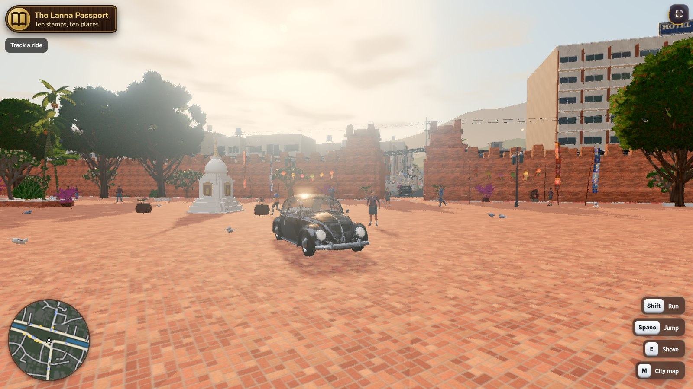
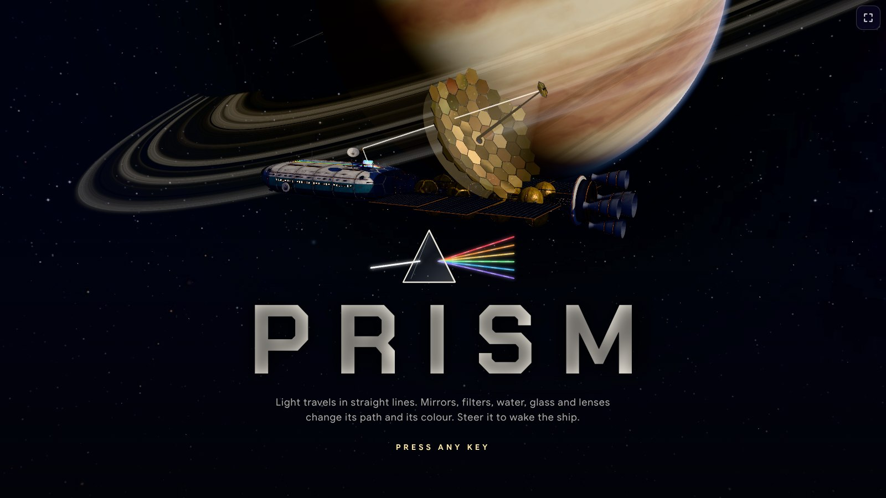

<p align="center">
<a href="README.md">English</a> · <a href="README.fr.md">Français</a> · <a href="README.es.md">Español</a> · <a href="README.de.md">Deutsch</a> · <a href="README.it.md">Italiano</a> · <a href="README.pt.md">Português</a> · <a href="README.pl.md">Polski</a> · <b>日本語</b> · <a href="README.ko.md">한국어</a> · <a href="README.zh.md">中文</a> · <a href="README.th.md">ไทย</a> · <a href="README.ar.md">العربية</a>
</p>

<div align="center">

# eラーニング エージェントスキル

**遊んで学び、作って稼ぐ。**

宿題をゲームに。授業をコースに。あなたの知識をコミュニティに。

Claude、ChatGPT、Gemini、Cursor など、あらゆる AI エージェントに MEXTY エコシステムでのものづくりを教えるスキル集です。
**EdVerse** の学習ゲーム、**Mextribe** のクリエイターコミュニティ、**MEXTY** のコースとラーニングパスを作れます。

[AI を接続する](https://mexty.ai/connect) · [EdVerse で遊ぶ](https://future.mexty.ai/edverse) · [料金](https://mexty.ai/pricing)

<p>
<a href="#組織の方へ作る割り当てる追跡する"></a>
&nbsp;&nbsp;&nbsp;<b>×</b>&nbsp;&nbsp;&nbsp;
<a href="https://future.mexty.ai/edverse"></a>
&nbsp;&nbsp;&nbsp;<b>×</b>&nbsp;&nbsp;&nbsp;
<a href="https://future.mexty.ai/mextribe"></a>
</p>

## MEXTY LMS × EdVerse × Mextribe

<table>
<tr>
<td width="33%" align="center"><a href="#組織の方へ作る割り当てる追跡する"></a><br><b>MEXTY LMS</b><br><sub>学校や企業のためのコース、ラーニングパス、進捗管理</sub></td>
<td width="33%" align="center"><a href="https://future.mexty.ai/edverse"></a><br><b>EdVerse</b><br><sub>4〜18歳向けの学習ゲーム。遊んで、作って、販売できます</sub></td>
<td width="33%" align="center"><a href="https://future.mexty.ai/mextribe"></a><br><b>Mextribe</b><br><sub>クリエイターから学び、あなたのトライブに教える</sub></td>
</tr>
</table>

<sub>アカウントひとつで、3つすべてを使えます。</sub>

</div>

---

## ひとつのエコシステム、3つの入り口

| | ご家庭向け | クリエイター向け | 組織向け |
|---|---|---|---|
| **対象** | 保護者、子ども、学生 | 先生、ゲーム制作者、AI のサブスクリプションをお持ちの方ならどなたでも | 学校、大学、研修事業者、中小企業 |
| **できること** | 学習ゲームで遊ぶ、宿題をゲームにする、お子さまの進み具合を見守る | ゲームやコースをひとりで、または仲間と作って販売し、自分の学習コミュニティを運営する | チームで研修を作り、メンバーに割り当て、誰が何を修了したかを確認する |
| **場所** | [EdVerse](https://future.mexty.ai/edverse) | EdVerse Studio と Mextribe | MEXTY ワークスペース：Authoring と LMS |
| **始める費用** | 無料 | 無料 | Authoring、Authoring + LMS、または Enterprise プラン |
| **詳しく読む** | [保護者の方](audiences/parents.md) | [ゲーム開発者の方](audiences/game-developers.md) | [企業の方](audiences/companies.md) · [大学・学校の方](audiences/universities-and-schools.md) |

## 各スキルの役割

| スキル | 内容 |
|---|---|
| [`mexty-start`](skills/mexty-start/SKILL.md) | あなたがどんな立場で何を必要としているかを把握し、まず無料の方法を選んで、適切なスキルに引き継ぎます |
| [`homework-to-game`](skills/homework-to-game/SKILL.md) | プリント、授業内容、復習リストを読み取り、遊ぶことがそのまま練習になるゲームを作ります |
| [`track-kid-progress`](skills/track-kid-progress/SKILL.md) | 保護者向け：お子さまが1週間または1か月に EdVerse で学んだことを、次に試すことを添えた短いレポートにまとめます |
| [`pick-games-for-my-kid`](skills/pick-games-for-my-kid/SKILL.md) | 年齢、教科、言語に合わせてゲームを選び、無理のない習慣と利用時間の設定を整えます |
| [`learning-game-design`](skills/learning-game-design/SKILL.md) | コードを書く前にゲームを設計します。身につける力、ゲームループ、レベル構成を1ページにまとめます |
| [`edverse-game-qa`](skills/edverse-game-qa/SKILL.md) | ストア審査の前に、11項目の EdVerse ゲーム要件に照らしてゲームを確認し、審査で差し戻された点を修正します |
| [`edverse-publish-and-earn`](skills/edverse-publish-and-earn/SKILL.md) | 掲載、価格設定、申請、そして提案ボックスと統計を使ったゲームの運営 |
| [`edverse-game-performance`](skills/edverse-game-performance/SKILL.md) | 3D ブラウザゲームを学校のタブレットでも動くようにします。予算管理、プロファイリング、WebGL と WebGPU |
| [`multiplayer-and-saves`](skills/multiplayer-and-saves/SKILL.md) | 進行状況の保存、ランキング、実績、リアルタイムプレイを、子どもにとって安全な形で実装します |
| [`free-creative-toolkit`](skills/free-creative-toolkit/SKILL.md) | 有料の生成に頼る前に：3D にはヘッドレスの Blender、字幕には Whisper、動画には Opuscar のフィルムスタイル、そしてストック素材 |
| [`curriculum-to-learning-path`](skills/curriculum-to-learning-path/SKILL.md) | シラバスや学習目標の一覧を、目標ごとに1コースのラーニングパスに変えます |
| [`ai-literacy-curriculum`](skills/ai-literacy-curriculum/SKILL.md) | 児童・生徒・学生向けの年齢別 AI リテラシー。教育機関が採用しているフレームワークに沿って作ります |
| [`assessment-design`](skills/assessment-design/SKILL.md) | 公平な評価：何を認定するのか、設計図、設問、配点、合格点 |
| [`mexty-courses-for-teams`](skills/mexty-courses-for-teams/SKILL.md) | 学校や企業向けのコース、アクティビティ、評価、ラーニングパス。シートと分析機能付き |
| [`onboarding-path`](skills/onboarding-path/SKILL.md) | 会社にある資料をもとに、職種ごとのオンボーディングパスを1日目から90日目まで作ります |
| [`compliance-course`](skills/compliance-course/SKILL.md) | 組織自身の規程から書き起こす、コンプライアンスコース1本とその確認テスト |
| [`keep-training-current`](skills/keep-training-current/SKILL.md) | 出典とひも付いた研修：変更時の下書き、レビュー、再認定、スケジュール実行のエージェント、コースから作る販売ページ |
| [`ai-literacy-at-work`](skills/ai-literacy-at-work/SKILL.md) | 職種別の従業員向け AI リテラシー。実際に使うツールと組織の AI ポリシーに合わせます |
| [`sales-enablement`](skills/sales-enablement/SKILL.md) | 製品資料をもとにした製品知識、ピッチ練習、反論への対応 |
| [`analytics-dashboards`](skills/analytics-dashboards/SKILL.md) | 学習に関するひとつの問いにライブデータで答える、カスタムダッシュボードを作ります |
| [`build-together`](skills/build-together/SKILL.md) | 共同執筆、下書き、レビュー、コメント、バージョン、マージ。ワークスペースでも EdVerse でも |
| [`mextribe-community`](skills/mextribe-community/SKILL.md) | 投稿、有料プラン、コメント、お知らせ、インサイト：ひとりで運営する学習コミュニティ |
| [`instagram-showcase`](skills/instagram-showcase/SKILL.md) | 作ったものから、リール、ストーリーズ、カルーセル、キャプションを作ります |

## 遊んで学び、作って稼ぐ

**遊んで学ぶ。** よくできた学習ゲームで遊ぶ子どもは、言われなくても自然にスキルを練習します。そして大人は、何を練習したのかを確認できます。

**作って稼ぐ。** ゲームを作る人が得るものは2つあります。ひとつは理解です。授業をゲームにするには、ゲームに説明できるほど内容をよく分かっていなければなりません。もうひとつはお金です。ストアに並んだゲームは販売することも、子どもたちが遊んだ時間に応じて収益を受け取ることもできます。

このスキル集があれば、ゲームを作ったことのない方でもその両方を実現できます。宿題の内容を伝えるだけで、AI があなたと一緒にゲームを作り、ストアの要件に照らして確認し、公開までお手伝いします。

## EdVerse で生まれたゲーム

<div align="center">

<a href="https://future.mexty.ai/edverse/play/6aec3b57c9fbf8c716737432"></a>

<sub><b><a href="https://future.mexty.ai/edverse/play/6aec3b57c9fbf8c716737432">Prism</a></b>：眠りについた宇宙船を、光線1本ずつ目覚めさせましょう。鏡、カラーフィルター、屈折、プリズム、レンズ。すべてが本物の光学に基づいています。法則を見つけ出せば、扉が開きます。理科、10〜18歳、無料。josephmaupas2 が EdVerse で制作。</sub>

</div>

ここに並ぶゲームはすべてストアで公開中で、無料で遊べます。クリックするとプレイできます。

<table>
<tr>
<td width="33%"><a href="https://future.mexty.ai/edverse/play/6ad4f323d2da4f44ae744019"></a><br><b><a href="https://future.mexty.ai/edverse/play/6ad4f323d2da4f44ae744019">Fraction Coaster</a></b><br><sub>ジェットコースターに乗って、正しい分数を撃ち抜こう。算数、7歳以上。</sub></td>
<td width="33%"><a href="https://future.mexty.ai/edverse/play/6ad8655c3b54b5603c79c1e4"></a><br><b><a href="https://future.mexty.ai/edverse/play/6ad8655c3b54b5603c79c1e4">Math Kitchen Rush</a></b><br><sub>数字が食材になる協力プレイのキッチン。算数、7歳以上。</sub></td>
<td width="33%"><a href="https://future.mexty.ai/edverse/play/6ad5d61286bc6e0a1c20a99d"></a><br><b><a href="https://future.mexty.ai/edverse/play/6ad5d61286bc6e0a1c20a99d">Turbo Gates</a></b><br><sub>正解のゲートを通り抜けて、ラップタイムを縮めよう。算数・数学、10〜15歳。</sub></td>
</tr>
<tr>
<td><a href="https://future.mexty.ai/edverse/play/6ad711bd87e1e3de99f9e2c8"></a><br><b><a href="https://future.mexty.ai/edverse/play/6ad711bd87e1e3de99f9e2c8">MathBot Siege</a></b><br><sub>正解が映っている画面を撃って、ロボットを停止させよう。算数、7〜12歳。</sub></td>
<td><a href="https://future.mexty.ai/edverse/play/6ae1d1c8b82eb1abf68a3fa6"></a><br><b><a href="https://future.mexty.ai/edverse/play/6ae1d1c8b82eb1abf68a3fa6">The Cartographers of the Fog</a></b><br><sub>霧の中の海戦で、マス目の座標と方位を練習しよう。算数、7〜12歳。制作：josephmaupas2。</sub></td>
<td><a href="https://future.mexty.ai/edverse/play/6ad9bb439c6bc47946fdc049"></a><br><b><a href="https://future.mexty.ai/edverse/play/6ad9bb439c6bc47946fdc049">Body Heroes</a></b><br><sub>3D の解剖学と手を動かす手術体験。学校の生物から医学部進学準備まで。からだと健康、13〜18歳。制作：nixht1。</sub></td>
</tr>
<tr>
<td><a href="https://future.mexty.ai/edverse/play/6aca37b57d7d7ac76d4cb78d"></a><br><b><a href="https://future.mexty.ai/edverse/play/6aca37b57d7d7ac76d4cb78d">Math Kingdom</a></b><br><sub>暗算があなたの軍勢の力になる、リアルタイムのトーナメント。算数・数学、7〜15歳。</sub></td>
<td><a href="https://future.mexty.ai/edverse/play/6ae00ca2d76841160f7bb1ee"></a><br><b><a href="https://future.mexty.ai/edverse/play/6ae00ca2d76841160f7bb1ee">Tick-Tock Town</a></b><br><sub>町の時計の針を回して、時刻を読もう。算数、7〜9歳。制作：josephmaupas2。</sub></td>
<td><a href="https://future.mexty.ai/edverse/play/6ae0544fb82eb1abf68a0b0b"></a><br><b><a href="https://future.mexty.ai/edverse/play/6ae0544fb82eb1abf68a0b0b">Robot Matrix</a></b><br><sub>ベクトルと行列でロボットを動かし、宇宙ステーションに明かりを灯そう。数学とプログラミング、16〜18歳。</sub></td>
</tr>
</table>

<details>
<summary>Prism をもっと見る</summary>
<br>
<table><tr>
<td></td>
<td></td>
<td></td>
</tr></table>
</details>

## 保護者の方へ：安心できる場所と、成長を見守る方法

**ストアのルールで守られた安全。** すべてのゲームは掲載前に同じ要件でテストされます。まず作者が、次に MEXTY の審査担当者が確認します。EdVerse のゲームには次の特徴があります。

- 広告、チャット、ゲーム外へのリンク、購入ボタン、登録を求める画面はありません。
- お子さまの名前、メールアドレス、写真、位置情報を求めることはなく、トラッカーもありません。
- 暴力的な表現、怖い表現、からかうような表現はなく、遊び続けることや支払いを迫る仕掛けもありません。
- 間違えたときもやさしく対応し、音はミュートできます。
- ワンタップで使える通報ボタンがあり、MEXTY のスタッフが対応します。

**学んだことを見守る。** EdVerse では、大人がお子さま一人ひとりを学習者として追加すると、それぞれのダッシュボードが用意されます。

| 見られる項目 | 分かること | |
|---|---|---|
| プレイ時間、遊んだゲーム数、利用した日数 | どれくらい、どの程度こまめに取り組んでいるか | 無料 |
| 遊んでいる時間帯 | 朝、放課後、夜のいつか | 無料 |
| 身についたスキル | 安定して正解できていること | 学習者シート |
| 練習が必要なスキル | 正答率が60%未満のスキル | 学習者シート |
| 教科と各ゲームの進み具合 | 時間をどこに使っているか | 学習者シート |

学習者シートはお子さま1人につき月額 €5 から。★ Included（シートに含まれる）のゲームもすべて遊べるようになります。

<table>
<tr>
<td width="64%"><br><sub><b>あなたのダッシュボード。</b> 学習者ごとのプレイ時間、遊んだゲーム数、身についたスキル、利用した日数を、7日間または30日間で表示します。</sub></td>
<td width="36%"><br><sub><b>あなたの設定。</b> 年齢層、1日の上限、休止時間、表示するゲーム。アカウントに保存され、すべての端末に適用されます。</sub></td>
</tr>
</table>

<sub>デモ用の学習者で表示しています。</sub>

**決めるのはあなたです。** 1日の利用時間の上限と、ゲームをしない時間帯を設定できます。どちらもすべての端末に適用されます。お子さまに支払い画面が表示されることはありません。価格を見て、まずあなたに相談する仕組みです。AI アシスタントがお子さまのプロフィールや進み具合を見ることはできません。

**レポートは AI に頼めます。** 「ミアは今月何を学んだ？ 次は何を練習するといい？」 [`track-kid-progress`](skills/track-kid-progress/SKILL.md) を使えば、AI が学習者シートを持つお子さまの学習レポートを読み、次に試すゲームをひとつ添えて分かりやすい言葉でまとめます。ご希望なら毎週でも毎月でも。

**そして、宿題そのものが悩みの種なら。** プリントを AI に渡せば、お子さまが今夜遊べるゲームができあがります。[`homework-to-game`](skills/homework-to-game/SKILL.md) をお使いください。

## クリエイターの方へ：作る、出品する、耳を傾ける、稼ぐ

AI のサブスクリプションがひとつあれば、ひとりですべての流れを回せます。制作は無料です。MCP ツールは MEXTY クレジットを消費しません。

1. **作る**：よく知っている授業内容からゲームを作ります（[`homework-to-game`](skills/homework-to-game/SKILL.md)）。
2. **審査を通す**：11項目の EdVerse ゲーム要件を満たします（[`edverse-game-qa`](skills/edverse-game-qa/SKILL.md)）。
3. **出品する**：無料、固定価格、自由価格、または学習者シートを持つ家庭や学校向けの ★ Included から選べます（[`edverse-publish-and-earn`](skills/edverse-publish-and-earn/SKILL.md)）。
4. **耳を傾ける**：プレイヤーがゲームの提案ボックスにアイデアを送ります。採用したものが、そのゲームの公開ロードマップになります。
5. **集める**：Mextribe に投稿し、フォロワーがもっと求めてきたら有料プランを追加します（[`mextribe-community`](skills/mextribe-community/SKILL.md)）。
6. **見せる**：何かを公開するたびに、リール、ストーリーズ、カルーセルを作ります（[`instagram-showcase`](skills/instagram-showcase/SKILL.md)）。

ゲームの売上はカード手数料を差し引いた後の80%が、Mextribe のメンバーシップもカード手数料を差し引いた後の80%が、あなたの取り分です。

### EdVerse エディター

すべてのゲームは、ブラウザ上のライブ 3D エディターで開きます。あなたも、共同制作者も、AI アシスタントも、同じワールドで同時に制作できます。作りたいものを言葉で伝えて現れるのを見守ることも、自分の手で動かすこともできます。上部のバーでは、表示・プレイ・編集の切り替え、スマートフォン・タブレット・デスクトップのプレビュー、履歴の表示、アシスタントの呼び出しができます。


<sub><b>Floodline。</b> 水没していく街の屋根を駆け抜ける一人称視点のパルクールゲーム。一次関数と変化の割合が、残り時間を教えてくれます。数学、13〜15歳。</sub>

<table>
<tr>
<td width="50%"><br><sub><b>Songthaew Rush.</b> OpenStreetMap から再現したチェンマイ。ターペー門の前に停まる黒いビートル、グラフィックは Ultra 設定です。</sub></td>
<td width="50%"><br><sub><b>Prism.</b> オープニングシーン。眠る宇宙船と、唯一の道具である光。</sub></td>
</tr>
</table>

<sub>Floodline はエディター上、Songthaew Rush と Prism はプレイ中の画面です。</sub>

## Mextribe：クリエイターから学び、あなたのトライブに教える

Mextribe は、このエコシステムのソーシャルな一面です。クリエイターは自分の作品を投稿します。コース、ラーニングパス、インタラクティブなアクティビティ、動画、EdVerse のゲームなどです。学習者は無料でフォローでき、それ以外のコンテンツは購読して楽しめます。利用は、クリエイターも学習者も無料です。

<a href="https://future.mexty.ai/mextribe/explore"></a>

<sub><b>探す。</b> おすすめ、トレンド、新着クリエイター、無料、ゲーム。アカウントがなくても誰でも閲覧できます。</sub>

<table>
<tr>
<td width="50%"><a href="https://future.mexty.ai/mextribe/@fabien.sabati"></a><br><sub><b>クリエイターのページ。</b> 投稿、フォロワー、メンバー。シリーズ。クリエイターが並べ替えてピン留めできるグリッド。コース、パス、動画、アクティビティ、ゲームのタブ。</sub></td>
<td width="50%"><br><sub><b>投稿。</b> アクティビティはその場で遊べます。いいね、コメント、シェア、保存。進捗と修了証は学習者の MEXTY アカウントに記録されます。</sub></td>
</tr>
</table>

| 学習者の方 | クリエイターの方 |
|---|---|
| クリエイターを無料でフォロー | MEXTY や EdVerse で作ったものなら何でも投稿でき、動画や写真も投稿できます |
| コース、アクティビティ、ゲームをその場でプレイ | 無料投稿、メンバー限定投稿、または投稿単体での販売 |
| クリエイターのプランを購読して、ライブラリ全体を利用 | Patreon のような有料プラン：カード手数料を差し引いた後の80%があなたの取り分で、毎月支払われます |
| コメントや質問ができる | コメントに返信し、良いものはピン留めし、それ以外は保留または非表示にできます |
| すべての投稿に対象年齢を明記 | フォロワーやメンバーにお知らせやアンケートを送れます |
| | インサイト：フォロワー、メンバー、収益、学習者が離脱した箇所 |

**設計段階から安全。** ダイレクトメッセージはありません。すべての投稿は対象年齢を明示します。クリエイターが18歳未満に向けて初めて投稿する際は、公開前に MEXTY が審査します。別の場所で話そうと誘うコメントや個人情報を求めるコメントは保留されます。18歳未満の学習者は、クリエイターには名前（ファーストネーム）とイニシャルのみで表示されます。

**AI から運営できます。** 「化学のコースを13〜17歳向けに投稿して。レッスン1は無料、残りはメンバー限定で。」「返信待ちのコメントを見せて、やさしい返信を下書きして。」「今月、いちばん多くメンバーを呼び込んだ投稿はどれ？」 すべての投稿は下書きから始まり、あなたの承認なしに公開、価格設定、送信されることはありません。[`mextribe-community`](skills/mextribe-community/SKILL.md) をご覧ください。リンク、QR コード、ストーリーズ用カード、キャプションが揃うシェアキットについては [`instagram-showcase`](skills/instagram-showcase/SKILL.md) をご覧ください。

## 組織の方へ：作る、割り当てる、追跡する

MEXTY はオーサリングツールであり LMS でもあります。別々にも、まとめてもご購入いただけます。MEXTY MCP を使えば、お使いの AI アシスタントがワークスペースの中で直接制作します。コース、インタラクティブなアクティビティ、評価、そしてラーニングパス全体を、組織の資料や規程から作り上げます。

<table>
<tr>
<td width="50%"><br><sub><b>作る。</b> ラーニングパスは、順番に解放される番号付きセルのグリッドです。ひとつのセルに複数の項目を入れ、すべて必須にすることも、どれかひとつでよいことにもできます。ご自身で編集することも、AI に構成全体を任せることもできます。</sub></td>
<td width="50%"><br><sub><b>追跡する。</b> コースごとの学習者数、修了率、スコア、所要時間と、学習者一人ひとりの進捗。</sub></td>
</tr>
</table>

| あなたは | 得られるもの |
|---|---|
| **学校・大学** | カリキュラムをラーニングパスに。修了証付きの評価、学習者ロール、学生ごとの進捗 |
| **研修事業者** | 顧客がすでに使っている LMS 向けに、HTML や SCORM で書き出せるコース |
| **企業** | 自社の資料から作るオンボーディング、コンプライアンス、製品研修。チーム向けのシートとロール。誰が何を修了したかの把握 |

- **ロールとシート**：クリエイターと学習者を招待できます。各自ができることはロールで決まります。
- **独自のダッシュボード**：標準の分析に加えて、あなたの問いにライブデータで答えるダッシュボードを作れます。週ごとのオンボーディング修了数、まもなく期限が切れる修了証、クラスが間違えやすい設問など。ロール、チーム、または特定の1人と共有できます（[`analytics-dashboards`](skills/analytics-dashboards/SKILL.md)）。
- **組織の外へも届ける**：コースを Mextribe に投稿したり、ゲームとして成立するアクティビティを EdVerse に出品したりできます。

MEXTY MCP は **Authoring**、**Authoring + LMS**、**Enterprise** に含まれます。学習者へのコンテンツの割り当てと進捗の追跡には LMS が必要です。まずは [`mexty-courses-for-teams`](skills/mexty-courses-for-teams/SKILL.md) から始めてください。価格は[料金ページ](https://mexty.ai/pricing)に掲載しています。

## コンプライアンスと、自ら最新に保たれる研修

コンプライアンス研修は、気づかないうちに古くなります。規程は変わるのに、コースは変わらないからです。MEXTY では、コースに出典、バージョン、責任者があり、AI エージェントがあなたに代わって出典を見張ります。

| タイミング | 起こること |
|---|---|
| 規程、法律、製品資料が変更されたとき | エージェントが新しいバージョンを読み、それを引用しているコースを見つけて変更案を下書きします。それ以上のことはしません |
| 学習者の目に触れる前 | コースの責任者が下書きをレビューし、受講登録者と認定取得者を確認したうえで、公開するか、規程の施行日に合わせて公開を予約します |
| 重要な変更の後 | 旧バージョンの修了証を持つ人を確認し、変更された部分だけを再度割り当てます |
| 毎週、スケジュールどおりに | レポート：何が変わったか、どの下書きが待機中か、誰の修了証がまもなく失効するか |
| 新しいコースが公開されたとき | エージェントが、組織の外に向けて販売するためのランディングページとオファーを下書きできます |

データ保護、セキュリティ、安全衛生、行動規範、AI リテラシー、製品研修に対応します。人の承認なしに公開、認定、販売されるものはありません。[`keep-training-current`](skills/keep-training-current/SKILL.md) をご覧ください。

## 一緒に作る

コースもゲームも、ひとりで完結する仕事ではありません。だからどちらの製品も、共同作業を前提に作られています。学習者やプレイヤーが目にするのは、公開またはマージされたものだけです。

| | MEXTY ワークスペース | EdVerse |
|---|---|---|
| **並んで作業する** | コース、アクティビティ、評価、ラーニングパスの共同執筆者 | 複数の人とその AI アシスタントが、同じライブ 3D エディターと同じコードで作業。編集はマージされ、ロックされるものはありません |
| **安全に試す** | 下書き：公開中のバージョンとは別に、試している変更を置けます | ゲームのワールドとコードの下書き。共有リンクから参加した人は誰でも下書きの中で作業します |
| **レビューする** | レビュー担当者を指名し、内容にコメントし、変更点とその影響を受ける人を確認して、承認または差し戻し | 変更点をオブジェクト単位、ファイル単位で確認。オーナーまたはメンテナーがマージします |
| **リリースする** | 今すぐ公開、または公開を予約 | ゲームにマージ。審査後、ストアで新しいバージョンが遊べるようになります |
| **元に戻す** | バージョン履歴：比較して、任意のバージョンを下書きとして復元 | 下書きは閉じることができ、競合は左右に並べて選べます |
| **クレジット** | 共同執筆者の名前が表示されます | マージされた作業の作者はクレジットされ、ゲームが学習者プールから得た収益の分配を受けます |

この方法なら、クラス全員でひとつのゲームを作れます。先生がオーナーとなり、各グループがそれぞれの下書きで作業し、マージの前にクラスでひとつずつレビューします。[`build-together`](skills/build-together/SKILL.md) をご覧ください。

## 無料でできること、プランが必要なこと

| | EdVerse | Mextribe | MEXTY |
|---|---|---|---|
| **概要** | 4〜18歳向け学習ゲームのストアとスタジオ | クリエイターの有料プランがある、学びのソーシャルネットワーク | 組織向けの AI オーサリングと LMS |
| **AI と一緒に使う** | **無料** | **無料** | **Authoring**、**Authoring + LMS**、または **Enterprise** プラン |
| **収益の得かた** | ゲームを固定価格または自由価格で販売する、プレイ時間に応じて学習者プールから支払いを受ける（★ Included）、または共同制作を受け付けているゲームを改良し、下書きがマージされたらプール収益の分配を受ける | 有料メンバーシッププランと単品販売 | — |
| **あなたの取り分** | 各売上の80%（カード手数料差し引き後） | 80%（カード手数料差し引き後） | — |

MCP ツールは MEXTY クレジットを消費しません。考える部分は、あなた自身の AI サブスクリプションが担います。クレジットを消費するのはメディア生成（画像、音声、3D モデル、文字起こし）だけで、[`free-creative-toolkit`](skills/free-creative-toolkit/SKILL.md) がそれぞれを無料で行う方法を紹介しています。

## 他の作者によるスキルも同梱

ゲーム制作はそれ自体がひとつの専門技術です。そのためこのリポジトリには、他の方が書いたスキルも、内容を変更せず、それぞれのライセンスのまま収録しています。出典とライセンスは [`THIRD_PARTY.md`](THIRD_PARTY.md) に記載しています。

| フォルダ | 内容 | 提供元 |
|---|---|---|
| [`third-party/gamedev`](third-party/gamedev) | 18のスキル：ゲームの手触り、レベルデザイン、ゲーム UI、オーディオ、カメラ、入力、セーブ、パフォーマンス、アセットパイプライン、高速プロトタイピング、three.js のセットアップ、glTF とライティング、そしてパズル、プラットフォーマー、シューティング、カードゲーム、ロールプレイングゲームのプレイブック | [awesome-gamedev-agent-skills](https://github.com/gamedev-skills/awesome-gamedev-agent-skills)、Apache 2.0 |
| [`third-party/webgpu-threejs-tsl`](third-party/webgpu-threejs-tsl) | three.js の WebGPU レンダラーと TSL：ノードマテリアル、コンピュートシェーダー、ポストプロセス、デバイスロスト | [webgpu-claude-skill](https://github.com/dgreenheck/webgpu-claude-skill)、MIT |

あわせておすすめするスキル（それぞれの配布元からインストールしてください）：モーショングラフィックスには [bang-motion](https://github.com/bangtutorial/bang-motion)、ポスターやカルーセルには [canvas-design](https://github.com/anthropics/skills/tree/main/skills/canvas-design)、そして [Lemo-Opuscar](https://github.com/lemomo-ai/lemo-opuscar) のフィルムスタイル。

## 宿題からストアのゲームへ

```
 宿題 ──► homework-to-game ──► edverse-game-qa ──► edverse-publish-and-earn ──► instagram-showcase
 (プリント、   仕組みを選び、       ストアの11要件。     価格設定、申請、              リール、
  授業内容)    テンプレートから     テストプレイは       提案ボックス、                ストーリーズ、
               制作                 あなた自身で         週ごとのサイクル              カルーセル
```

すべてのゲームは、同じ要件で2回テストされます。Studio で実際にプレイするあなたと、MEXTY の審査担当者によってです。AI があなたの代わりにそのテストを受けることはできません。でも、あなたが合格できるように支えることはできます。

## インストール

**1. MCP サーバーを接続します。** [mexty.ai/connect](https://mexty.ai/connect) から接続できます（Claude、ChatGPT、Cursor、VS Code、Gemini CLI、Codex など）。Claude Code の場合：

```bash
claude mcp add --transport http edverse  https://mcp.mexty.ai/mcp/edverse
claude mcp add --transport http mextribe https://mcp.mexty.ai/mcp/mextribe
claude mcp add --transport http mexty    https://mcp.mexty.ai/mcp/mexty
```

**2. スキルを追加します。**

Claude Code にプラグインとして追加する場合：

```
/plugin marketplace add mext-ai/elearning-agent-skills
/plugin install elearning-agent-skills@mexty
```

または、必要なフォルダをコピーします。

```bash
git clone https://github.com/mext-ai/elearning-agent-skills
cp -r elearning-agent-skills/skills/* ~/.claude/skills/
cp -r elearning-agent-skills/third-party/gamedev/* ~/.claude/skills/          # 任意
cp -r elearning-agent-skills/third-party/webgpu-threejs-tsl ~/.claude/skills/ # 任意
```

Claude.ai：スキルのフォルダを zip にまとめ、Settings → Capabilities → Skills（設定 → 機能 → スキル）からアップロードします。その他のエージェント：各スキルは Markdown ファイル1つです。必要な `SKILL.md` をエージェントに読み込ませてください。

**3. やりたいことを伝えます。**

> これは娘の分数のプリントです。タブレットで遊べるゲームにしてください。

> 息子は今月 EdVerse で何を学びましたか？ 次は何を練習するとよいでしょうか？

> 私のゲームは EdVerse の審査を受けられる状態ですか？

> 公開中のゲームに届いた提案を読んで、今週何を作るべきか教えてください。

> 毎週月曜日に、分数のレベルを必要としている共同制作ゲームを見つけて、下書きで作り、オーナーにレビューを依頼してください。

> 当社のデータプライバシーポリシーを、クイズ付きの10分間のオンボーディングコースにして、新入社員に割り当ててください。

---

<div align="center">
<sub>提供：<a href="https://mexty.ai">MEXTY</a>。ゲームのアートは各ゲームのクリエイターに帰属します。サードパーティのスキルはそれぞれの作者に帰属します。<a href="THIRD_PARTY.md">THIRD_PARTY.md</a> をご覧ください。</sub>
</div>
