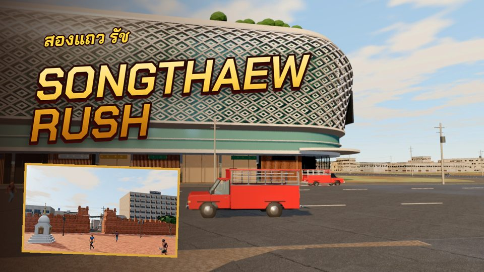
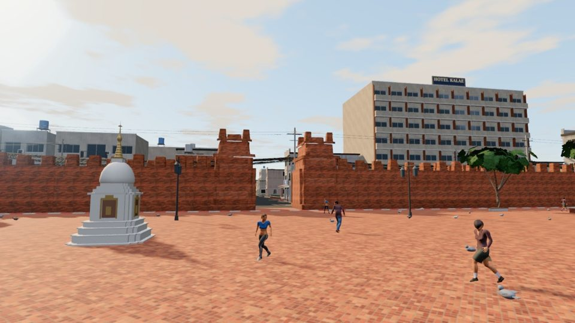
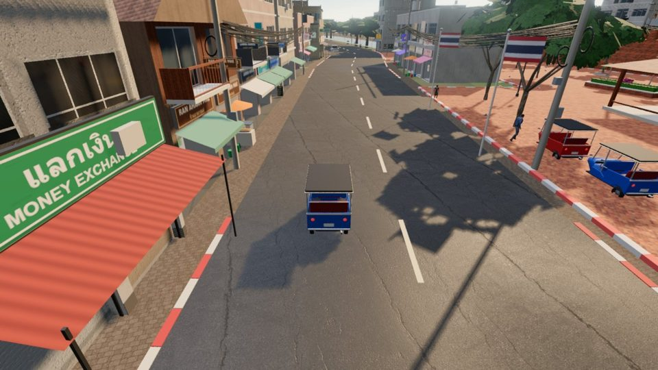

<div align="center">

# E-learning agent skills

**Turn homework into games. Turn lessons into courses. Turn what you know into a community.**

Skills that teach Claude, ChatGPT, Gemini, Cursor or any AI agent to build on the MEXTY ecosystem:
learning games on **EdVerse**, creator communities on **Mextribe**, courses and learning paths on **MEXTY**.

[Connect your AI](https://mexty.ai/connect) · [EdVerse](https://mexty.ai/edverse) · [Pricing](https://mexty.ai/pricing)



<sub><b>Songthaew Rush</b>: drive a red songthaew through Chiang Mai, rebuilt from OpenStreetMap, and learn how the city fits together. Geography, ages 16–18. Built with the EdVerse MCP. Coming soon to the store.</sub>

</div>

---

## Play to learn. Build to learn.

A child who plays a good learning game practises a skill without being asked to. A student who *builds* one has to understand the lesson well enough to explain it to a game. Both are learning; the second one sticks longer.

These skills make both possible for someone who has never made a game: describe the homework, and your AI builds the game with you, checks it against the store's requirements, and helps you publish it.

## Made on EdVerse

Every game below is live on the EdVerse store and free to play.

<table>
<tr>
<td width="33%"><br><b>Fraction Coaster</b><br><sub>Ride a roller coaster and splat the right fraction. Math, ages 7+.</sub></td>
<td width="33%"><br><b>Math Kitchen Rush</b><br><sub>A co-op kitchen where numbers are the ingredients. Math, ages 7+.</sub></td>
<td width="33%"><br><b>Turbo Gates</b><br><sub>Steer through the gate with the right answer to cut your lap time. Math, ages 10–15.</sub></td>
</tr>
<tr>
<td><br><b>MathBot Siege</b><br><sub>Shoot the screen showing the right answer to power the robot down. Math, ages 7–12.</sub></td>
<td><br><b>Prism</b><br><sub>Wake a sleeping starship with real optics: mirrors, filters, lenses. Science, ages 10–18. By josephmaupas2.</sub></td>
<td><br><b>Body Heroes</b><br><sub>3D anatomy and hands-on surgery, from school biology to pre-med. Body &amp; health, ages 13–18. By nixht1.</sub></td>
</tr>
<tr>
<td><br><b>Math Kingdom</b><br><sub>Mental math powers your army in a real-time tournament. Math, ages 7–15.</sub></td>
<td><br><b>Tick-Tock Town</b><br><sub>Turn the hands of the town clock to tell the time. Math, ages 7–9. By josephmaupas2.</sub></td>
<td><br><b>Robot Matrix</b><br><sub>Move robots with vectors and matrices to light a space station. Math and coding, ages 16–18.</sub></td>
</tr>
</table>

<details>
<summary>More from Songthaew Rush</summary>
<br>
<table><tr>
<td></td>
<td></td>
<td></td>
</tr></table>
</details>

## Who it is for

| You are | You want to | Start with |
|---|---|---|
| A **student** | Turn tonight's homework into a game you would actually play | [`homework-to-game`](skills/homework-to-game/SKILL.md) |
| A **parent** | Help your child practise one topic | [`homework-to-game`](skills/homework-to-game/SKILL.md) |
| A **teacher** | Make a game for your class, and share or sell it | [`homework-to-game`](skills/homework-to-game/SKILL.md) → [`edverse-publish-and-earn`](skills/edverse-publish-and-earn/SKILL.md) |
| A **game creator** | Build, polish and sell learning games | [`edverse-game-performance`](skills/edverse-game-performance/SKILL.md) → [`edverse-game-qa`](skills/edverse-game-qa/SKILL.md) |
| Someone with an **AI subscription** | Earn from it | [`edverse-publish-and-earn`](skills/edverse-publish-and-earn/SKILL.md), [`mextribe-community`](skills/mextribe-community/SKILL.md) |
| A **school, university or company** | Build and distribute training | [`mexty-courses-for-teams`](skills/mexty-courses-for-teams/SKILL.md) |

Not sure? [`mexty-start`](skills/mexty-start/SKILL.md) asks what you want and sends you to the right place.

## What is free, and what needs a plan

| | EdVerse | Mextribe | MEXTY |
|---|---|---|---|
| **What it is** | Store and studio for learning games, ages 4–18 | Social network for learning, with paid creator plans | AI authoring and LMS for organisations |
| **Using it with your AI** | **Free** | **Free** | **Authoring**, **Authoring + LMS** or **Enterprise** plan |
| **How you earn** | Sell a game at a fixed price or pay what you want, or get paid from the learner pool by minutes played (★ Included) | Paid membership plans and single sales | — |

The MCP tools spend no MEXTY credits: your own AI subscription does the thinking. Only media generation (images, voices, 3D models, transcription) spends credits, and [`free-creative-toolkit`](skills/free-creative-toolkit/SKILL.md) shows the free way to do each one.

## The skills

| Skill | What it does |
|---|---|
| [`mexty-start`](skills/mexty-start/SKILL.md) | Works out who you are and what you need, picks the free route first, hands over to the right skill |
| [`homework-to-game`](skills/homework-to-game/SKILL.md) | Reads a worksheet, lesson or revision list and builds a game where playing is the practising |
| [`edverse-game-qa`](skills/edverse-game-qa/SKILL.md) | Checks a game against the 11 EdVerse Game Requirements before the store review, and fixes what a review sent back |
| [`edverse-publish-and-earn`](skills/edverse-publish-and-earn/SKILL.md) | Listing, pricing, submitting, and running a game with the Suggestion box and the stats |
| [`edverse-game-performance`](skills/edverse-game-performance/SKILL.md) | Makes a 3D browser game run on a school tablet: budgets, profiling, WebGL and WebGPU |
| [`free-creative-toolkit`](skills/free-creative-toolkit/SKILL.md) | Headless Blender for 3D, Whisper for subtitles, Opuscar film styles for video, stock media, before any paid generation |
| [`mextribe-community`](skills/mextribe-community/SKILL.md) | Posts, paid plans, comments, updates and insights: a learning community run by one person |
| [`mexty-courses-for-teams`](skills/mexty-courses-for-teams/SKILL.md) | Courses, activities, evaluations and learning paths for schools and companies, with seats and analytics |
| [`instagram-showcase`](skills/instagram-showcase/SKILL.md) | Reels, Stories, carousels and captions from what you made |

## From homework to a game on the store

```
 homework ──► homework-to-game ──► edverse-game-qa ──► edverse-publish-and-earn ──► instagram-showcase
 (a sheet,     pick a mechanic,     the 11 store        price, submit,               Reel, Story,
  a lesson)    build from a         requirements;       Suggestion box,              carousel
               template             you play the test   weekly loop
```

Every game is tested twice against the same requirements: by you, playing it in the Studio, and by a MEXTY reviewer. An AI cannot take that test for you. It can make sure you pass it.

## Run it by yourself

One person with one AI subscription can run the whole loop:

1. **Make** a game from a lesson you know well.
2. **List** it: free to build an audience, paid when it has hours of content.
3. **Listen**: players send ideas to the game's Suggestion box. Accept the good ones; they become the public roadmap.
4. **Gather**: post the game on Mextribe, add a paid plan when followers ask for more.
5. **Show**: share the kit on Instagram each time something ships.

## Install

**1. Connect the MCP servers** at [mexty.ai/connect](https://mexty.ai/connect) (Claude, ChatGPT, Cursor, VS Code, Gemini CLI, Codex and others). In Claude Code:

```bash
claude mcp add --transport http edverse https://mcp.mexty.ai/mcp/edverse
claude mcp add --transport http mexty   https://mcp.mexty.ai/mcp/mexty
```

**2. Add the skills.**

Claude Code, as a plugin:

```
/plugin marketplace add fabien-sabatie-mexty/elearning-agent-skills
/plugin install elearning-agent-skills@mexty
```

Or copy the folders you want:

```bash
git clone https://github.com/fabien-sabatie-mexty/elearning-agent-skills
cp -r elearning-agent-skills/skills/* ~/.claude/skills/
```

Claude.ai: zip a skill folder and upload it under Settings → Capabilities → Skills. Other agents: each skill is one Markdown file; point your agent at the `SKILL.md` you need.

**3. Say what you want.**

> Here is my daughter's fractions worksheet. Turn it into a game she can play on the tablet.

> Is my game ready for the EdVerse review?

> Read the suggestions on my live games and tell me what to build this week.

## Safe for children

Games on EdVerse are for ages 4 to 18. The skills hold to the store's rules: nothing scary or pressuring, no links out, no chat, no ads, and never a request for a child's name, photo or location.

---

<div align="center">
<sub>By <a href="https://mexty.ai">MEXTY</a>. Game art belongs to each game's creator.</sub>
</div>
