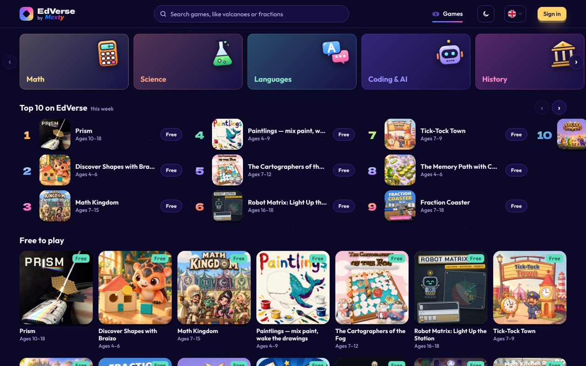

<div align="center">

# E-learning agent skills

**Turn homework into games. Turn lessons into courses. Turn what you know into a community.**

Skills that teach Claude, ChatGPT, Gemini, Cursor or any AI agent to build on the MEXTY ecosystem:
learning games on **EdVerse**, creator communities on **Mextribe**, courses and learning paths on **MEXTY**.

[Connect your AI](https://mexty.ai/connect) · [Play on EdVerse](https://future.mexty.ai/edverse) · [Pricing](https://mexty.ai/pricing)

<a href="https://future.mexty.ai/edverse/play/6aec3b57c9fbf8c716737432"></a>

<sub><b><a href="https://future.mexty.ai/edverse/play/6aec3b57c9fbf8c716737432">Prism</a></b>: wake a sleeping starship one beam at a time. Mirrors, colour filters, refraction, prisms and lenses, all on real optics: you work out the rule, and the door opens. Science, ages 10–18, free. Made on EdVerse by josephmaupas2.</sub>

</div>

---

## One ecosystem, three ways in

| | For families | For creators | For organisations |
|---|---|---|---|
| **Who** | Parents, children, students | Teachers, game makers, anyone with an AI subscription | Schools, universities, training providers, small and mid-size companies |
| **What you do** | Play learning games, turn homework into a game, follow your child's progress | Build games and courses, sell them, run your own learning community | Build training, assign it to your people, see who completed what |
| **Where** | [EdVerse](https://future.mexty.ai/edverse) | EdVerse Studio and Mextribe | The MEXTY workspace: Authoring and LMS |
| **Cost to start** | Free | Free | Authoring, Authoring + LMS or Enterprise plan |
| **Read more** | [For parents](#for-parents-a-safe-place-and-a-way-to-follow-progress) | [For creators](#for-creators-make-list-listen-earn) | [For organisations](#for-organisations-build-assign-track) |

## Play to learn. Build to learn.

A child who plays a good learning game practises a skill without being asked to. A student who *builds* one has to understand the lesson well enough to explain it to a game. Both are learning; the second one sticks longer.

These skills make both possible for someone who has never made a game: describe the homework, and your AI builds the game with you, checks it against the store's requirements, and helps you publish it.

## Made on EdVerse

<a href="https://future.mexty.ai/edverse"></a>

Every game here is live on the store and free to play. Click one to play it.

<table>
<tr>
<td width="33%"><a href="https://future.mexty.ai/edverse/play/6ad4f323d2da4f44ae744019"></a><br><b><a href="https://future.mexty.ai/edverse/play/6ad4f323d2da4f44ae744019">Fraction Coaster</a></b><br><sub>Ride a roller coaster and splat the right fraction. Math, ages 7+.</sub></td>
<td width="33%"><a href="https://future.mexty.ai/edverse/play/6ad8655c3b54b5603c79c1e4"></a><br><b><a href="https://future.mexty.ai/edverse/play/6ad8655c3b54b5603c79c1e4">Math Kitchen Rush</a></b><br><sub>A co-op kitchen where numbers are the ingredients. Math, ages 7+.</sub></td>
<td width="33%"><a href="https://future.mexty.ai/edverse/play/6ad5d61286bc6e0a1c20a99d"></a><br><b><a href="https://future.mexty.ai/edverse/play/6ad5d61286bc6e0a1c20a99d">Turbo Gates</a></b><br><sub>Steer through the gate with the right answer to cut your lap time. Math, ages 10–15.</sub></td>
</tr>
<tr>
<td><a href="https://future.mexty.ai/edverse/play/6ad711bd87e1e3de99f9e2c8"></a><br><b><a href="https://future.mexty.ai/edverse/play/6ad711bd87e1e3de99f9e2c8">MathBot Siege</a></b><br><sub>Shoot the screen showing the right answer to power the robot down. Math, ages 7–12.</sub></td>
<td><a href="https://future.mexty.ai/edverse/play/6ae1d1c8b82eb1abf68a3fa6"></a><br><b><a href="https://future.mexty.ai/edverse/play/6ae1d1c8b82eb1abf68a3fa6">The Cartographers of the Fog</a></b><br><sub>A sea battle in the fog to practise grid coordinates and compass directions. Math, ages 7–12. By josephmaupas2.</sub></td>
<td><a href="https://future.mexty.ai/edverse/play/6ad9bb439c6bc47946fdc049"></a><br><b><a href="https://future.mexty.ai/edverse/play/6ad9bb439c6bc47946fdc049">Body Heroes</a></b><br><sub>3D anatomy and hands-on surgery, from school biology to pre-med. Body &amp; health, ages 13–18. By nixht1.</sub></td>
</tr>
<tr>
<td><a href="https://future.mexty.ai/edverse/play/6aca37b57d7d7ac76d4cb78d"></a><br><b><a href="https://future.mexty.ai/edverse/play/6aca37b57d7d7ac76d4cb78d">Math Kingdom</a></b><br><sub>Mental math powers your army in a real-time tournament. Math, ages 7–15.</sub></td>
<td><a href="https://future.mexty.ai/edverse/play/6ae00ca2d76841160f7bb1ee"></a><br><b><a href="https://future.mexty.ai/edverse/play/6ae00ca2d76841160f7bb1ee">Tick-Tock Town</a></b><br><sub>Turn the hands of the town clock to tell the time. Math, ages 7–9. By josephmaupas2.</sub></td>
<td><a href="https://future.mexty.ai/edverse/play/6ae0544fb82eb1abf68a0b0b"></a><br><b><a href="https://future.mexty.ai/edverse/play/6ae0544fb82eb1abf68a0b0b">Robot Matrix</a></b><br><sub>Move robots with vectors and matrices to light a space station. Math and coding, ages 16–18.</sub></td>
</tr>
</table>

<details>
<summary>More from Prism</summary>
<br>
<table><tr>
<td></td>
<td></td>
<td></td>
</tr></table>
</details>

## For parents: a safe place, and a way to follow progress

**Safe by the store's rules.** Every game is tested against the same requirements before it is listed, first by its author and then by a MEXTY reviewer. A game on EdVerse has:

- no ads, no chat, no links out of the game, no purchase buttons and no sign-up wall;
- no request for a child's name, email, photo or location, and no trackers;
- nothing violent, scary or mocking, and nothing that pressures a child to keep playing or to pay;
- kind handling of wrong answers, and sound that can be muted;
- a one-tap Report button, answered by MEXTY staff.

**Follow what they learn.** In EdVerse, a grown-up adds each child as a learner and gets a dashboard for them:

| You see | What it tells you |
|---|---|
| Play time and when they play | How much, and at what time of day |
| Skills mastered | What they answer right consistently |
| Needs practice | Skills answered right less than 60% of the time |
| Games they can see | You choose whether free games and paid games appear in their store |

**You stay in charge.** Set a daily time limit and hours with no games; both apply on every device. A child never sees a payment screen: they see the price and ask you first. AI assistants cannot see children's profiles or progress.

**And when the homework is the problem:** give your AI the worksheet and get a game your child can play tonight, with [`homework-to-game`](skills/homework-to-game/SKILL.md).

## For creators: make, list, listen, earn

One person with one AI subscription can run the whole loop. Building is free: the MCP tools spend no MEXTY credits.

1. **Make** a game from a lesson you know well ([`homework-to-game`](skills/homework-to-game/SKILL.md)).
2. **Pass the review** against the 11 EdVerse Game Requirements ([`edverse-game-qa`](skills/edverse-game-qa/SKILL.md)).
3. **List** it: free, fixed price, pay what you want, or ★ Included for families and schools with a learner seat ([`edverse-publish-and-earn`](skills/edverse-publish-and-earn/SKILL.md)).
4. **Listen**: players send ideas to the game's Suggestion box. The ones you accept become its public roadmap.
5. **Gather**: post it on Mextribe and add a paid plan when followers ask for more ([`mextribe-community`](skills/mextribe-community/SKILL.md)).
6. **Show**: a Reel, a Story and a carousel each time something ships ([`instagram-showcase`](skills/instagram-showcase/SKILL.md)).

You keep 80% of each game sale after the card fee, and 80% of Mextribe memberships after card fees.

## For organisations: build, assign, track

MEXTY is an authoring tool and an LMS, bought separately or together. With the MEXTY MCP, your own AI assistant builds inside your workspace: courses, interactive activities, evaluations and whole learning paths, from your documents and policies.

| You are | You get |
|---|---|
| A **school or university** | Curricula as learning paths, evaluations with certificates, learner roles, progress per student |
| A **training provider** | Courses that export to HTML and SCORM for the LMS your clients already have |
| A **company** | Onboarding, compliance and product training built from your own documents; seats and roles for your teams; who completed what |

- **Review before release**: work in a draft, ask a colleague to review, publish or schedule it.
- **Roles and seats**: invite creators and learners; roles decide what each person can do.
- **Reach beyond your walls**: post a course on Mextribe, or list an activity that works as a game on EdVerse.

The MEXTY MCP comes with **Authoring**, **Authoring + LMS** and **Enterprise**. Assigning content to learners and tracking them needs the LMS. Start with [`mexty-courses-for-teams`](skills/mexty-courses-for-teams/SKILL.md); prices are on the [pricing page](https://mexty.ai/pricing).

## What is free, and what needs a plan

| | EdVerse | Mextribe | MEXTY |
|---|---|---|---|
| **What it is** | Store and studio for learning games, ages 4–18 | Social network for learning, with paid creator plans | AI authoring and LMS for organisations |
| **Using it with your AI** | **Free** | **Free** | **Authoring**, **Authoring + LMS** or **Enterprise** plan |
| **How you earn** | Sell a game at a fixed price or pay what you want, or get paid from the learner pool by minutes played (★ Included) | Paid membership plans and single sales | — |
| **What you keep** | 80% of each sale after the card fee | 80% after card fees | — |

The MCP tools spend no MEXTY credits: your own AI subscription does the thinking. Only media generation (images, voices, 3D models, transcription) spends credits, and [`free-creative-toolkit`](skills/free-creative-toolkit/SKILL.md) shows the free way to do each one.

## The skills

| Skill | What it does |
|---|---|
| [`mexty-start`](skills/mexty-start/SKILL.md) | Works out who you are and what you need, picks the free route first, hands over to the right skill |
| [`homework-to-game`](skills/homework-to-game/SKILL.md) | Reads a worksheet, lesson or revision list and builds a game where playing is the practising |
| [`edverse-game-qa`](skills/edverse-game-qa/SKILL.md) | Checks a game against the 11 EdVerse Game Requirements before the store review, and fixes what a review sent back |
| [`edverse-publish-and-earn`](skills/edverse-publish-and-earn/SKILL.md) | Listing, pricing, submitting, and running a game with the Suggestion box and the stats |
| [`edverse-game-performance`](skills/edverse-game-performance/SKILL.md) | Makes a 3D browser game run on a school tablet: budgets, profiling, WebGL and WebGPU |
| [`free-creative-toolkit`](skills/free-creative-toolkit/SKILL.md) | Headless Blender for 3D, Whisper for subtitles, Opuscar film styles for video, stock media, before any paid generation |
| [`mextribe-community`](skills/mextribe-community/SKILL.md) | Posts, paid plans, comments, updates and insights: a learning community run by one person |
| [`mexty-courses-for-teams`](skills/mexty-courses-for-teams/SKILL.md) | Courses, activities, evaluations and learning paths for schools and companies, with seats and analytics |
| [`instagram-showcase`](skills/instagram-showcase/SKILL.md) | Reels, Stories, carousels and captions from what you made |

### Included from other authors

Game making is a craft of its own, so the repository also carries skills written by others, unchanged and under their own licences. Sources and licences are in [`THIRD_PARTY.md`](THIRD_PARTY.md).

| Folder | What is in it | By |
|---|---|---|
| [`third-party/gamedev`](third-party/gamedev) | 18 skills: game feel, level design, game UI, audio, cameras, input, saves, performance, asset pipeline, fast prototyping, three.js setup, glTF and lighting, and playbooks for puzzle, platformer, shooter, card and role-playing games | [awesome-gamedev-agent-skills](https://github.com/gamedev-skills/awesome-gamedev-agent-skills), Apache 2.0 |
| [`third-party/webgpu-threejs-tsl`](third-party/webgpu-threejs-tsl) | three.js WebGPU renderer and TSL: node materials, compute shaders, post-processing, device loss | [webgpu-claude-skill](https://github.com/dgreenheck/webgpu-claude-skill), MIT |

Recommended alongside, installed from their own sources: [bang-motion](https://github.com/bangtutorial/bang-motion) for motion graphics, [canvas-design](https://github.com/anthropics/skills/tree/main/skills/canvas-design) for posters and carousels, and the [Lemo-Opuscar](https://github.com/lemomo-ai/lemo-opuscar) film styles.

## From homework to a game on the store

```
 homework ──► homework-to-game ──► edverse-game-qa ──► edverse-publish-and-earn ──► instagram-showcase
 (a sheet,     pick a mechanic,     the 11 store        price, submit,               Reel, Story,
  a lesson)    build from a         requirements;       Suggestion box,              carousel
               template             you play the test   weekly loop
```

Every game is tested twice against the same requirements: by you, playing it in the Studio, and by a MEXTY reviewer. An AI cannot take that test for you. It can make sure you pass it.

## Install

**1. Connect the MCP servers** at [mexty.ai/connect](https://mexty.ai/connect) (Claude, ChatGPT, Cursor, VS Code, Gemini CLI, Codex and others). In Claude Code:

```bash
claude mcp add --transport http edverse  https://mcp.mexty.ai/mcp/edverse
claude mcp add --transport http mextribe https://mcp.mexty.ai/mcp/mextribe
claude mcp add --transport http mexty    https://mcp.mexty.ai/mcp/mexty
```

**2. Add the skills.**

Claude Code, as a plugin:

```
/plugin marketplace add mext-ai/elearning-agent-skills
/plugin install elearning-agent-skills@mexty
```

Or copy the folders you want:

```bash
git clone https://github.com/mext-ai/elearning-agent-skills
cp -r elearning-agent-skills/skills/* ~/.claude/skills/
cp -r elearning-agent-skills/third-party/gamedev/* ~/.claude/skills/          # optional
cp -r elearning-agent-skills/third-party/webgpu-threejs-tsl ~/.claude/skills/ # optional
```

Claude.ai: zip a skill folder and upload it under Settings → Capabilities → Skills. Other agents: each skill is one Markdown file; point your agent at the `SKILL.md` you need.

**3. Say what you want.**

> Here is my daughter's fractions worksheet. Turn it into a game she can play on the tablet.

> Is my game ready for the EdVerse review?

> Read the suggestions on my live games and tell me what to build this week.

> Turn our data privacy policy into a 10-minute onboarding course with a quiz, and assign it to the new hires.

---

<div align="center">
<sub>By <a href="https://mexty.ai">MEXTY</a>. Game art belongs to each game's creator. Third-party skills belong to their authors; see <a href="THIRD_PARTY.md">THIRD_PARTY.md</a>.</sub>
</div>
