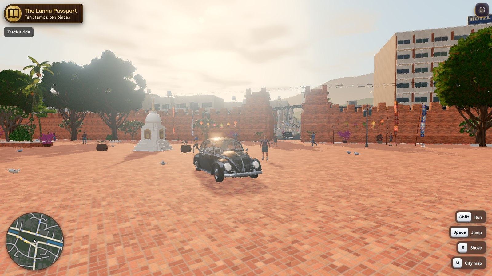
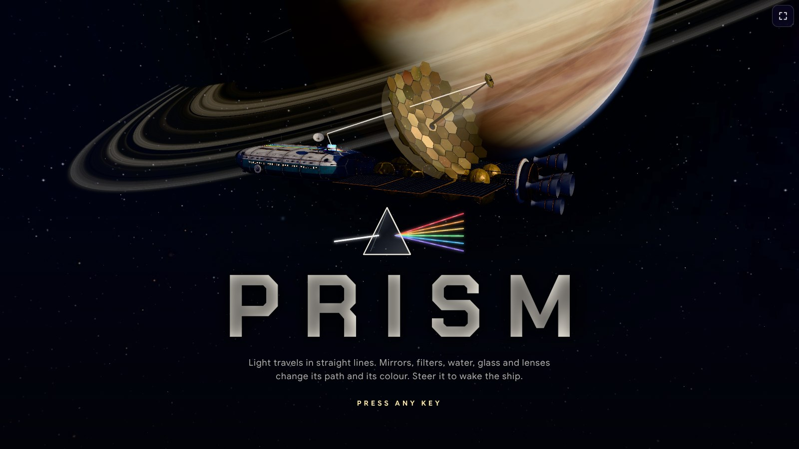

<p align="center">
<a href="README.md">English</a> · <a href="README.fr.md">Français</a> · <a href="README.es.md">Español</a> · <a href="README.de.md">Deutsch</a> · <a href="README.it.md">Italiano</a> · <b>Português</b> · <a href="README.pl.md">Polski</a> · <a href="README.ja.md">日本語</a> · <a href="README.ko.md">한국어</a> · <a href="README.zh.md">中文</a> · <a href="README.th.md">ไทย</a> · <a href="README.ar.md">العربية</a>
</p>

<div align="center">

# Skills de e-learning para agentes de IA

**Jogue para aprender, crie para ganhar.**

Transforme tarefas de casa em jogos. Transforme aulas em cursos. Transforme o que você sabe em uma comunidade.

Skills que ensinam Claude, ChatGPT, Gemini, Cursor ou qualquer outro agente de IA a criar no ecossistema MEXTY:
jogos educativos no **EdVerse**, comunidades de criadores no **Mextribe**, cursos e trilhas de aprendizagem no **MEXTY**.

[Conecte sua IA](https://mexty.ai/connect) · [Jogue no EdVerse](https://future.mexty.ai/edverse) · [Preços](https://mexty.ai/pricing)

<p>
<a href="#para-organizações-criar-atribuir-acompanhar"></a>
&nbsp;&nbsp;&nbsp;<b>×</b>&nbsp;&nbsp;&nbsp;
<a href="https://future.mexty.ai/edverse"></a>
&nbsp;&nbsp;&nbsp;<b>×</b>&nbsp;&nbsp;&nbsp;
<a href="https://future.mexty.ai/mextribe"></a>
</p>

## MEXTY LMS × EdVerse × Mextribe

<table>
<tr>
<td width="33%" align="center"><a href="#para-organizações-criar-atribuir-acompanhar"></a><br><b>MEXTY LMS</b><br><sub>Cursos, trilhas de aprendizagem e acompanhamento para escolas e empresas</sub></td>
<td width="33%" align="center"><a href="https://future.mexty.ai/edverse"></a><br><b>EdVerse</b><br><sub>Jogos educativos dos 4 aos 18 anos. Para jogar, criar e vender</sub></td>
<td width="33%" align="center"><a href="https://future.mexty.ai/mextribe"></a><br><b>Mextribe</b><br><sub>Aprenda com criadores. Ensine a sua comunidade</sub></td>
</tr>
</table>

<sub>Uma só conta para os três.</sub>

</div>

---

## Um ecossistema, três portas de entrada

| | Para famílias | Para criadores | Para organizações |
|---|---|---|---|
| **Quem** | Pais, crianças, estudantes | Professores, criadores de jogos, qualquer pessoa com uma assinatura de IA | Escolas, universidades, empresas de formação, pequenas e médias empresas |
| **O que você faz** | Joga jogos educativos, transforma a tarefa de casa em um jogo, acompanha o progresso da criança | Cria jogos e cursos, sozinho ou com outras pessoas, vende o que criou e mantém a sua própria comunidade de aprendizagem | Cria treinamentos em equipe, atribui às pessoas e vê quem concluiu o quê |
| **Onde** | [EdVerse](https://future.mexty.ai/edverse) | EdVerse Studio e Mextribe | O espaço de trabalho MEXTY: Authoring e LMS |
| **Custo para começar** | Grátis | Grátis | Plano Authoring, Authoring + LMS ou Enterprise |
| **Saiba mais** | [Pais](audiences/parents.md) | [Desenvolvedores de jogos](audiences/game-developers.md) | [Empresas](audiences/companies.md) · [Universidades e escolas](audiences/universities-and-schools.md) |

## O que cada skill faz

| Skill | O que faz |
|---|---|
| [`mexty-start`](skills/mexty-start/SKILL.md) | Descobre quem você é e do que precisa, escolhe primeiro o caminho gratuito e passa a vez para a skill certa |
| [`homework-to-game`](skills/homework-to-game/SKILL.md) | Lê uma folha de exercícios, uma aula ou uma lista de revisão e cria um jogo em que jogar é praticar |
| [`track-kid-progress`](skills/track-kid-progress/SKILL.md) | Para pais: o que a criança aprendeu no EdVerse em uma semana ou um mês, em um relatório curto com sugestões do que tentar a seguir |
| [`pick-games-for-my-kid`](skills/pick-games-for-my-kid/SKILL.md) | Escolhe jogos por idade, disciplina e idioma, e define uma rotina tranquila e os limites de tempo de tela |
| [`learning-game-design`](skills/learning-game-design/SKILL.md) | Projeta o jogo antes de qualquer código: a habilidade, o ciclo de jogo, os níveis, tudo em uma página |
| [`edverse-game-qa`](skills/edverse-game-qa/SKILL.md) | Verifica o jogo com base nos 11 EdVerse Game Requirements antes da revisão da loja e corrige o que uma revisão devolveu |
| [`edverse-publish-and-earn`](skills/edverse-publish-and-earn/SKILL.md) | Página na loja, preço, envio e gestão do jogo com a caixa de sugestões e as estatísticas |
| [`edverse-game-performance`](skills/edverse-game-performance/SKILL.md) | Faz um jogo 3D de navegador rodar em um tablet escolar: orçamentos, profiling, WebGL e WebGPU |
| [`multiplayer-and-saves`](skills/multiplayer-and-saves/SKILL.md) | Progresso salvo, rankings, conquistas e jogo em tempo real, feitos com segurança para crianças |
| [`free-creative-toolkit`](skills/free-creative-toolkit/SKILL.md) | Blender sem interface para 3D, Whisper para legendas, estilos de filme Opuscar para vídeo e mídia de banco de imagens, antes de qualquer geração paga |
| [`curriculum-to-learning-path`](skills/curriculum-to-learning-path/SKILL.md) | Transforma um programa de ensino ou um conjunto de objetivos de aprendizagem em uma trilha, com um curso por objetivo |
| [`ai-literacy-curriculum`](skills/ai-literacy-curriculum/SKILL.md) | Letramento em IA para alunos e estudantes, por idade, de acordo com o referencial que a instituição segue |
| [`assessment-design`](skills/assessment-design/SKILL.md) | Uma avaliação justa: o que ela certifica, uma matriz, perguntas, pontos e nota mínima |
| [`mexty-courses-for-teams`](skills/mexty-courses-for-teams/SKILL.md) | Cursos, atividades, avaliações e trilhas de aprendizagem para escolas e empresas, com licenças e análises |
| [`onboarding-path`](skills/onboarding-path/SKILL.md) | Uma trilha de onboarding para uma função, do dia 1 ao dia 90, a partir dos documentos que a empresa já tem |
| [`compliance-course`](skills/compliance-course/SKILL.md) | Um curso de compliance com a respectiva verificação, escrito a partir da política da própria organização |
| [`keep-training-current`](skills/keep-training-current/SKILL.md) | Treinamento ligado à sua fonte: rascunhos a cada mudança, revisão, recertificação, agentes agendados e uma página de vendas a partir de um curso |
| [`ai-literacy-at-work`](skills/ai-literacy-at-work/SKILL.md) | Letramento em IA para colaboradores, por função, ajustado às ferramentas que usam e à política de IA da organização |
| [`sales-enablement`](skills/sales-enablement/SKILL.md) | Conhecimento do produto, treino de pitch e resposta a objeções a partir da ficha do produto |
| [`analytics-dashboards`](skills/analytics-dashboards/SKILL.md) | Cria um painel personalizado que responde a uma pergunta sobre a aprendizagem com dados em tempo real |
| [`build-together`](skills/build-together/SKILL.md) | Coautoria, rascunhos, revisões, comentários, versões e mesclagens, no espaço de trabalho e no EdVerse |
| [`mextribe-community`](skills/mextribe-community/SKILL.md) | Publicações, planos pagos, comentários, novidades e métricas: uma comunidade de aprendizagem gerida por uma só pessoa |
| [`instagram-showcase`](skills/instagram-showcase/SKILL.md) | Reels, Stories, carrosséis e legendas a partir do que você criou |

## Jogue para aprender, crie para ganhar

**Jogue para aprender.** Uma criança que joga um bom jogo educativo pratica uma habilidade sem que ninguém peça, e um adulto consegue ver o que ela praticou.

**Crie para ganhar.** Quem cria o jogo ganha duas vezes. Primeiro em compreensão: não dá para transformar uma aula em jogo sem conhecê-la bem o bastante para explicá-la ao jogo. Depois em dinheiro: um jogo na loja pode ser vendido ou remunerado pelos minutos que as crianças passam jogando.

Estas skills tornam as duas coisas possíveis para quem nunca fez um jogo: descreva a tarefa de casa, e a sua IA cria o jogo com você, verifica se ele cumpre os requisitos da loja e ajuda a publicá-lo.

## Feito no EdVerse

<div align="center">

<a href="https://future.mexty.ai/edverse/play/6aec3b57c9fbf8c716737432"></a>

<sub><b><a href="https://future.mexty.ai/edverse/play/6aec3b57c9fbf8c716737432">Prism</a></b>: desperte uma nave estelar adormecida, um feixe de cada vez. Espelhos, filtros de cor, refração, prismas e lentes, tudo com óptica real: você descobre a regra, e a porta se abre. Ciências, 10–18 anos, grátis. Feito no EdVerse por josephmaupas2.</sub>

</div>

Todos os jogos aqui estão disponíveis na loja e são gratuitos. Clique em um para jogar.

<table>
<tr>
<td width="33%"><a href="https://future.mexty.ai/edverse/play/6ad4f323d2da4f44ae744019"></a><br><b><a href="https://future.mexty.ai/edverse/play/6ad4f323d2da4f44ae744019">Fraction Coaster</a></b><br><sub>Ande de montanha-russa e acerte a fração certa. Matemática, a partir dos 7 anos.</sub></td>
<td width="33%"><a href="https://future.mexty.ai/edverse/play/6ad8655c3b54b5603c79c1e4"></a><br><b><a href="https://future.mexty.ai/edverse/play/6ad8655c3b54b5603c79c1e4">Math Kitchen Rush</a></b><br><sub>Uma cozinha cooperativa em que os números são os ingredientes. Matemática, a partir dos 7 anos.</sub></td>
<td width="33%"><a href="https://future.mexty.ai/edverse/play/6ad5d61286bc6e0a1c20a99d"></a><br><b><a href="https://future.mexty.ai/edverse/play/6ad5d61286bc6e0a1c20a99d">Turbo Gates</a></b><br><sub>Passe pelo portão com a resposta certa para baixar o tempo da volta. Matemática, 10–15 anos.</sub></td>
</tr>
<tr>
<td><a href="https://future.mexty.ai/edverse/play/6ad711bd87e1e3de99f9e2c8"></a><br><b><a href="https://future.mexty.ai/edverse/play/6ad711bd87e1e3de99f9e2c8">MathBot Siege</a></b><br><sub>Atire na tela que mostra a resposta certa para desligar o robô. Matemática, 7–12 anos.</sub></td>
<td><a href="https://future.mexty.ai/edverse/play/6ae1d1c8b82eb1abf68a3fa6"></a><br><b><a href="https://future.mexty.ai/edverse/play/6ae1d1c8b82eb1abf68a3fa6">The Cartographers of the Fog</a></b><br><sub>Uma batalha naval no nevoeiro para praticar coordenadas em grade e pontos cardeais. Matemática, 7–12 anos. Por josephmaupas2.</sub></td>
<td><a href="https://future.mexty.ai/edverse/play/6ad9bb439c6bc47946fdc049"></a><br><b><a href="https://future.mexty.ai/edverse/play/6ad9bb439c6bc47946fdc049">Body Heroes</a></b><br><sub>Anatomia em 3D e cirurgia na prática, da biologia escolar à preparação para medicina. Corpo &amp; saúde, 13–18 anos. Por nixht1.</sub></td>
</tr>
<tr>
<td><a href="https://future.mexty.ai/edverse/play/6aca37b57d7d7ac76d4cb78d"></a><br><b><a href="https://future.mexty.ai/edverse/play/6aca37b57d7d7ac76d4cb78d">Math Kingdom</a></b><br><sub>O cálculo mental dá força ao seu exército em um torneio em tempo real. Matemática, 7–15 anos.</sub></td>
<td><a href="https://future.mexty.ai/edverse/play/6ae00ca2d76841160f7bb1ee"></a><br><b><a href="https://future.mexty.ai/edverse/play/6ae00ca2d76841160f7bb1ee">Tick-Tock Town</a></b><br><sub>Gire os ponteiros do relógio da cidade para dizer as horas. Matemática, 7–9 anos. Por josephmaupas2.</sub></td>
<td><a href="https://future.mexty.ai/edverse/play/6ae0544fb82eb1abf68a0b0b"></a><br><b><a href="https://future.mexty.ai/edverse/play/6ae0544fb82eb1abf68a0b0b">Robot Matrix</a></b><br><sub>Mova robôs com vetores e matrizes para iluminar uma estação espacial. Matemática e programação, 16–18 anos.</sub></td>
</tr>
</table>

<details>
<summary>Mais de Prism</summary>
<br>
<table><tr>
<td></td>
<td></td>
<td></td>
</tr></table>
</details>

## Para pais: um lugar seguro e uma forma de acompanhar o progresso

**Seguro pelas regras da loja.** Cada jogo é testado com base nos mesmos requisitos antes de entrar na loja, primeiro por quem o criou e depois por um revisor da MEXTY. Um jogo no EdVerse:

- não tem anúncios, chat, links para fora do jogo, botões de compra nem cadastro obrigatório;
- não pede nome, e-mail, foto ou localização da criança e não tem rastreadores;
- não tem nada violento, assustador ou que ridicularize, nem nada que pressione a criança a continuar jogando ou a pagar;
- trata as respostas erradas com gentileza e tem som que pode ser silenciado;
- tem um botão “Denunciar” a um toque, com resposta da equipe da MEXTY.

**Acompanhe o que eles aprendem.** No EdVerse, um adulto adiciona cada criança como aluno e recebe um painel para ela:

| Você vê | O que isso mostra | |
|---|---|---|
| Tempo de jogo, jogos jogados, dias ativos | Quanto e com que regularidade | Grátis |
| Quando jogam | De manhã, depois da escola ou à noite | Grátis |
| Habilidades dominadas | O que acertam de forma consistente | Licença de aluno |
| Precisa de prática | Habilidades com menos de 60% de acertos | Licença de aluno |
| Disciplinas e progresso em cada jogo | Para onde vai o tempo | Licença de aluno |

Uma licença de aluno custa a partir de €5 por mês por criança e também libera todos os jogos ★ Included (“incluídos”).

<table>
<tr>
<td width="64%"><br><sub><b>O seu painel.</b> Tempo de jogo, jogos jogados, habilidades dominadas e dias ativos de cada aluno, em 7 ou 30 dias.</sub></td>
<td width="36%"><br><sub><b>As suas configurações.</b> Faixa etária, um limite diário, horário de descanso e quais jogos a criança pode ver. Ficam salvas na sua conta e valem em todos os dispositivos.</sub></td>
</tr>
</table>

<sub>Exemplo com um aluno de demonstração.</sub>

**Você continua no comando.** Defina um limite de tempo diário e horários sem jogos; os dois valem em todos os dispositivos. A criança nunca vê uma tela de pagamento: ela vê o preço e pede a você primeiro. Assistentes de IA não têm acesso aos perfis nem ao progresso das crianças.

**Peça o relatório à sua IA.** “O que a Mia aprendeu este mês e o que devemos praticar?” Com [`track-kid-progress`](skills/track-kid-progress/SKILL.md), a sua IA lê o relatório de aprendizagem das crianças que têm licença de aluno e o resume em palavras simples, com um jogo para experimentar em seguida, toda semana ou todo mês, se você quiser.

**E quando o problema é a tarefa de casa:** entregue a folha de exercícios à sua IA e receba um jogo que a criança pode jogar hoje à noite, com [`homework-to-game`](skills/homework-to-game/SKILL.md).

## Para criadores: criar, publicar, ouvir, ganhar

Uma pessoa com uma assinatura de IA dá conta do ciclo inteiro. Criar é grátis: as ferramentas MCP não consomem créditos MEXTY.

1. **Crie** um jogo a partir de uma aula que você conhece bem ([`homework-to-game`](skills/homework-to-game/SKILL.md)).
2. **Passe na revisão** com base nos 11 EdVerse Game Requirements ([`edverse-game-qa`](skills/edverse-game-qa/SKILL.md)).
3. **Publique na loja**: grátis, com preço fixo, no modelo “pague quanto quiser” ou ★ Included para famílias e escolas com licença de aluno ([`edverse-publish-and-earn`](skills/edverse-publish-and-earn/SKILL.md)).
4. **Ouça**: os jogadores enviam ideias para a caixa de sugestões do jogo. As que você aceita viram o roadmap público dele.
5. **Reúna a sua comunidade**: publique o jogo no Mextribe e acrescente um plano pago quando os seguidores pedirem mais ([`mextribe-community`](skills/mextribe-community/SKILL.md)).
6. **Mostre**: um Reel, um Story e um carrossel a cada lançamento ([`instagram-showcase`](skills/instagram-showcase/SKILL.md)).

Você fica com 80% de cada venda de jogo, descontada a taxa do cartão, e com 80% das assinaturas do Mextribe, descontadas as taxas de cartão.

### O editor do EdVerse

Cada jogo abre em um editor 3D ao vivo, no navegador. Você, os seus colaboradores e os seus assistentes de IA constroem no mesmo mundo ao mesmo tempo: descreva o que quer e veja aparecer, ou mova as coisas você mesmo. A barra superior alterna entre visualizar, jogar e editar, mostra a prévia em smartphone, tablet e computador, abre o histórico e chama o Assistente.


<sub><b>Floodline.</b> Um jogo de parkour em primeira pessoa pelos telhados de uma cidade que está sendo inundada, em que funções lineares e taxas de variação dizem quanto tempo resta. Matemática, 13–15 anos.</sub>

<table>
<tr>
<td width="50%"><br><sub><b>Songthaew Rush.</b> Chiang Mai reconstruída a partir do OpenStreetMap: um Fusca preto em frente ao portão Tha Phae, com gráficos Ultra.</sub></td>
<td width="50%"><br><sub><b>Prism.</b> A cena de abertura: uma nave adormecida e a luz como única ferramenta.</sub></td>
</tr>
</table>

<sub>Floodline aparece no editor; Songthaew Rush e Prism, durante o jogo.</sub>

## Mextribe: aprenda com criadores, ensine a sua comunidade

O Mextribe é o lado social do ecossistema. Os criadores publicam o que fazem: cursos, trilhas de aprendizagem, atividades interativas, vídeos e jogos do EdVerse. Os alunos seguem os criadores de graça e assinam para ter acesso ao restante. Usar o Mextribe é gratuito, para criadores e para alunos.

<a href="https://future.mexty.ai/mextribe/explore"></a>

<sub><b>Explorar.</b> Para você, em alta, novos criadores, grátis e jogos. Qualquer pessoa pode navegar sem ter conta.</sub>

<table>
<tr>
<td width="50%"><a href="https://future.mexty.ai/mextribe/@fabien.sabati"></a><br><sub><b>A página de um criador.</b> Publicações, seguidores e membros; séries; uma grade que o criador organiza e na qual fixa conteúdos; abas para cursos, trilhas, vídeos, atividades e jogos.</sub></td>
<td width="50%"><br><sub><b>Uma publicação.</b> A atividade roda ali mesmo. Curtidas, comentários, compartilhar e salvar; o progresso e os certificados vão para a conta MEXTY do aluno.</sub></td>
</tr>
</table>

| Para alunos | Para criadores |
|---|---|
| Siga criadores de graça | Publique tudo o que você criou no MEXTY ou no EdVerse, além de vídeos e fotos |
| Faça cursos, atividades e jogos sem sair da publicação | Publicações gratuitas, publicações só para membros ou um preço avulso em uma publicação |
| Assine o plano de um criador para ter a biblioteca completa | Planos pagos, no estilo Patreon: você fica com 80%, descontadas as taxas de cartão, com pagamento mensal |
| Comente e faça perguntas | Responda aos comentários, fixe os bons, retenha ou oculte os demais |
| Cada publicação indica as idades a que se destina | Envie uma novidade ou uma enquete a seguidores ou membros |
| | Métricas: seguidores, membros, ganhos e onde os alunos desistem |

**Seguro desde a concepção.** Não há mensagens privadas. Cada publicação declara o seu público por idade; a primeira publicação de um criador voltada a menores de 18 anos é revisada pela MEXTY antes de ir ao ar; comentários que pedem para conversar em outro lugar ou solicitam dados pessoais ficam retidos. Alunos com menos de 18 anos aparecem para os criadores apenas com o primeiro nome e uma inicial.

**Comande tudo pela sua IA.** “Publique o meu curso de química para idades de 13 a 17 anos, com a aula 1 grátis e o restante para membros.” “Mostre os comentários que aguardam resposta e redija respostas gentis.” “Qual publicação trouxe mais membros este mês?” Toda publicação começa como rascunho, e nada é publicado, precificado ou enviado sem o seu sim. Veja [`mextribe-community`](skills/mextribe-community/SKILL.md) e [`instagram-showcase`](skills/instagram-showcase/SKILL.md) para o kit de divulgação: link, QR code, card para Story e legendas.

## Para organizações: criar, atribuir, acompanhar

O MEXTY é uma ferramenta de autoria e um LMS, vendidos separadamente ou em conjunto. Com o MEXTY MCP, o seu próprio assistente de IA cria dentro do seu espaço de trabalho: cursos, atividades interativas, avaliações e trilhas de aprendizagem inteiras, a partir dos seus documentos e políticas.

<table>
<tr>
<td width="50%"><br><sub><b>Criar.</b> Uma trilha de aprendizagem é uma grade de células numeradas que são liberadas em ordem. Uma célula pode conter vários itens, sendo obrigatórios todos ou qualquer um deles. Edite você mesmo ou deixe a sua IA montar a estrutura inteira.</sub></td>
<td width="50%"><br><sub><b>Acompanhar.</b> Alunos, conclusão, nota e tempo de cada curso, e uma linha de progresso para cada aluno.</sub></td>
</tr>
</table>

| Você é | Você recebe |
|---|---|
| Uma **escola ou universidade** | Currículos em forma de trilhas de aprendizagem, avaliações com certificados, perfis de aluno, progresso por estudante |
| Uma **empresa de formação** | Cursos que podem ser exportados em HTML e SCORM para o LMS que os seus clientes já usam |
| Uma **empresa** | Onboarding, compliance e treinamento de produto criados a partir dos seus próprios documentos; licenças e perfis para as suas equipes; quem concluiu o quê |

- **Perfis e licenças**: convide criadores e alunos; os perfis definem o que cada pessoa pode fazer.
- **Os seus próprios painéis**: além das análises padrão, crie um painel que responde à sua pergunta com dados em tempo real: onboardings concluídos por semana, certificados prestes a vencer, as perguntas que uma turma erra. Compartilhe com um perfil, uma equipe ou uma pessoa ([`analytics-dashboards`](skills/analytics-dashboards/SKILL.md)).
- **Vá além dos seus muros**: publique um curso no Mextribe ou coloque na loja do EdVerse uma atividade que funciona como jogo.

O MEXTY MCP vem com os planos **Authoring**, **Authoring + LMS** e **Enterprise**. Para atribuir conteúdo aos alunos e acompanhá-los, é preciso ter o LMS. Comece por [`mexty-courses-for-teams`](skills/mexty-courses-for-teams/SKILL.md); os preços estão na [página de preços](https://mexty.ai/pricing).

## Compliance e treinamentos que se mantêm atualizados

O treinamento de compliance falha em silêncio: a política muda e o curso não. Aqui, um curso tem uma fonte, uma versão e um responsável, e um agente de IA pode vigiar a fonte por você.

| Quando | O que acontece |
|---|---|
| Uma política, uma lei ou uma ficha de produto muda | O agente lê a nova versão, encontra os cursos que a citam e redige as alterações em rascunho, nada mais |
| Antes de os alunos verem qualquer coisa | O responsável pelo curso revisa o rascunho, vê quem está inscrito e certificado e publica ou agenda para o dia em que a política entra em vigor |
| Depois de uma mudança relevante | Você vê quem tem certificado da versão antiga e reatribui apenas o que mudou |
| Toda semana, de forma agendada | Um relatório: o que mudou, quais rascunhos estão aguardando, de quem é o certificado que vence em breve |
| Um novo curso é publicado | O agente pode redigir uma landing page e uma oferta para vendê-lo fora da organização |

Funciona para proteção de dados, segurança da informação, saúde e segurança no trabalho, códigos de conduta, letramento em IA e treinamento de produto. Nada é publicado, certificado ou colocado à venda sem o sim de uma pessoa. Veja [`keep-training-current`](skills/keep-training-current/SKILL.md).

## Feito em conjunto

Nem um curso nem um jogo é trabalho de uma pessoa só, por isso os dois produtos foram feitos para o trabalho compartilhado. Alunos e jogadores só veem o que foi publicado ou mesclado.

| | No espaço de trabalho MEXTY | No EdVerse |
|---|---|---|
| **Trabalhar lado a lado** | Coautores em um curso, atividade, avaliação ou trilha de aprendizagem | Várias pessoas e os seus assistentes de IA no mesmo editor 3D ao vivo e no mesmo código. As edições são mescladas; nada fica bloqueado |
| **Experimentar com segurança** | Rascunhos: alterações que as pessoas estão testando, ao lado da versão publicada | Rascunhos do mundo e do código de um jogo. Quem entra pelo link de compartilhamento trabalha em um deles |
| **Revisar** | Indique revisores, comente o conteúdo, veja as alterações e quem elas afetam, aprove ou devolva | Veja o que mudou, objeto por objeto e arquivo por arquivo; o dono ou um mantenedor faz a mesclagem |
| **Lançar** | Publique agora ou agende | Mescle no jogo; a loja passa a oferecer a nova versão depois da revisão |
| **Voltar atrás** | Histórico de versões: compare e restaure qualquer versão como rascunho | Um rascunho pode ser fechado; os conflitos são resolvidos comparando as duas versões lado a lado |
| **Crédito** | Os coautores são identificados pelo nome | Os autores do trabalho mesclado recebem crédito e uma parte do que o jogo ganha do fundo de alunos |

Uma turma pode criar um jogo dessa forma: o professor é o dono, cada grupo trabalha no seu próprio rascunho, e a turma revisa cada um antes da mesclagem. Veja [`build-together`](skills/build-together/SKILL.md).

## O que é grátis e o que exige um plano

| | EdVerse | Mextribe | MEXTY |
|---|---|---|---|
| **O que é** | Loja e estúdio de jogos educativos, 4–18 anos | Rede social de aprendizagem, com planos pagos de criadores | Autoria com IA e LMS para organizações |
| **Uso com a sua IA** | **Grátis** | **Grátis** | Plano **Authoring**, **Authoring + LMS** ou **Enterprise** |
| **Como você ganha** | Venda um jogo a preço fixo ou no modelo “pague quanto quiser”, receba do fundo de alunos pelos minutos jogados (★ Included) ou melhore jogos abertos à colaboração e participe dos ganhos do fundo quando o seu rascunho for mesclado | Planos de assinatura pagos e vendas avulsas | — |
| **Com quanto você fica** | 80% de cada venda, descontada a taxa do cartão | 80%, descontadas as taxas de cartão | — |

As ferramentas MCP não consomem créditos MEXTY: quem pensa é a sua própria assinatura de IA. Só a geração de mídia (imagens, vozes, modelos 3D, transcrição) consome créditos, e [`free-creative-toolkit`](skills/free-creative-toolkit/SKILL.md) mostra a forma gratuita de fazer cada uma.

## Incluído de outros autores

Criar jogos é um ofício à parte, por isso o repositório também traz skills escritas por outras pessoas, sem alterações e sob as suas próprias licenças. As fontes e as licenças estão em [`THIRD_PARTY.md`](THIRD_PARTY.md).

| Pasta | O que contém | Por |
|---|---|---|
| [`third-party/gamedev`](third-party/gamedev) | 18 skills: game feel, level design, interface de jogo, áudio, câmeras, controles, saves, desempenho, pipeline de assets, prototipagem rápida, configuração do three.js, glTF e iluminação, além de guias para jogos de quebra-cabeça, plataforma, tiro, cartas e RPG | [awesome-gamedev-agent-skills](https://github.com/gamedev-skills/awesome-gamedev-agent-skills), Apache 2.0 |
| [`third-party/webgpu-threejs-tsl`](third-party/webgpu-threejs-tsl) | Renderizador WebGPU do three.js e TSL: materiais de nós, compute shaders, pós-processamento, perda de dispositivo | [webgpu-claude-skill](https://github.com/dgreenheck/webgpu-claude-skill), MIT |

Recomendados como complemento, instalados a partir das suas próprias fontes: [bang-motion](https://github.com/bangtutorial/bang-motion) para motion graphics, [canvas-design](https://github.com/anthropics/skills/tree/main/skills/canvas-design) para pôsteres e carrosséis, e os estilos de filme do [Lemo-Opuscar](https://github.com/lemomo-ai/lemo-opuscar).

## Da tarefa de casa a um jogo na loja

```
 tarefa de casa ──► homework-to-game ───► edverse-game-qa ──► edverse-publish-and-earn ──► instagram-showcase
 (uma folha,        escolher a mecânica,  os 11 requisitos    preço, envio,                Reel, Story,
  uma aula)         criar a partir de     da loja; você       caixa de sugestões,          carrossel
                    um modelo             joga o teste        ciclo semanal
```

Cada jogo é testado duas vezes com base nos mesmos requisitos: por você, jogando no Studio, e por um revisor da MEXTY. Uma IA não pode fazer esse teste no seu lugar. Ela pode garantir que você passe.

## Instalação

**1. Conecte os servidores MCP** em [mexty.ai/connect](https://mexty.ai/connect) (Claude, ChatGPT, Cursor, VS Code, Gemini CLI, Codex e outros). No Claude Code:

```bash
claude mcp add --transport http edverse  https://mcp.mexty.ai/mcp/edverse
claude mcp add --transport http mextribe https://mcp.mexty.ai/mcp/mextribe
claude mcp add --transport http mexty    https://mcp.mexty.ai/mcp/mexty
```

**2. Adicione as skills.**

Claude Code, como plugin:

```
/plugin marketplace add mext-ai/elearning-agent-skills
/plugin install elearning-agent-skills@mexty
```

Ou copie as pastas que quiser:

```bash
git clone https://github.com/mext-ai/elearning-agent-skills
cp -r elearning-agent-skills/skills/* ~/.claude/skills/
cp -r elearning-agent-skills/third-party/gamedev/* ~/.claude/skills/          # opcional
cp -r elearning-agent-skills/third-party/webgpu-threejs-tsl ~/.claude/skills/ # opcional
```

Claude.ai: compacte a pasta de uma skill em um arquivo ZIP e envie em Settings → Capabilities → Skills. Outros agentes: cada skill é um único arquivo Markdown; aponte o seu agente para o `SKILL.md` de que você precisa.

**3. Diga o que você quer.**

> Aqui está a folha de exercícios de frações da minha filha. Transforme em um jogo que ela possa jogar no tablet.

> O que o meu filho aprendeu no EdVerse este mês e o que devemos praticar?

> O meu jogo está pronto para a revisão do EdVerse?

> Leia as sugestões dos meus jogos publicados e diga o que devo criar esta semana.

> Toda segunda-feira, encontre um jogo colaborativo que precise de um nível sobre frações, crie esse nível em um rascunho e peça uma revisão ao dono.

> Transforme a nossa política de privacidade de dados em um curso de onboarding de 10 minutos com um quiz e atribua aos novos contratados.

---

<div align="center">
<sub>Por <a href="https://mexty.ai">MEXTY</a>. A arte de cada jogo pertence ao respectivo criador. As skills de terceiros pertencem aos seus autores; veja <a href="THIRD_PARTY.md">THIRD_PARTY.md</a>.</sub>
</div>
