<p align="center">
<a href="README.md">English</a> · <a href="README.fr.md">Français</a> · <a href="README.es.md">Español</a> · <a href="README.de.md">Deutsch</a> · <a href="README.it.md">Italiano</a> · <a href="README.pt.md">Português</a> · <a href="README.pl.md">Polski</a> · <a href="README.ja.md">日本語</a> · <a href="README.ko.md">한국어</a> · <a href="README.zh.md">中文</a> · <b>ไทย</b> · <a href="README.ar.md">العربية</a>
</p>

<div align="center">

# สกิลเอเจนต์สำหรับอีเลิร์นนิง

**เล่นเพื่อเรียนรู้ สร้างเพื่อผลตอบแทน**

เปลี่ยนการบ้านให้เป็นเกม เปลี่ยนบทเรียนให้เป็นคอร์ส เปลี่ยนสิ่งที่คุณรู้ให้เป็นคอมมูนิตี้

สกิลที่สอนให้ Claude, ChatGPT, Gemini, Cursor หรือเอเจนต์ AI ตัวไหนก็ได้ สร้างผลงานบนระบบนิเวศของ MEXTY:
เกมการเรียนรู้บน **EdVerse** คอมมูนิตี้ของครีเอเตอร์บน **Mextribe** คอร์สและเส้นทางการเรียนรู้บน **MEXTY**

[เชื่อมต่อ AI ของคุณ](https://mexty.ai/connect) · [เล่นบน EdVerse](https://future.mexty.ai/edverse) · [ราคา](https://mexty.ai/pricing)

<p>
<a href="#สำหรับองค์กร-สร้าง-มอบหมาย-ติดตาม"></a>
&nbsp;&nbsp;&nbsp;<b>×</b>&nbsp;&nbsp;&nbsp;
<a href="https://future.mexty.ai/edverse"></a>
&nbsp;&nbsp;&nbsp;<b>×</b>&nbsp;&nbsp;&nbsp;
<a href="https://future.mexty.ai/mextribe"></a>
</p>

## MEXTY LMS × EdVerse × Mextribe

<table>
<tr>
<td width="33%" align="center"><a href="#สำหรับองค์กร-สร้าง-มอบหมาย-ติดตาม">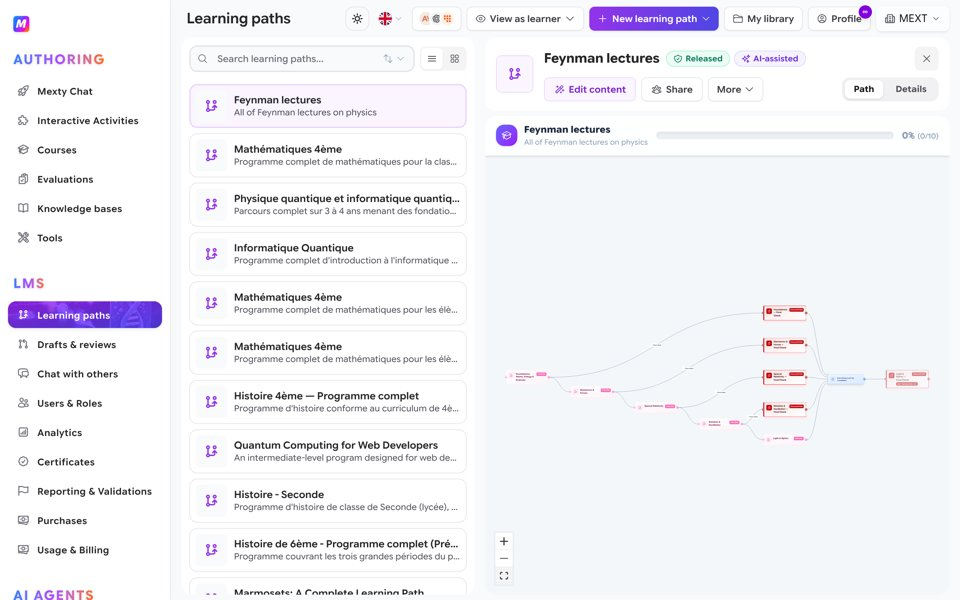</a><br><b>MEXTY LMS</b><br><sub>คอร์ส เส้นทางการเรียนรู้ และการติดตามผล สำหรับโรงเรียนและบริษัท</sub></td>
<td width="33%" align="center"><a href="https://future.mexty.ai/edverse">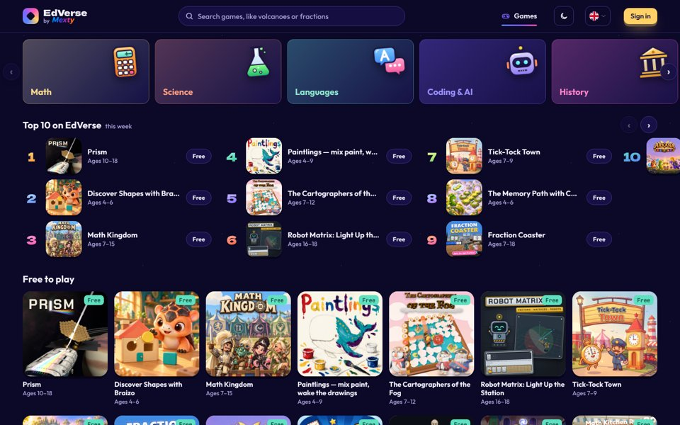</a><br><b>EdVerse</b><br><sub>เกมการเรียนรู้สำหรับวัย 4 ถึง 18 ปี จะเล่น จะสร้าง หรือจะขายก็ได้</sub></td>
<td width="33%" align="center"><a href="https://future.mexty.ai/mextribe">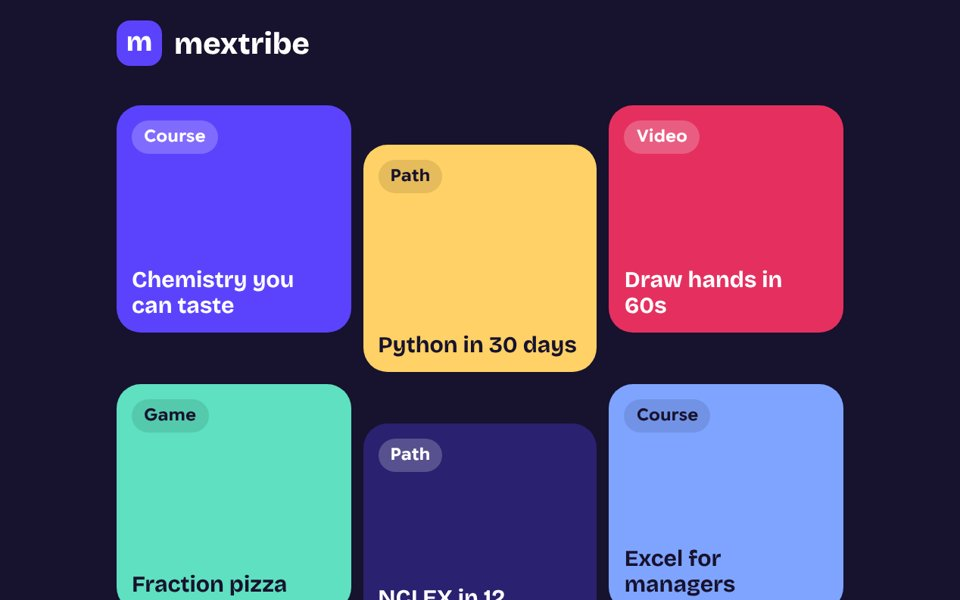</a><br><b>Mextribe</b><br><sub>เรียนรู้จากครีเอเตอร์ สอนชุมชนของคุณเอง</sub></td>
</tr>
</table>

<sub>บัญชีเดียวใช้ได้ครบทั้งสาม</sub>

</div>

---

## ระบบนิเวศเดียว เข้าได้สามทาง

| | สำหรับครอบครัว | สำหรับครีเอเตอร์ | สำหรับองค์กร |
|---|---|---|---|
| **ใคร** | ผู้ปกครอง เด็ก นักเรียน | ครู นักสร้างเกม และทุกคนที่มีแพ็กเกจ AI อยู่แล้ว | โรงเรียน มหาวิทยาลัย ผู้ให้บริการฝึกอบรม ธุรกิจขนาดเล็กและขนาดกลาง |
| **ทำอะไรได้** | เล่นเกมการเรียนรู้ เปลี่ยนการบ้านให้เป็นเกม ติดตามพัฒนาการของลูก | สร้างเกมและคอร์ส ทำคนเดียวหรือทำร่วมกับคนอื่น วางขาย และดูแลคอมมูนิตี้การเรียนรู้ของตัวเอง | สร้างหลักสูตรอบรมกันเป็นทีม มอบหมายให้คนในองค์กร แล้วดูว่าใครเรียนอะไรจบแล้วบ้าง |
| **ที่ไหน** | [EdVerse](https://future.mexty.ai/edverse) | EdVerse Studio และ Mextribe | เวิร์กสเปซของ MEXTY: Authoring และ LMS |
| **ค่าใช้จ่ายเริ่มต้น** | ฟรี | ฟรี | แพ็กเกจ Authoring, Authoring + LMS หรือ Enterprise |
| **อ่านเพิ่มเติม** | [ผู้ปกครอง](audiences/parents.md) | [นักพัฒนาเกม](audiences/game-developers.md) | [บริษัท](audiences/companies.md) · [มหาวิทยาลัยและโรงเรียน](audiences/universities-and-schools.md) |

## แต่ละสกิลทำอะไรได้บ้าง

| สกิล | ทำอะไร |
|---|---|
| [`mexty-start`](skills/mexty-start/SKILL.md) | ดูว่าคุณเป็นใครและต้องการอะไร เลือกเส้นทางที่ฟรีก่อน แล้วส่งต่อให้สกิลที่เหมาะสม |
| [`homework-to-game`](skills/homework-to-game/SKILL.md) | อ่านใบงาน บทเรียน หรือรายการทบทวน แล้วสร้างเกมที่การเล่นก็คือการฝึกฝน |
| [`track-kid-progress`](skills/track-kid-progress/SKILL.md) | สำหรับผู้ปกครอง: สรุปสิ่งที่ลูกได้เรียนรู้บน EdVerse ในรอบสัปดาห์หรือรอบเดือนเป็นรายงานสั้น ๆ พร้อมคำแนะนำว่าควรลองอะไรต่อ |
| [`pick-games-for-my-kid`](skills/pick-games-for-my-kid/SKILL.md) | เลือกเกมตามอายุ วิชา และภาษา พร้อมจัดกิจวัตรแบบสบาย ๆ และตั้งค่าเวลาหน้าจอ |
| [`learning-game-design`](skills/learning-game-design/SKILL.md) | ออกแบบเกมก่อนเขียนโค้ดสักบรรทัด: ทักษะ ลูปการเล่น และด่านต่าง ๆ จบในหน้าเดียว |
| [`edverse-game-qa`](skills/edverse-game-qa/SKILL.md) | ตรวจเกมตามข้อกำหนดเกม EdVerse ทั้ง 11 ข้อก่อนส่งให้สโตร์รีวิว และแก้ไขจุดที่ถูกตีกลับ |
| [`edverse-publish-and-earn`](skills/edverse-publish-and-earn/SKILL.md) | ทำหน้าเกมบนสโตร์ ตั้งราคา ส่งรีวิว และดูแลเกมด้วยกล่องข้อเสนอแนะและสถิติ |
| [`edverse-game-performance`](skills/edverse-game-performance/SKILL.md) | ทำให้เกม 3D บนเบราว์เซอร์เล่นลื่นบนแท็บเล็ตของโรงเรียน: งบประสิทธิภาพ การโปรไฟล์ WebGL และ WebGPU |
| [`multiplayer-and-saves`](skills/multiplayer-and-saves/SKILL.md) | บันทึกความคืบหน้า กระดานจัดอันดับ ความสำเร็จ และการเล่นแบบเรียลไทม์ ที่ปลอดภัยสำหรับเด็ก |
| [`free-creative-toolkit`](skills/free-creative-toolkit/SKILL.md) | Blender แบบ headless สำหรับงาน 3D, Whisper สำหรับซับไตเติล, สไตล์ภาพยนตร์ของ Opuscar สำหรับวิดีโอ และสื่อสต็อก ก่อนจะใช้การสร้างสื่อแบบเสียเงิน |
| [`curriculum-to-learning-path`](skills/curriculum-to-learning-path/SKILL.md) | เปลี่ยนประมวลรายวิชาหรือชุดผลลัพธ์การเรียนรู้ให้เป็นเส้นทางการเรียนรู้ หนึ่งคอร์สต่อหนึ่งผลลัพธ์ |
| [`ai-literacy-curriculum`](skills/ai-literacy-curriculum/SKILL.md) | ความรู้เท่าทัน AI สำหรับนักเรียนนักศึกษาตามช่วงวัย สร้างตามกรอบหลักสูตรที่สถาบันใช้อยู่ |
| [`assessment-design`](skills/assessment-design/SKILL.md) | แบบประเมินที่เป็นธรรม: รับรองอะไร ผังข้อสอบ คำถาม คะแนน และเกณฑ์ผ่าน |
| [`mexty-courses-for-teams`](skills/mexty-courses-for-teams/SKILL.md) | คอร์ส กิจกรรม แบบประเมิน และเส้นทางการเรียนรู้สำหรับโรงเรียนและบริษัท พร้อมที่นั่งผู้ใช้และสถิติวิเคราะห์ |
| [`onboarding-path`](skills/onboarding-path/SKILL.md) | เส้นทางปฐมนิเทศสำหรับแต่ละตำแหน่ง ตั้งแต่วันที่ 1 ถึงวันที่ 90 จากเอกสารที่บริษัทมีอยู่แล้ว |
| [`compliance-course`](skills/compliance-course/SKILL.md) | คอร์สด้านการปฏิบัติตามกฎระเบียบหนึ่งคอร์สพร้อมแบบทดสอบ เขียนจากนโยบายขององค์กรเอง |
| [`keep-training-current`](skills/keep-training-current/SKILL.md) | การอบรมที่ผูกกับแหล่งที่มา: ร่างเมื่อมีการเปลี่ยนแปลง การตรวจทาน การรับรองใหม่ เอเจนต์ที่ทำงานตามกำหนดเวลา และหน้าขายที่สร้างจากคอร์ส |
| [`ai-literacy-at-work`](skills/ai-literacy-at-work/SKILL.md) | ความรู้เท่าทัน AI สำหรับพนักงานตามบทบาท ปรับให้เข้ากับเครื่องมือที่ใช้และนโยบาย AI ขององค์กร |
| [`sales-enablement`](skills/sales-enablement/SKILL.md) | ความรู้เรื่องผลิตภัณฑ์ การฝึกนำเสนอขาย และการรับมือข้อโต้แย้ง จากเอกสารข้อมูลผลิตภัณฑ์ |
| [`analytics-dashboards`](skills/analytics-dashboards/SKILL.md) | สร้างแดชบอร์ดเฉพาะที่ตอบคำถามหนึ่งข้อเกี่ยวกับการเรียนรู้ด้วยข้อมูลสด |
| [`build-together`](skills/build-together/SKILL.md) | การเขียนร่วมกัน ฉบับร่าง การรีวิว ความคิดเห็น เวอร์ชัน และการรวมงาน ทั้งในเวิร์กสเปซและใน EdVerse |
| [`mextribe-community`](skills/mextribe-community/SKILL.md) | โพสต์ แพ็กเกจสมาชิกแบบเสียเงิน ความคิดเห็น ข่าวสาร และข้อมูลเชิงลึก: คอมมูนิตี้การเรียนรู้ที่ดูแลได้ด้วยคนคนเดียว |
| [`instagram-showcase`](skills/instagram-showcase/SKILL.md) | Reels, Stories, โพสต์แบบเลื่อนหลายภาพ และแคปชัน จากผลงานที่คุณสร้าง |

## เล่นเพื่อเรียนรู้ สร้างเพื่อผลตอบแทน

**เล่นเพื่อเรียนรู้** เด็กที่ได้เล่นเกมการเรียนรู้ดี ๆ จะได้ฝึกทักษะโดยไม่ต้องมีใครสั่ง และผู้ใหญ่ก็มองเห็นได้ว่าเด็กฝึกอะไรไปบ้าง

**สร้างเพื่อผลตอบแทน** คนสร้างเกมได้ผลตอบแทนสองต่อ ต่อแรกคือความเข้าใจ: คุณจะเปลี่ยนบทเรียนให้เป็นเกมไม่ได้เลย ถ้าไม่เข้าใจบทเรียนนั้นดีพอจะอธิบายให้เกมเข้าใจ ต่อที่สองคือรายได้: เกมบนสโตร์วางขายได้ หรือรับรายได้ตามจำนวนนาทีที่เด็ก ๆ เล่น

สกิลเหล่านี้ทำให้ทั้งสองอย่างเป็นไปได้ แม้คุณจะไม่เคยสร้างเกมมาก่อน: แค่เล่าเรื่องการบ้าน AI ของคุณก็จะสร้างเกมไปพร้อมกับคุณ ตรวจตามข้อกำหนดของสโตร์ และช่วยคุณเผยแพร่

## สร้างบน EdVerse

<div align="center">

<a href="https://future.mexty.ai/edverse/play/6aec3b57c9fbf8c716737432">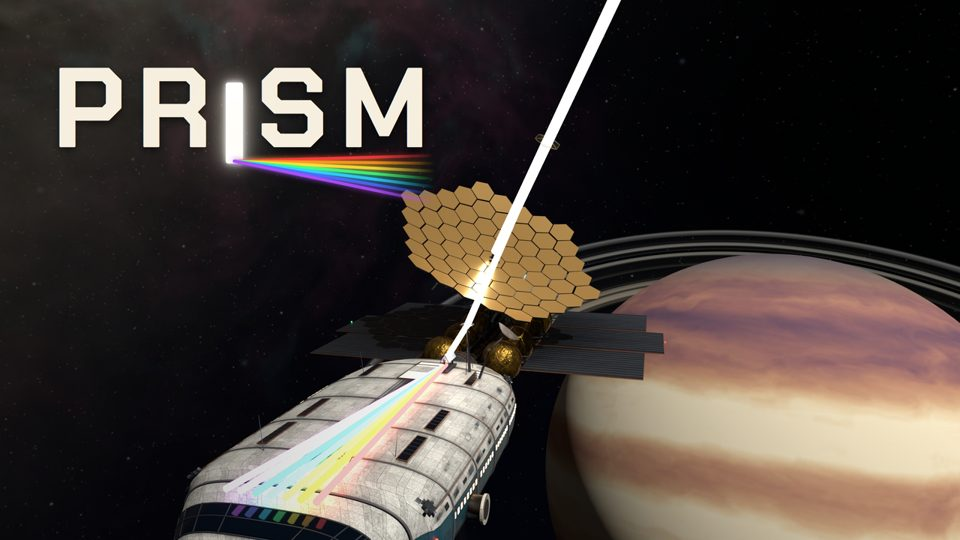</a>

<sub><b><a href="https://future.mexty.ai/edverse/play/6aec3b57c9fbf8c716737432">Prism</a></b>: ปลุกยานอวกาศที่หลับใหลทีละลำแสง กระจก ฟิลเตอร์สี การหักเห ปริซึม และเลนส์ ทุกอย่างอิงหลักทัศนศาสตร์จริง: คุณค้นพบกฎได้เมื่อไร ประตูก็เปิดเมื่อนั้น วิทยาศาสตร์ อายุ 10–18 ปี เล่นฟรี สร้างบน EdVerse โดย josephmaupas2</sub>

</div>

ทุกเกมในหน้านี้เปิดให้เล่นจริงบนสโตร์และเล่นได้ฟรี คลิกที่เกมไหนก็เล่นได้เลย

<table>
<tr>
<td width="33%"><a href="https://future.mexty.ai/edverse/play/6ad4f323d2da4f44ae744019">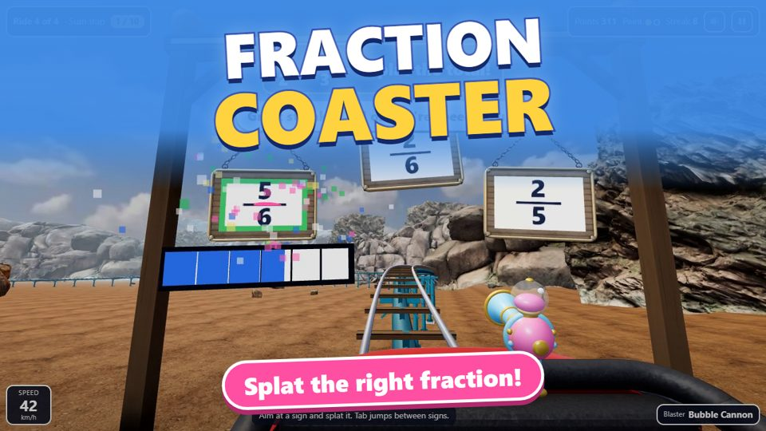</a><br><b><a href="https://future.mexty.ai/edverse/play/6ad4f323d2da4f44ae744019">Fraction Coaster</a></b><br><sub>นั่งรถไฟเหาะแล้วปาสีใส่เศษส่วนที่ถูกต้อง คณิตศาสตร์ อายุ 7 ปีขึ้นไป</sub></td>
<td width="33%"><a href="https://future.mexty.ai/edverse/play/6ad8655c3b54b5603c79c1e4">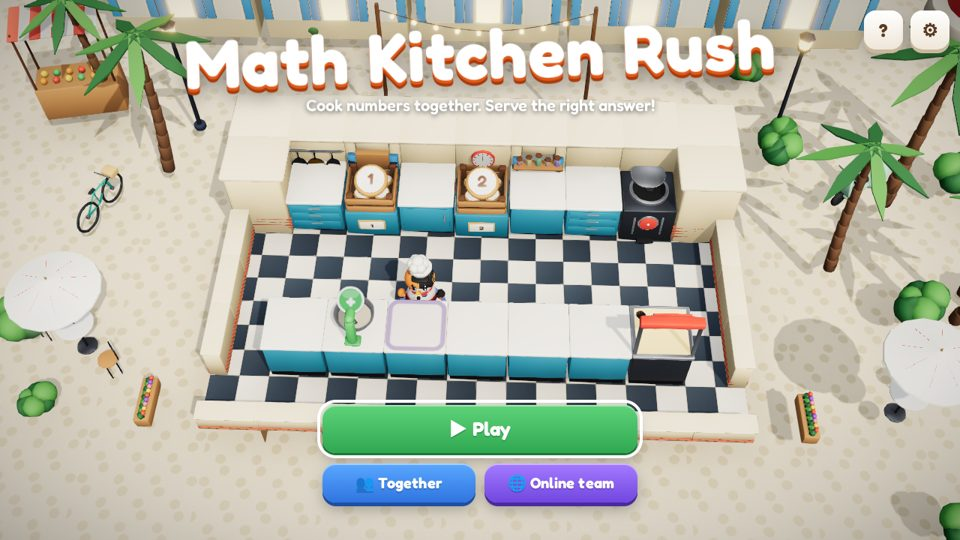</a><br><b><a href="https://future.mexty.ai/edverse/play/6ad8655c3b54b5603c79c1e4">Math Kitchen Rush</a></b><br><sub>ครัวที่ต้องช่วยกันทำ โดยมีตัวเลขเป็นวัตถุดิบ คณิตศาสตร์ อายุ 7 ปีขึ้นไป</sub></td>
<td width="33%"><a href="https://future.mexty.ai/edverse/play/6ad5d61286bc6e0a1c20a99d">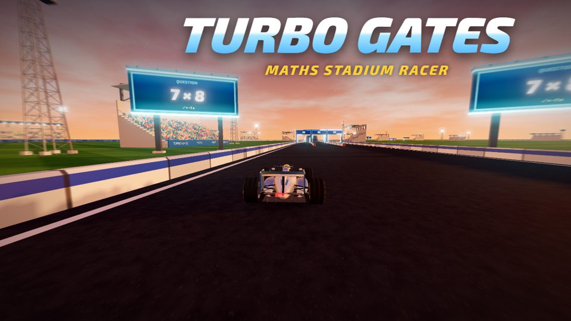</a><br><b><a href="https://future.mexty.ai/edverse/play/6ad5d61286bc6e0a1c20a99d">Turbo Gates</a></b><br><sub>ขับผ่านประตูที่มีคำตอบถูกเพื่อทำเวลาต่อรอบให้ดีขึ้น คณิตศาสตร์ อายุ 10–15 ปี</sub></td>
</tr>
<tr>
<td><a href="https://future.mexty.ai/edverse/play/6ad711bd87e1e3de99f9e2c8">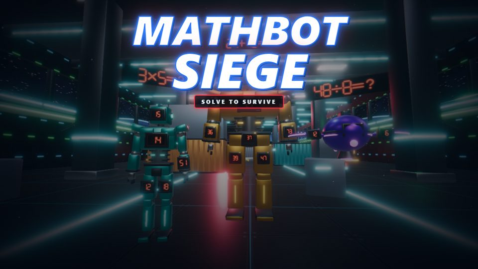</a><br><b><a href="https://future.mexty.ai/edverse/play/6ad711bd87e1e3de99f9e2c8">MathBot Siege</a></b><br><sub>ยิงจอที่แสดงคำตอบถูกเพื่อปิดการทำงานของหุ่นยนต์ คณิตศาสตร์ อายุ 7–12 ปี</sub></td>
<td><a href="https://future.mexty.ai/edverse/play/6ae1d1c8b82eb1abf68a3fa6">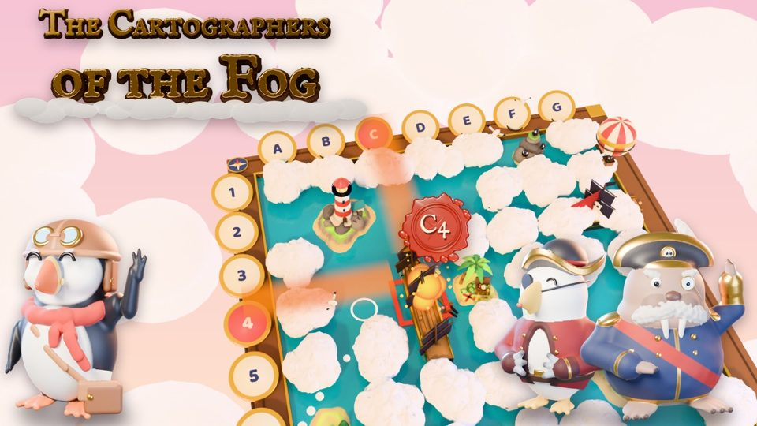</a><br><b><a href="https://future.mexty.ai/edverse/play/6ae1d1c8b82eb1abf68a3fa6">The Cartographers of the Fog</a></b><br><sub>ศึกเรือรบกลางหมอก ฝึกพิกัดบนตารางและทิศตามเข็มทิศ คณิตศาสตร์ อายุ 7–12 ปี โดย josephmaupas2</sub></td>
<td><a href="https://future.mexty.ai/edverse/play/6ad9bb439c6bc47946fdc049">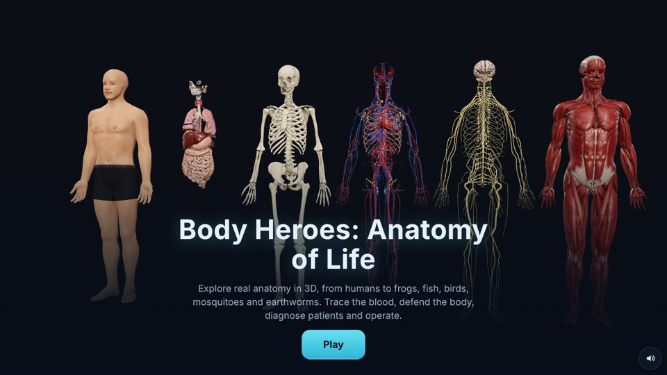</a><br><b><a href="https://future.mexty.ai/edverse/play/6ad9bb439c6bc47946fdc049">Body Heroes</a></b><br><sub>กายวิภาค 3D และการผ่าตัดแบบลงมือทำเอง ตั้งแต่ชีววิทยาระดับโรงเรียนจนถึงเตรียมแพทย์ ร่างกายและสุขภาพ อายุ 13–18 ปี โดย nixht1</sub></td>
</tr>
<tr>
<td><a href="https://future.mexty.ai/edverse/play/6aca37b57d7d7ac76d4cb78d">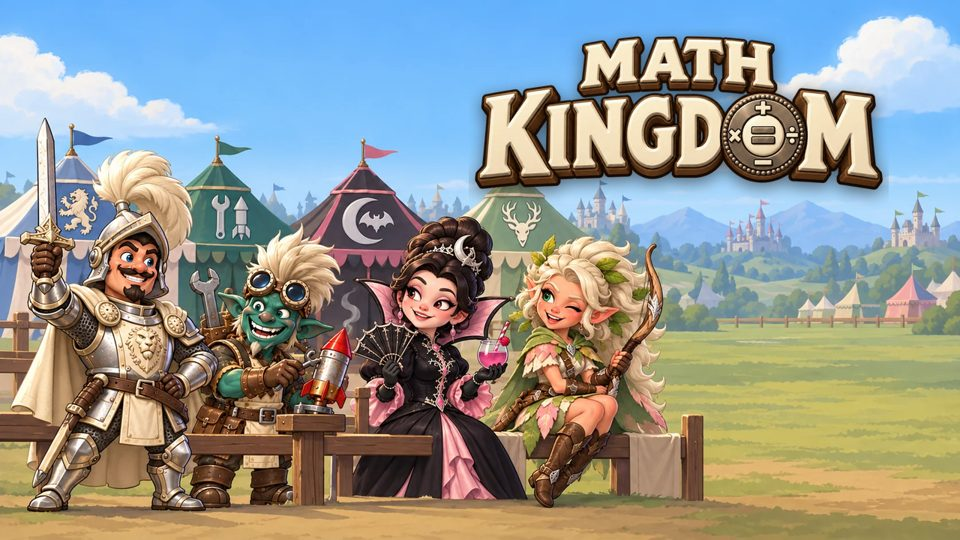</a><br><b><a href="https://future.mexty.ai/edverse/play/6aca37b57d7d7ac76d4cb78d">Math Kingdom</a></b><br><sub>คิดเลขในใจเพื่อเสริมพลังกองทัพในทัวร์นาเมนต์แบบเรียลไทม์ คณิตศาสตร์ อายุ 7–15 ปี</sub></td>
<td><a href="https://future.mexty.ai/edverse/play/6ae00ca2d76841160f7bb1ee">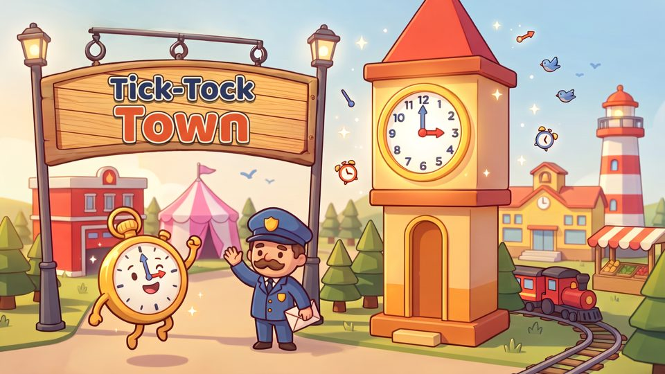</a><br><b><a href="https://future.mexty.ai/edverse/play/6ae00ca2d76841160f7bb1ee">Tick-Tock Town</a></b><br><sub>หมุนเข็มนาฬิกาประจำเมืองเพื่อฝึกบอกเวลา คณิตศาสตร์ อายุ 7–9 ปี โดย josephmaupas2</sub></td>
<td><a href="https://future.mexty.ai/edverse/play/6ae0544fb82eb1abf68a0b0b">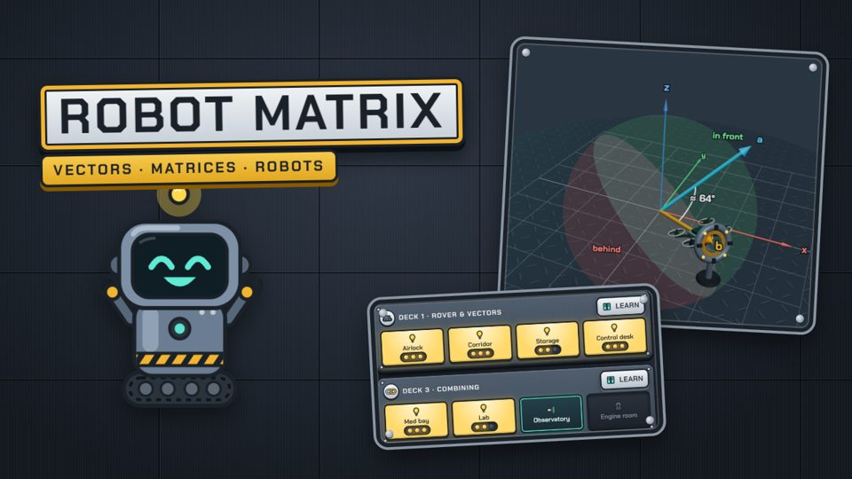</a><br><b><a href="https://future.mexty.ai/edverse/play/6ae0544fb82eb1abf68a0b0b">Robot Matrix</a></b><br><sub>เคลื่อนหุ่นยนต์ด้วยเวกเตอร์และเมทริกซ์เพื่อเปิดไฟให้สถานีอวกาศ คณิตศาสตร์และการเขียนโค้ด อายุ 16–18 ปี</sub></td>
</tr>
</table>

<details>
<summary>ดู Prism เพิ่มเติม</summary>
<br>
<table><tr>
<td>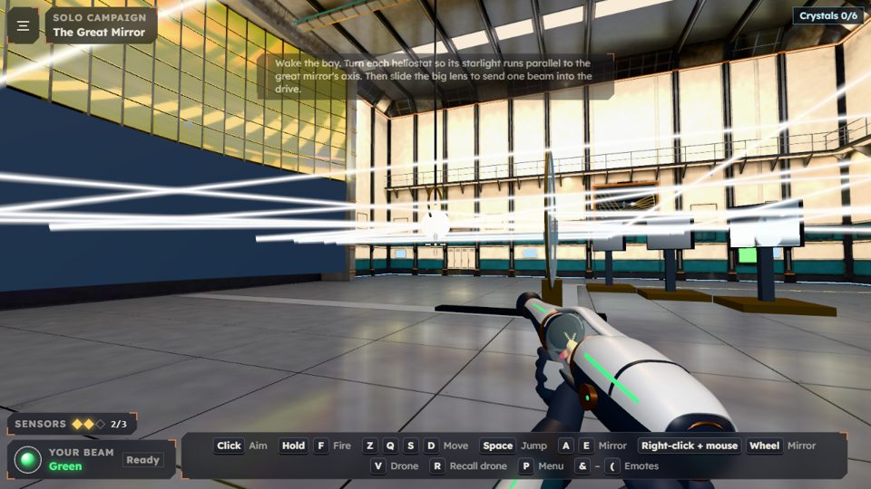</td>
<td>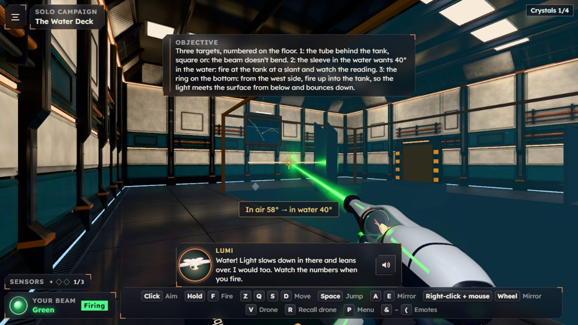</td>
<td>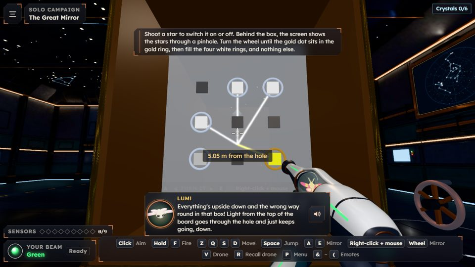</td>
</tr></table>
</details>

## สำหรับผู้ปกครอง: พื้นที่ปลอดภัย และวิธีติดตามพัฒนาการ

**ปลอดภัยตามกฎของสโตร์** ทุกเกมผ่านการทดสอบตามข้อกำหนดชุดเดียวกันก่อนขึ้นสโตร์ เริ่มจากผู้สร้างเกมเอง แล้วต่อด้วยผู้ตรวจของ MEXTY เกมบน EdVerse:

- ไม่มีโฆษณา ไม่มีแชต ไม่มีลิงก์ออกนอกเกม ไม่มีปุ่มซื้อ และไม่บังคับสมัครสมาชิกก่อนเล่น
- ไม่ขอชื่อ อีเมล รูปถ่าย หรือตำแหน่งที่อยู่ของเด็ก และไม่มีตัวติดตาม
- ไม่มีเนื้อหารุนแรง น่ากลัว หรือล้อเลียน และไม่มีอะไรกดดันให้เด็กเล่นต่อหรือจ่ายเงิน
- ตอบผิดก็ได้รับการตอบสนองอย่างอ่อนโยน และปิดเสียงได้
- มีปุ่มรายงานที่แตะครั้งเดียว โดยมีทีมงาน MEXTY เป็นผู้ตอบ

**ติดตามสิ่งที่ลูกเรียนรู้** ใน EdVerse ผู้ใหญ่เพิ่มเด็กแต่ละคนเป็นผู้เรียน แล้วจะได้แดชบอร์ดของเด็กคนนั้น:

| สิ่งที่คุณเห็น | บอกอะไรคุณ | |
|---|---|---|
| เวลาเล่น จำนวนเกมที่เล่น จำนวนวันที่เข้าเล่น | เล่นมากแค่ไหน และสม่ำเสมอเพียงใด | ฟรี |
| ช่วงเวลาที่เล่น | ตอนเช้า หลังเลิกเรียน หรือตอนค่ำ | ฟรี |
| ทักษะที่เชี่ยวชาญแล้ว | สิ่งที่ตอบถูกอย่างสม่ำเสมอ | ที่นั่งผู้เรียน |
| ต้องฝึกเพิ่ม | ทักษะที่ตอบถูกน้อยกว่า 60% ของจำนวนครั้ง | ที่นั่งผู้เรียน |
| วิชาและความคืบหน้าในแต่ละเกม | เวลาถูกใช้ไปกับอะไร | ที่นั่งผู้เรียน |

ที่นั่งผู้เรียนเริ่มต้นที่ €5 ต่อเดือนต่อเด็กหนึ่งคน และยังปลดล็อกเกม ★ Included (รวมในแพ็กเกจ) ทุกเกมด้วย

<table>
<tr>
<td width="64%">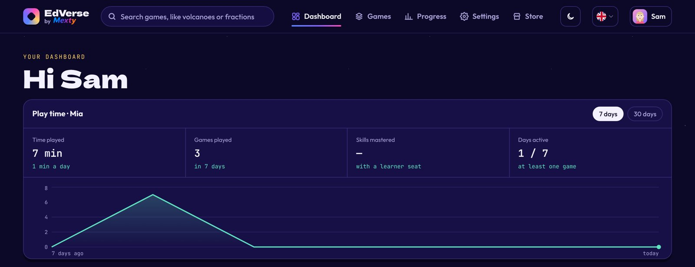<br><sub><b>แดชบอร์ดของคุณ</b> เวลาเล่น จำนวนเกมที่เล่น ทักษะที่เชี่ยวชาญ และจำนวนวันที่เข้าเล่นของผู้เรียนแต่ละคน ย้อนหลัง 7 หรือ 30 วัน</sub></td>
<td width="36%">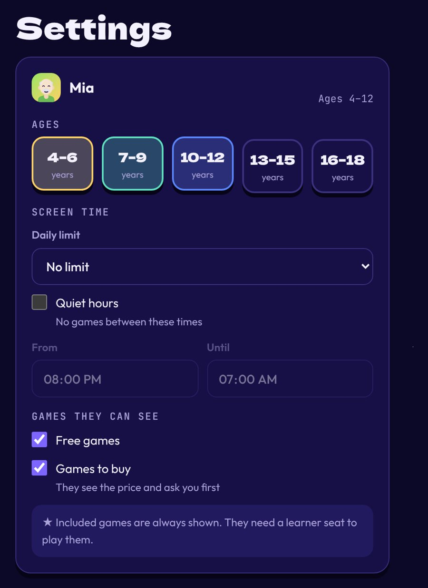<br><sub><b>การตั้งค่าของคุณ</b> ช่วงอายุ เวลาจำกัดต่อวัน ช่วงเวลางดเล่น และเกมที่เด็กมองเห็นได้ บันทึกไว้กับบัญชีของคุณและมีผลบนทุกอุปกรณ์</sub></td>
</tr>
</table>

<sub>ภาพตัวอย่างจากผู้เรียนสาธิต</sub>

**คุณเป็นผู้ควบคุมเสมอ** กำหนดเวลาเล่นต่อวันและช่วงเวลาที่งดเล่นเกมได้ โดยทั้งสองอย่างมีผลบนทุกอุปกรณ์ เด็กจะไม่เห็นหน้าจอชำระเงินเลย: เด็กเห็นแค่ราคาแล้วมาขอคุณก่อน ผู้ช่วย AI มองไม่เห็นโปรไฟล์หรือความคืบหน้าของเด็ก

**ขอรายงานจาก AI ของคุณ** "เดือนนี้มีอาได้เรียนรู้อะไรบ้าง แล้วเราควรฝึกอะไรกันต่อ" ด้วย [`track-kid-progress`](skills/track-kid-progress/SKILL.md) AI ของคุณจะอ่านรายงานการเรียนรู้ของเด็กที่มีที่นั่งผู้เรียน แล้วสรุปเป็นภาษาที่เข้าใจง่าย พร้อมแนะนำหนึ่งเกมให้ลองเล่นต่อ จะรับทุกสัปดาห์หรือทุกเดือนก็ได้ตามต้องการ

**และเมื่อปัญหาอยู่ที่การบ้าน:** ส่งใบงานให้ AI ของคุณ แล้วรับเกมที่ลูกเล่นได้คืนนี้เลย ด้วย [`homework-to-game`](skills/homework-to-game/SKILL.md)

## สำหรับครีเอเตอร์: สร้าง วางขาย รับฟัง สร้างรายได้

คนคนเดียวกับแพ็กเกจ AI หนึ่งแพ็กเกจก็เดินครบทั้งวงจรได้ การสร้างนั้นฟรี: เครื่องมือ MCP ไม่ใช้เครดิต MEXTY เลย

1. **สร้าง** เกมจากบทเรียนที่คุณรู้ดี ([`homework-to-game`](skills/homework-to-game/SKILL.md))
2. **ผ่านการรีวิว** ตามข้อกำหนดเกม EdVerse ทั้ง 11 ข้อ ([`edverse-game-qa`](skills/edverse-game-qa/SKILL.md))
3. **วางขาย** บนสโตร์: ฟรี ราคาคงที่ จ่ายตามที่พอใจ หรือ ★ Included สำหรับครอบครัวและโรงเรียนที่มีที่นั่งผู้เรียน ([`edverse-publish-and-earn`](skills/edverse-publish-and-earn/SKILL.md))
4. **รับฟัง**: ผู้เล่นส่งไอเดียเข้ามาที่กล่องข้อเสนอแนะของเกม ไอเดียที่คุณรับไว้จะกลายเป็นโรดแมปสาธารณะของเกม
5. **รวมกลุ่ม**: โพสต์เกมบน Mextribe และเพิ่มแพ็กเกจแบบเสียเงินเมื่อผู้ติดตามอยากได้มากกว่านี้ ([`mextribe-community`](skills/mextribe-community/SKILL.md))
6. **โชว์ผลงาน**: Reel, Story และโพสต์แบบเลื่อนหลายภาพ ทุกครั้งที่ปล่อยของใหม่ ([`instagram-showcase`](skills/instagram-showcase/SKILL.md))

คุณได้รับ 80% ของยอดขายเกมแต่ละครั้งหลังหักค่าธรรมเนียมบัตร และ 80% ของค่าสมาชิก Mextribe หลังหักค่าธรรมเนียมบัตร

### เอดิเตอร์ของ EdVerse

ทุกเกมเปิดในเอดิเตอร์ 3D แบบสดบนเบราว์เซอร์ คุณ ผู้ร่วมงาน และผู้ช่วย AI ของคุณสร้างในโลกเดียวกันได้พร้อมกัน: บอกสิ่งที่ต้องการแล้วดูมันปรากฏขึ้น หรือจะขยับสิ่งต่าง ๆ เองก็ได้ แถบด้านบนใช้สลับระหว่างโหมดดู เล่น และแก้ไข ดูตัวอย่างบนมือถือ แท็บเล็ต และเดสก์ท็อป เปิดประวัติ และเรียกผู้ช่วย

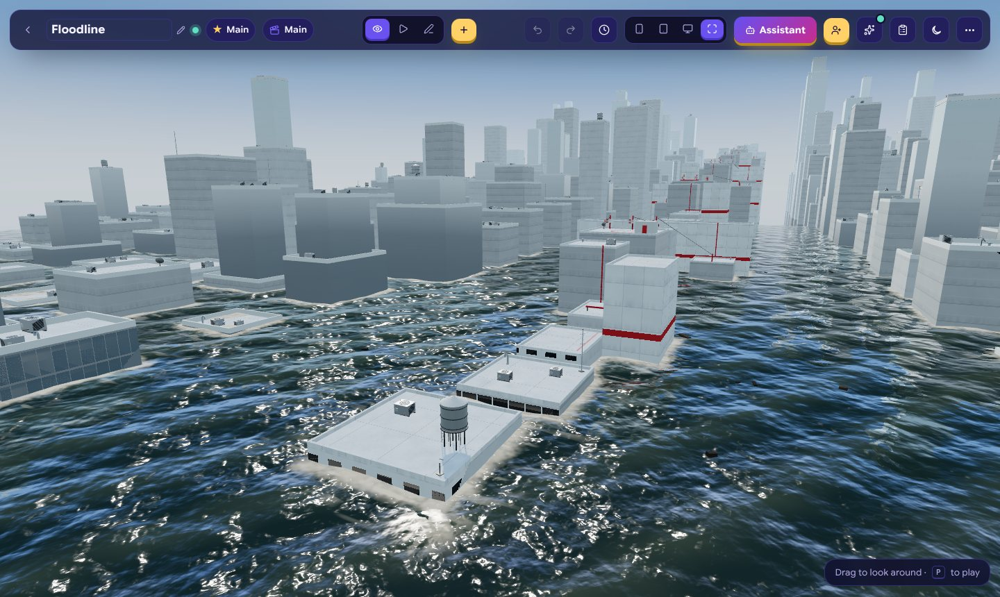

<sub><b>Floodline</b> เกมปาร์กัวร์มุมมองบุคคลที่หนึ่งบนหลังคาของเมืองที่น้ำกำลังท่วม ฟังก์ชันเชิงเส้นและอัตราการเปลี่ยนแปลงจะบอกว่าคุณเหลือเวลาอีกเท่าไร คณิตศาสตร์ อายุ 13–15 ปี</sub>

<table>
<tr>
<td width="50%">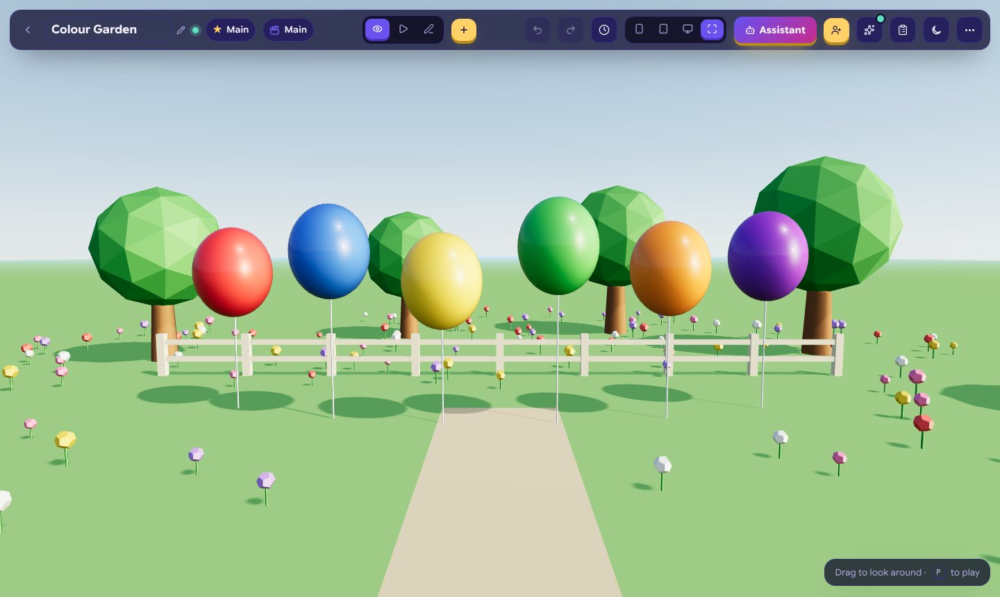<br><sub><b>Colour Garden</b> ฟังชื่อสี แล้วแตะลูกโป่งให้ถูกลูก หกสี พูดเป็นภาษาอังกฤษ ฝรั่งเศส และไทย</sub></td>
<td width="50%">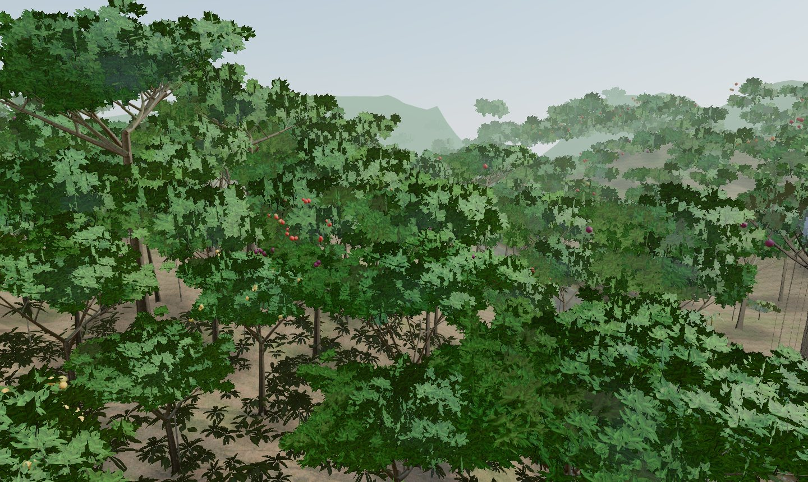<br><sub><b>Canopy</b> ป่าฝนแบบโอเพนเวิลด์: คุณเล่นเป็นนกที่หาอาหารให้ลูก แล้วเล่นเป็นลูกนกที่เติบโตขึ้นในขณะที่ผืนป่าหดเล็กลง</sub></td>
</tr>
</table>

<sub>เกมที่กำลังพัฒนา แสดงในเอดิเตอร์</sub>

## Mextribe: เรียนรู้จากครีเอเตอร์ สอนชุมชนของคุณเอง

Mextribe คือด้านโซเชียลของระบบนิเวศนี้ ครีเอเตอร์โพสต์สิ่งที่ตัวเองสร้าง: คอร์ส เส้นทางการเรียนรู้ กิจกรรมแบบอินเทอร์แอกทีฟ วิดีโอ และเกม EdVerse ผู้เรียนติดตามได้ฟรีและสมัครสมาชิกเพื่อเข้าถึงส่วนที่เหลือ การใช้งานนั้นฟรี ทั้งสำหรับครีเอเตอร์และผู้เรียน

<a href="https://future.mexty.ai/mextribe/explore">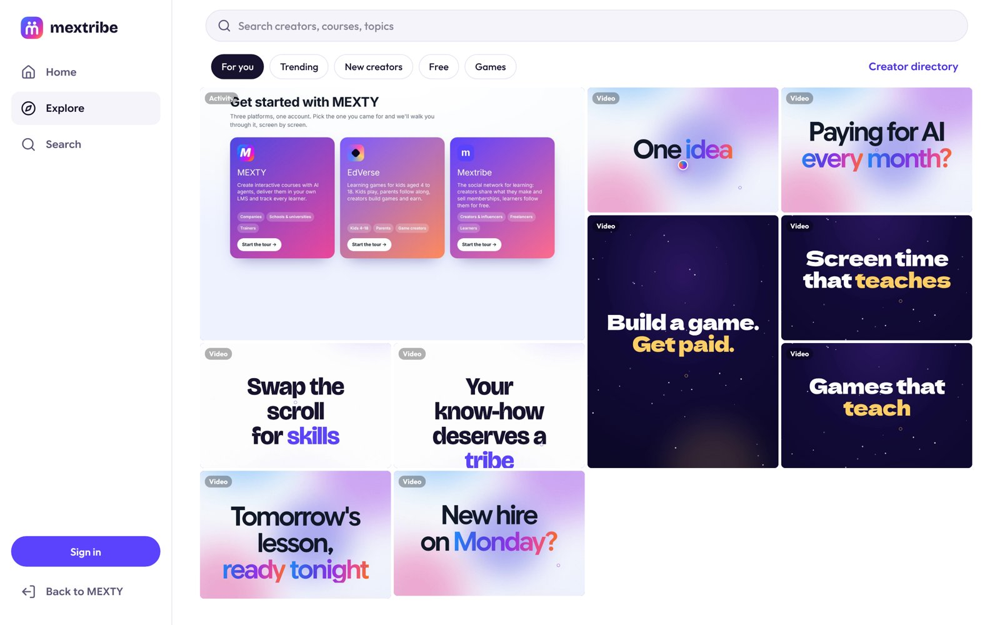</a>

<sub><b>สำรวจ</b> สำหรับคุณ มาแรง ครีเอเตอร์หน้าใหม่ ฟรี และเกม ใครก็เข้ามาดูได้โดยไม่ต้องมีบัญชี</sub>

<table>
<tr>
<td width="50%"><a href="https://future.mexty.ai/mextribe/@fabien.sabati">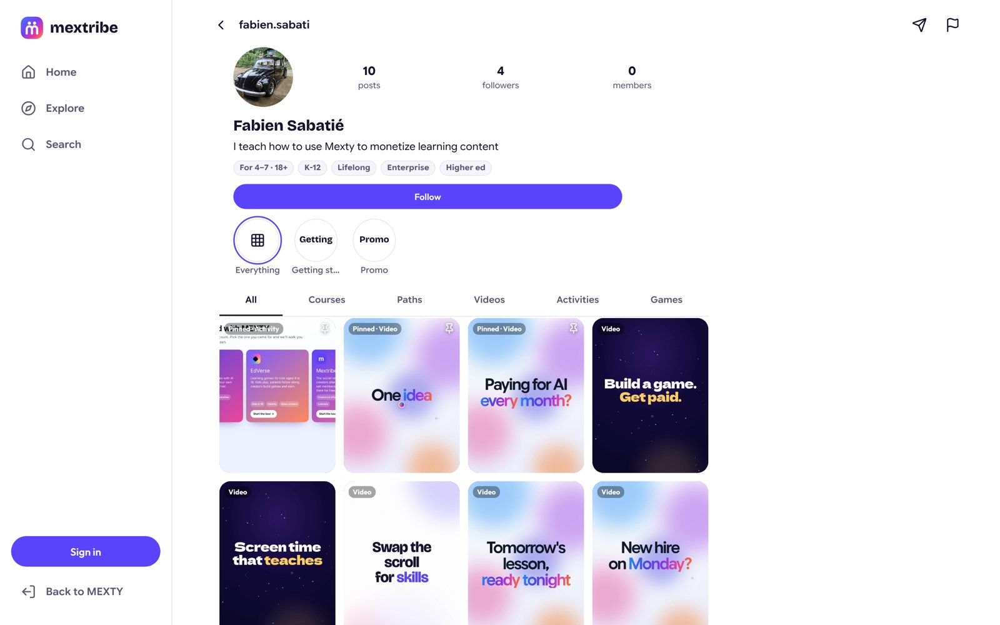</a><br><sub><b>หน้าของครีเอเตอร์</b> โพสต์ ผู้ติดตามและสมาชิก ซีรีส์ ตารางผลงานที่ครีเอเตอร์จัดลำดับและปักหมุดเอง แท็บสำหรับคอร์ส เส้นทางการเรียนรู้ วิดีโอ กิจกรรม และเกม</sub></td>
<td width="50%">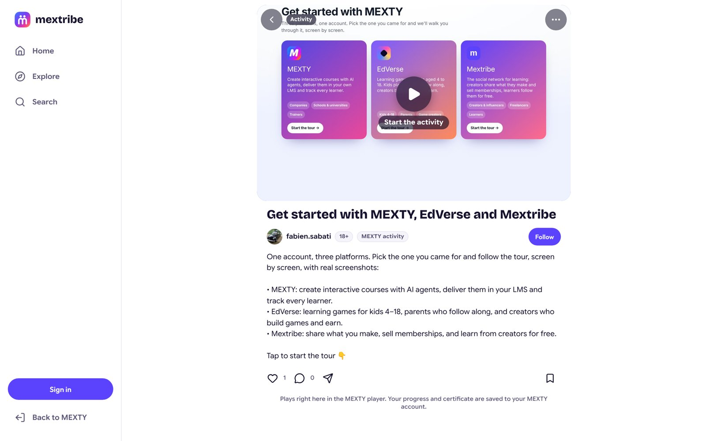<br><sub><b>โพสต์</b> กิจกรรมเล่นได้ตรงนั้นเลย ถูกใจ แสดงความคิดเห็น แชร์ และบันทึกได้ ความคืบหน้าและใบรับรองจะเข้าไปอยู่ในบัญชี MEXTY ของผู้เรียน</sub></td>
</tr>
</table>

| สำหรับผู้เรียน | สำหรับครีเอเตอร์ |
|---|---|
| ติดตามครีเอเตอร์ได้ฟรี | โพสต์ทุกอย่างที่คุณสร้างบน MEXTY หรือ EdVerse รวมถึงวิดีโอและรูปภาพ |
| เล่นคอร์ส กิจกรรม และเกมได้ในโพสต์เลย | โพสต์ฟรี โพสต์เฉพาะสมาชิก หรือตั้งราคาเดี่ยวให้โพสต์ใดโพสต์หนึ่ง |
| สมัครแพ็กเกจของครีเอเตอร์เพื่อเข้าถึงคลังทั้งหมด | แพ็กเกจแบบเสียเงินสไตล์ Patreon: คุณได้รับ 80% หลังหักค่าธรรมเนียมบัตร จ่ายออกทุกเดือน |
| แสดงความคิดเห็นและถามคำถาม | ตอบความคิดเห็น ปักหมุดความคิดเห็นดี ๆ ส่วนที่เหลือพักไว้หรือซ่อนได้ |
| ทุกโพสต์ระบุช่วงอายุที่เหมาะสม | ส่งข่าวสารหรือโพลถึงผู้ติดตามหรือสมาชิก |
| | ข้อมูลเชิงลึก: ผู้ติดตาม สมาชิก รายได้ และจุดที่ผู้เรียนเลิกเรียนกลางคัน |

**ปลอดภัยตั้งแต่การออกแบบ** ไม่มีข้อความส่วนตัว ทุกโพสต์ระบุกลุ่มผู้ชมตามอายุ โพสต์แรกของครีเอเตอร์ที่มุ่งไปยังผู้ชมอายุต่ำกว่า 18 ปีจะถูกตรวจโดย MEXTY ก่อนเผยแพร่ ความคิดเห็นที่ชวนไปคุยที่อื่นหรือขอข้อมูลส่วนตัวจะถูกพักไว้ ส่วนผู้เรียนอายุต่ำกว่า 18 ปีจะปรากฏต่อครีเอเตอร์เป็นชื่อต้นและอักษรย่อเท่านั้น

**สั่งงานผ่าน AI ของคุณ** "โพสต์คอร์สเคมีของฉันสำหรับวัย 13 ถึง 17 ปี บทที่ 1 ฟรี ที่เหลือสำหรับสมาชิก" "ขอดูความคิดเห็นที่รอคำตอบอยู่ แล้วร่างคำตอบแบบใจดีให้หน่อย" "เดือนนี้โพสต์ไหนพาสมาชิกเข้ามามากที่สุด" ทุกโพสต์เริ่มต้นเป็นฉบับร่าง และจะไม่มีอะไรถูกเผยแพร่ ตั้งราคา หรือส่งออกไปหากคุณยังไม่ตอบตกลง ดู [`mextribe-community`](skills/mextribe-community/SKILL.md) และ [`instagram-showcase`](skills/instagram-showcase/SKILL.md) สำหรับชุดแชร์: ลิงก์ คิวอาร์โค้ด การ์ด Story และแคปชัน

## สำหรับองค์กร: สร้าง มอบหมาย ติดตาม

MEXTY เป็นทั้งเครื่องมือสร้างเนื้อหาและ LMS จะซื้อแยกหรือซื้อคู่กันก็ได้ ด้วย MEXTY MCP ผู้ช่วย AI ของคุณเองจะสร้างงานในเวิร์กสเปซของคุณ: คอร์ส กิจกรรมแบบอินเทอร์แอกทีฟ แบบประเมิน และเส้นทางการเรียนรู้ทั้งเส้น จากเอกสารและนโยบายของคุณ

<table>
<tr>
<td width="50%">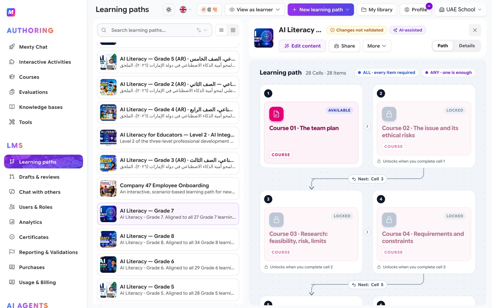<br><sub><b>สร้าง</b> เส้นทางการเรียนรู้คือตารางของช่องที่มีหมายเลขและปลดล็อกตามลำดับ หนึ่งช่องใส่ได้หลายรายการ โดยกำหนดให้ต้องทำครบทุกรายการหรือรายการใดรายการหนึ่งก็ได้ จะแก้ไขเองหรือให้ AI สร้างโครงสร้างทั้งหมดก็ได้</sub></td>
<td width="50%">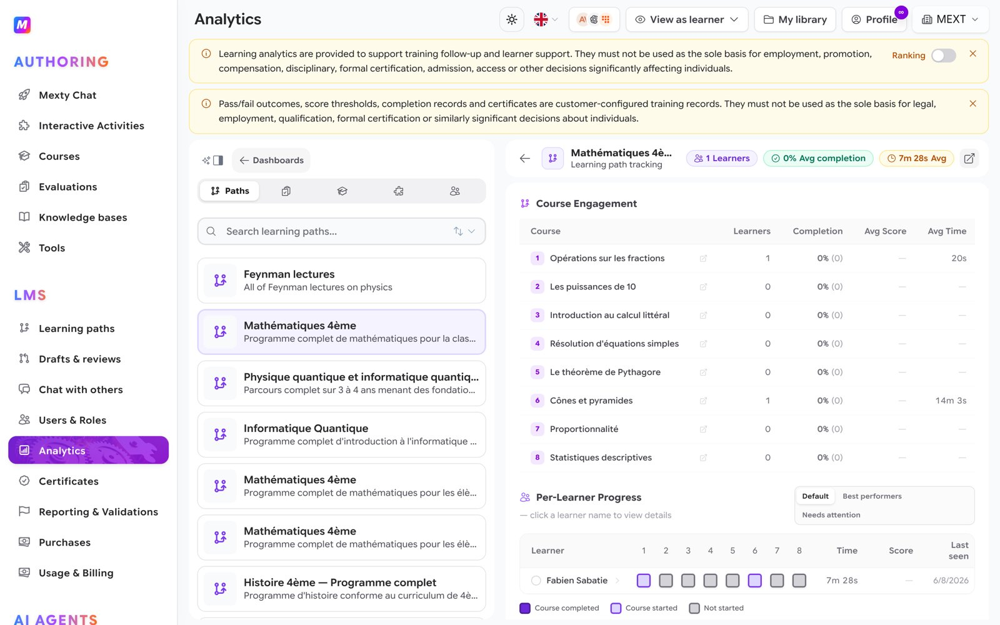<br><sub><b>ติดตาม</b> ผู้เรียน อัตราการเรียนจบ คะแนน และเวลาของแต่ละคอร์ส พร้อมเส้นความคืบหน้าของผู้เรียนแต่ละคน</sub></td>
</tr>
</table>

| คุณคือ | คุณจะได้ |
|---|---|
| **โรงเรียนหรือมหาวิทยาลัย** | หลักสูตรในรูปแบบเส้นทางการเรียนรู้ แบบประเมินพร้อมใบรับรอง บทบาทผู้เรียน และความคืบหน้ารายบุคคล |
| **ผู้ให้บริการฝึกอบรม** | คอร์สที่ส่งออกเป็น HTML และ SCORM สำหรับ LMS ที่ลูกค้าของคุณมีอยู่แล้ว |
| **บริษัท** | การปฐมนิเทศ การอบรมด้านกฎระเบียบ และการอบรมผลิตภัณฑ์ ที่สร้างจากเอกสารของคุณเอง ที่นั่งและบทบาทสำหรับทีม และข้อมูลว่าใครเรียนอะไรจบแล้ว |

- **บทบาทและที่นั่ง**: เชิญครีเอเตอร์และผู้เรียนเข้ามา โดยบทบาทจะกำหนดว่าแต่ละคนทำอะไรได้บ้าง
- **แดชบอร์ดของคุณเอง**: นอกเหนือจากสถิติวิเคราะห์มาตรฐาน คุณสร้างแดชบอร์ดที่ตอบคำถามของคุณด้วยข้อมูลสดได้ เช่น จำนวนคนที่ผ่านการปฐมนิเทศต่อสัปดาห์ ใบรับรองที่ใกล้หมดอายุ หรือคำถามที่ทั้งห้องตอบผิด แล้วแชร์ให้บทบาทหนึ่ง ทีมหนึ่ง หรือคนคนเดียวก็ได้ ([`analytics-dashboards`](skills/analytics-dashboards/SKILL.md))
- **ไปได้ไกลกว่าในองค์กร**: โพสต์คอร์สบน Mextribe หรือนำกิจกรรมที่เล่นเป็นเกมได้ไปวางบน EdVerse

MEXTY MCP มาพร้อมกับแพ็กเกจ **Authoring**, **Authoring + LMS** และ **Enterprise** การมอบหมายเนื้อหาให้ผู้เรียนและการติดตามผลต้องใช้ LMS เริ่มต้นได้ที่ [`mexty-courses-for-teams`](skills/mexty-courses-for-teams/SKILL.md) ส่วนราคาดูได้ที่[หน้าราคา](https://mexty.ai/pricing)

## การปฏิบัติตามกฎระเบียบ และการอบรมที่อัปเดตตัวเองอยู่เสมอ

การอบรมด้านกฎระเบียบมักล้มเหลวแบบเงียบ ๆ: นโยบายเปลี่ยน แต่คอร์สไม่เปลี่ยนตาม ที่นี่ทุกคอร์สมีแหล่งที่มา เวอร์ชัน และผู้รับผิดชอบ และเอเจนต์ AI ก็คอยเฝ้าดูแหล่งที่มาแทนคุณได้

| เมื่อไร | เกิดอะไรขึ้น |
|---|---|
| นโยบาย กฎหมาย หรือเอกสารข้อมูลผลิตภัณฑ์เปลี่ยนแปลง | เอเจนต์อ่านเวอร์ชันใหม่ หาคอร์สที่อ้างอิงถึง แล้วร่างการแก้ไข เพียงเท่านั้น |
| ก่อนที่ผู้เรียนจะเห็นอะไร | ผู้รับผิดชอบคอร์สตรวจฉบับร่าง ดูว่าใครลงทะเบียนและได้รับการรับรองแล้ว จากนั้นเผยแพร่หรือตั้งเวลาให้ตรงกับวันที่นโยบายมีผล |
| หลังการเปลี่ยนแปลงที่มีนัยสำคัญ | คุณเห็นว่าใครถือใบรับรองของเวอร์ชันเก่า และมอบหมายใหม่เฉพาะส่วนที่เปลี่ยน |
| ทุกสัปดาห์ ตามกำหนดเวลา | รายงาน: อะไรเปลี่ยนไป ฉบับร่างไหนรออยู่ และใบรับรองของใครใกล้หมดอายุ |
| มีการเผยแพร่คอร์สใหม่ | เอเจนต์ร่างแลนดิงเพจและข้อเสนอเพื่อขายคอร์สนั้นนอกองค์กรได้ |

ใช้ได้กับการคุ้มครองข้อมูล ความปลอดภัยสารสนเทศ อาชีวอนามัยและความปลอดภัย จรรยาบรรณ ความรู้เท่าทัน AI และการอบรมผลิตภัณฑ์ จะไม่มีอะไรถูกเผยแพร่ รับรอง หรือวางขายหากไม่มีคนตอบตกลง ดู [`keep-training-current`](skills/keep-training-current/SKILL.md)

## สร้างไปด้วยกัน

ไม่ว่าคอร์สหรือเกมก็ไม่ใช่งานของคนคนเดียว ทั้งสองผลิตภัณฑ์จึงออกแบบมาเพื่อการทำงานร่วมกัน ผู้เรียนและผู้เล่นจะเห็นเฉพาะสิ่งที่เผยแพร่หรือรวมงานแล้วเท่านั้น

| | ในเวิร์กสเปซของ MEXTY | ใน EdVerse |
|---|---|---|
| **ทำงานเคียงข้างกัน** | ผู้เขียนร่วมในคอร์ส กิจกรรม แบบประเมิน หรือเส้นทางการเรียนรู้ | หลายคนพร้อมผู้ช่วย AI ของแต่ละคน ในเอดิเตอร์ 3D สดตัวเดียวกันและโค้ดชุดเดียวกัน การแก้ไขจะถูกรวมเข้าด้วยกัน ไม่มีอะไรถูกล็อก |
| **ลองได้อย่างปลอดภัย** | ฉบับร่าง: การเปลี่ยนแปลงที่ทีมกำลังทดลอง อยู่คู่กับเวอร์ชันที่ใช้งานจริง | ฉบับร่างของโลกและโค้ดของเกม ทุกคนที่เข้าร่วมผ่านลิงก์แชร์จะทำงานในฉบับร่างของตัวเอง |
| **รีวิว** | ระบุผู้รีวิว แสดงความคิดเห็นบนเนื้อหา ดูการเปลี่ยนแปลงและผู้ที่ได้รับผลกระทบ แล้วอนุมัติหรือส่งกลับ | ดูสิ่งที่เปลี่ยนทีละออบเจกต์และทีละไฟล์ โดยเจ้าของหรือผู้ดูแลเป็นผู้รวมงาน |
| **ปล่อยงาน** | เผยแพร่ทันทีหรือตั้งเวลาไว้ | รวมเข้ากับเกม แล้วสโตร์จะเปิดเวอร์ชันใหม่ให้เล่นหลังผ่านการรีวิว |
| **ย้อนกลับ** | ประวัติเวอร์ชัน: เปรียบเทียบ และกู้คืนเวอร์ชันใดก็ได้เป็นฉบับร่าง | ปิดฉบับร่างได้ ส่วนจุดที่ขัดแย้งกันให้เลือกโดยเทียบกันแบบเคียงข้าง |
| **เครดิต** | ผู้เขียนร่วมได้รับการระบุชื่อ | ผู้สร้างงานที่ถูกรวมแล้วได้รับเครดิต และได้ส่วนแบ่งจากรายได้ที่เกมได้รับจากกองทุนผู้เรียน |

ทั้งห้องเรียนสร้างเกมเกมเดียวด้วยวิธีนี้ได้: ครูเป็นเจ้าของเกม แต่ละกลุ่มทำงานในฉบับร่างของตัวเอง แล้วทั้งห้องช่วยกันรีวิวแต่ละฉบับก่อนรวมงาน ดู [`build-together`](skills/build-together/SKILL.md)

## อะไรฟรี และอะไรต้องใช้แพ็กเกจ

| | EdVerse | Mextribe | MEXTY |
|---|---|---|---|
| **คืออะไร** | สโตร์และสตูดิโอสำหรับเกมการเรียนรู้ วัย 4–18 ปี | โซเชียลเน็ตเวิร์กเพื่อการเรียนรู้ พร้อมแพ็กเกจแบบเสียเงินของครีเอเตอร์ | เครื่องมือสร้างเนื้อหาด้วย AI และ LMS สำหรับองค์กร |
| **การใช้งานกับ AI ของคุณ** | **ฟรี** | **ฟรี** | แพ็กเกจ **Authoring**, **Authoring + LMS** หรือ **Enterprise** |
| **สร้างรายได้อย่างไร** | ขายเกมในราคาคงที่หรือแบบจ่ายตามที่พอใจ รับเงินจากกองทุนผู้เรียนตามจำนวนนาทีที่เล่น (★ Included) หรือช่วยพัฒนาเกมที่เปิดให้ร่วมสร้าง แล้วรับส่วนแบ่งรายได้จากกองทุนเมื่อฉบับร่างของคุณถูกรวมแล้ว | แพ็กเกจสมาชิกแบบเสียเงินและการขายแบบรายชิ้น | — |
| **ส่วนที่คุณได้รับ** | 80% ของยอดขายแต่ละครั้งหลังหักค่าธรรมเนียมบัตร | 80% หลังหักค่าธรรมเนียมบัตร | — |

เครื่องมือ MCP ไม่ใช้เครดิต MEXTY: แพ็กเกจ AI ของคุณเองเป็นฝ่ายคิดให้ มีเพียงการสร้างสื่อ (รูปภาพ เสียงพูด โมเดล 3D การถอดเสียง) เท่านั้นที่ใช้เครดิต และ [`free-creative-toolkit`](skills/free-creative-toolkit/SKILL.md) ก็มีวิธีทำแต่ละอย่างแบบฟรีให้ดู

## สกิลจากผู้เขียนรายอื่นที่รวมมาให้

การสร้างเกมเป็นงานฝีมือเฉพาะทาง รีโพซิทอรีนี้จึงรวมสกิลที่ผู้อื่นเขียนไว้ด้วย โดยไม่แก้ไขและอยู่ภายใต้สัญญาอนุญาตของแต่ละราย แหล่งที่มาและสัญญาอนุญาตอยู่ใน [`THIRD_PARTY.md`](THIRD_PARTY.md)

| โฟลเดอร์ | มีอะไรอยู่ข้างใน | โดย |
|---|---|---|
| [`third-party/gamedev`](third-party/gamedev) | 18 สกิล: เกมฟีล การออกแบบด่าน UI ของเกม เสียง กล้อง อินพุต การบันทึก ประสิทธิภาพ ไปป์ไลน์แอสเซต การทำต้นแบบอย่างรวดเร็ว การตั้งค่า three.js, glTF และการจัดแสง รวมถึงคู่มือสำหรับเกมแนวพัซเซิล แพลตฟอร์มเมอร์ ชูตเตอร์ การ์ด และเกมสวมบทบาท | [awesome-gamedev-agent-skills](https://github.com/gamedev-skills/awesome-gamedev-agent-skills), Apache 2.0 |
| [`third-party/webgpu-threejs-tsl`](third-party/webgpu-threejs-tsl) | เรนเดอเรอร์ WebGPU ของ three.js และ TSL: โหนดแมททีเรียล คอมพิวต์เชเดอร์ โพสต์โปรเซสซิง และการสูญเสียดีไวซ์ | [webgpu-claude-skill](https://github.com/dgreenheck/webgpu-claude-skill), MIT |

แนะนำให้ใช้ควบคู่กัน โดยติดตั้งจากแหล่งของแต่ละตัวเอง: [bang-motion](https://github.com/bangtutorial/bang-motion) สำหรับโมชันกราฟิก, [canvas-design](https://github.com/anthropics/skills/tree/main/skills/canvas-design) สำหรับโปสเตอร์และโพสต์แบบเลื่อนหลายภาพ และสไตล์ภาพยนตร์ของ [Lemo-Opuscar](https://github.com/lemomo-ai/lemo-opuscar)

## จากการบ้านสู่เกมบนสโตร์

```
 การบ้าน ──► homework-to-game ──► edverse-game-qa ──► edverse-publish-and-earn ──► instagram-showcase
 (ใบงาน        เลือกกลไกเกม          ข้อกำหนดสโตร์         ตั้งราคา ส่งรีวิว               Reel, Story,
  บทเรียน)     สร้างจากเทมเพลต       11 ข้อ                กล่องข้อเสนอแนะ                โพสต์หลายภาพ
                                    คุณเล่นทดสอบเอง       วงจรรายสัปดาห์
```

ทุกเกมถูกทดสอบสองครั้งตามข้อกำหนดชุดเดียวกัน: โดยคุณเองที่ลองเล่นใน Studio และโดยผู้ตรวจของ MEXTY AI ทำการทดสอบนั้นแทนคุณไม่ได้ แต่ช่วยให้คุณมั่นใจได้ว่าจะผ่าน

## การติดตั้ง

**1. เชื่อมต่อเซิร์ฟเวอร์ MCP** ที่ [mexty.ai/connect](https://mexty.ai/connect) (Claude, ChatGPT, Cursor, VS Code, Gemini CLI, Codex และอื่น ๆ) ใน Claude Code:

```bash
claude mcp add --transport http edverse  https://mcp.mexty.ai/mcp/edverse
claude mcp add --transport http mextribe https://mcp.mexty.ai/mcp/mextribe
claude mcp add --transport http mexty    https://mcp.mexty.ai/mcp/mexty
```

**2. เพิ่มสกิล**

Claude Code ในรูปแบบปลั๊กอิน:

```
/plugin marketplace add mext-ai/elearning-agent-skills
/plugin install elearning-agent-skills@mexty
```

หรือคัดลอกเฉพาะโฟลเดอร์ที่ต้องการ:

```bash
git clone https://github.com/mext-ai/elearning-agent-skills
cp -r elearning-agent-skills/skills/* ~/.claude/skills/
cp -r elearning-agent-skills/third-party/gamedev/* ~/.claude/skills/          # optional
cp -r elearning-agent-skills/third-party/webgpu-threejs-tsl ~/.claude/skills/ # optional
```

Claude.ai: บีบอัดโฟลเดอร์ของสกิลเป็นไฟล์ zip แล้วอัปโหลดที่ Settings → Capabilities → Skills ส่วนเอเจนต์อื่น ๆ: แต่ละสกิลคือไฟล์ Markdown ไฟล์เดียว เพียงชี้เอเจนต์ของคุณไปที่ `SKILL.md` ที่ต้องการ

**3. บอกสิ่งที่คุณต้องการ**

> นี่คือใบงานเรื่องเศษส่วนของลูกสาว ช่วยเปลี่ยนเป็นเกมที่ลูกเล่นบนแท็บเล็ตได้หน่อย

> เดือนนี้ลูกชายได้เรียนรู้อะไรบน EdVerse บ้าง แล้วเราควรฝึกอะไรกันต่อ

> เกมของฉันพร้อมสำหรับการรีวิวของ EdVerse หรือยัง

> ช่วยอ่านข้อเสนอแนะของเกมที่เปิดให้เล่นอยู่ แล้วบอกหน่อยว่าสัปดาห์นี้ควรสร้างอะไร

> ทุกวันจันทร์ ช่วยหาเกมแบบร่วมสร้างที่ยังขาดด่านเรื่องเศษส่วน สร้างด่านนั้นในฉบับร่าง แล้วขอให้เจ้าของเกมรีวิว

> ช่วยเปลี่ยนนโยบายความเป็นส่วนตัวของข้อมูลของเราเป็นคอร์สปฐมนิเทศ 10 นาทีพร้อมควิซ แล้วมอบหมายให้พนักงานใหม่

---

<div align="center">
<sub>โดย <a href="https://mexty.ai">MEXTY</a> งานศิลป์ของเกมเป็นของครีเอเตอร์ของแต่ละเกม สกิลจากบุคคลที่สามเป็นของผู้เขียนแต่ละราย ดู <a href="THIRD_PARTY.md">THIRD_PARTY.md</a></sub>
</div>
